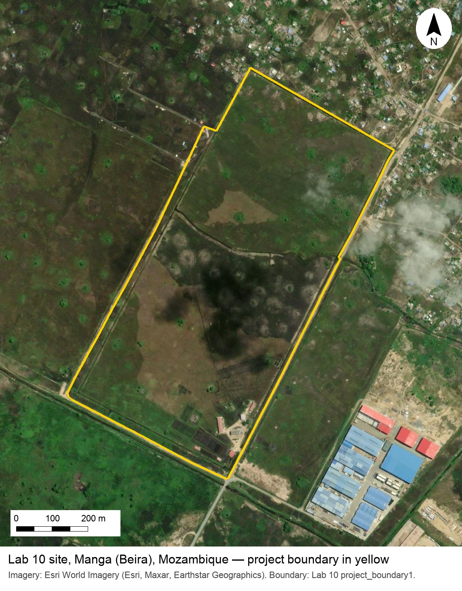

# Week 11 Activity — Paper Site Plan

**Lecture**{ .badge .badge-lecture } · *Day 20 · Tuesday of [Week 11 — Geoplanning and Georeferencing](../weeks/week-11.md)*

**Graded in-class activity.** Paper Site Plan: in groups, mark the constraints on a printed aerial of the Lab 10 site, fit a small program around them, and name the GIS operation behind every mark. Record your completion on Learning Suite.

<!-- notes -->
*New in Fall 2026, replacing a georeferencing sketch activity that belonged to CE 414. It sits two-thirds of the way through the [Geoplanning deck](https://byu-hydroinformatics.github.io/cce114-geomatics/slides/day-20/geoplanning.html), right after the slide that turns each planning idea into a GIS operation, and it previews Lab 10 without doing it for them.*

**Setup.** One printed handout per group of three: the Lab 10 site on recent imagery, with the project boundary, a scale bar, and a north arrow ([download the handout](images/week-11-site-handout.jpg); print it on letter paper, fit to page). A sheet of tracing paper on top of each, taped at the corners, and two colored pencils (red and blue) per group. No laptops.

**Run.**

1. **Constraints first, in red** (5 minutes). Trace the canals along the edges and the one across the middle, and shade a band along each one as a flood setback. Circle any stand of trees worth keeping. Mark where a road could come in from outside the site. Nothing goes in the shaded areas.
2. **Then the program, in blue** (5 minutes). Fit a cut-down version of the Lab 10 program into what is left: **20 homes**, **one school**, **one market**, and a **road** that reaches all of them from the entry point. Use the scale bar: at this print size a home 8 meters across is barely a dot, and that surprise is part of the point.
3. **Name the operation** (5 minutes, report out). Each group holds up its plan and names the GIS operation behind three of its marks: the shaded band is a **buffer**, the homes are **points buffered by half their diameter**, the road is a **centerline buffered by half its width**, the land left over is the site **minus** the constraints, and the market is a **polygon** checked with the area tool.

Fifteen minutes. Collect one plan per group, or have one person upload a phone photo of it to *In Class Activity: Paper Site Plan* on Learning Suite for the 5 points.

What they learn: a site plan is drawn constraints first, the program only fits what the constraints leave behind, and every pencil mark they made is a tool they will run in Lab 10.

> [!NOTE]
> Learning Suite may still list the old *Georeference Your Neighborhood Sketch* item for this day. Rename it to *Paper Site Plan* before class.
