# Lab 6: Spatial Data Web Services

**Lab**{ .badge .badge-lab } · Due Saturday of Week 7, 11:59 pm · Prepared for by the [Week 7 lectures](../../weeks/week-07.md): Tuesday on finding data, Thursday on web services

**Civil and Construction Engineering 114 — Geomatics**

Dr. Dan Ames · Brigham Young University

*Lab assignment developed by Nathan Godfrey and Dr. Ames*


## **Background**

### **Data Source Types**

We’ve used the Data Source Manager several times now in QGIS. It’s the interface that allows you to add data to your projects, and as you’ve seen on the left side of the manager window, there are many ways to do that. They all fall into 3 categories:

1. Local Files  
2. Databases  
3. Web Services

So far, we’ve used many **files** to insert data. Most of those files came from **databases** that you can link to directly by using methods like the PostgreSQL option. You can also use a **web service** that will retrieve the data for you from a database. Databases and web services look similar on our end, but think of it this way:

1. Using a local file is like eating the food in your fridge.  
2. Using a database is like getting takeout at a restaurant.  
3. Web services are like DoorDash, Uber Eats, and other delivery services.

Both **databases** and **web services** are great solutions for handling large amounts of data without using up your computer storage (fridge space). They also both allow data to be updated frequently without the need for re-downloading files with each update (fresh food, the moment it’s ready). On top of the convenience of data ready to go, **web services** offer better security and are easier on database servers (no crowded restaurant, many orders picked up by one delivery person).

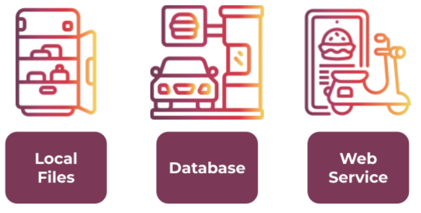

Web services also matter when the data itself won’t hold still. During wildfire season, the National Interagency Fire Center publishes live fire perimeters as a public ArcGIS feature service that refreshes as often as every five minutes, and it’s the same feed behind the fire maps you see in the news. Nobody is downloading and unzipping a shapefile while the fire is still moving (https://data-nifc.opendata.arcgis.com/).

### **Web Services in QGIS**

The Open Geospatial Consortium (OGC) has published several standards for sharing GIS data on the web. Just as a standard USB cord enables various types of connections, an OGC standard allows different map and GIS applications to connect to the same data sources. QGIS uses some of these OGC standards, and you can find them near the bottom of the list in the Data Source Manager:  


* Web Map Service (**WMS**): A web service that provides georeferenced (attached to coordinates) map *images* to the client over the internet based on a request.  
* Web Map Tile Service (**WMTS**): A fast type of WMS that provides pre-rendered *image* “tiles” to the client based on need (panning and zoom level) instead of loading a full map image.


* Web Feature Service (**WFS**): Instead of returning images, a WFS provides *vector data* (points, lines, and polygons) that your computer creates images from. To continue the food analogy, it’s like getting raw ingredients rather than a prepared meal. WFS is much slower, but more analysis can be done because you have raw data, not just an image. WFS also has a modern successor called OGC API \- Features (it started life as “WFS 3.0” before being renamed): the same idea rebuilt on plain web URLs and GeoJSON, so even your web browser can read the data directly. QGIS handles both through the same “WFS / OGC API \- Features” entry in the Data Source Manager.  
* Web Coverage Service (**WCS**): Similar to a WFS, but provides *raster data* rather than discrete geometries/features.

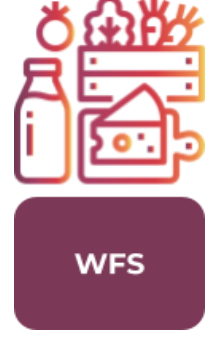

  
There are a couple of other web services in the Data Source Manager that exist outside the OGC standards:

* **XYZ**: A less standardized version of WMTS, used by Google and others.  
* **Vector Tile**: A fast type of WFS that provides vector data in tiles, similar to how WMTS is a faster WMS.  
* **ArcGIS REST Server**: Provides either vector or raster data hosted on ArcGIS servers through a web service developed by ESRI (another GIS software company).

## **Problem Statement**

In this lab, you will write your own problem statement. You’ll need to explore the data in the State of Utah GIS web portal, and **write one question** that you want to **answer using 3 datasets**. You will practice loading the data into your map via **web service** rather than downloading and unzipping it. You may choose any three different datasets (e.g., roads, county boundaries, cities) and use them to create a map layout that helps answer your question. If you want to find other online data sources for other states/countries to complete this lab, you may, but you’re on your own to find the data, and you must still meet all requirements in the rubric.

Treat this lab as a mini project. To reiterate: your final layout will consist of three mapped datasets that help you answer some kind of GIS question (ex. “Where might I find more hiking trails at lower elevations?” or “Is there a correlation between the locations of Utah’s ghost towns and water sources?”) Remember that you have learned to use symbology to create, view, and compare points, lines, or polygons. You can review raster data this way as well. You’ve calculated lengths and areas, and found elevations at specific points; you can do it again if any of those skills are relevant to your question.

Be creative, and if you want to do something ridiculous like answer the question: “Are there any public libraries near black bear habitats, so that the bears can check out a book if they get bored?” then do it well\! This lab consists mostly of things you’ve already done, so use it to be creative and consider real-world applications of your growing GIS skills.

## **Learning Objectives**

* Repeat skills from the previous labs  
* Combine experiences from previous labs  
* Learn how to use web services in QGIS  
* Identify whether a question or problem can be solved through GIS  
* Learn independent problem-solving using GIS/QGIS

## **Software and Data**

* For this lab, we will use the GIS software application, QGIS (also known as Quantum GIS). This is a free/open source GIS package that runs on Windows, Mac, and Linux. The software is pre-installed on the computers in the Clyde Building 234 computer lab. You can also download it and install it on your own computer from this website: [https://www.qgis.org/](https://www.qgis.org/). We will be using this version throughout the course: *“Long Term Version 3.44 (LTR)”*.  
* There are no custom data downloads for this lab. Follow the instructions to load data directly from the State of Utah GIS website via web services: [https://gis.utah.gov/products/sgid/](https://gis.utah.gov/products/sgid/)  
* Imagery from Google will also be used as a base layer (or a different base layer of your choice).

**REVIEW THE deliverables section at the end of the document before continuing. You should always do this before starting any of your labs. It will help you make sense of the lab and not waste time.**

## **Step by Step Instructions**

### **Step 1: Explore the UGRC Datasets**

1. Go to the UGRC site we’ve been using: [https://gis.utah.gov/products/sgid/](https://gis.utah.gov/products/sgid/)   
2. Click the "Browse Our Data" link to view available GIS data for the State of Utah.  
3. Browse the data offerings by category. You can find download links to most of the data we’ve used in other labs. Can you tell which of the web services listed above the SGID most often uses? (Hint: read the URL that opens when you click on any of their “feature service” links.)

> [!NOTE]
> At the top of the categories page, you can see that this collection of data is called the **State Geographic Information Datasource (SGID)**. The part that we can browse is the open (public) section. Most of the open data has both a **download link** and a **web service link**.

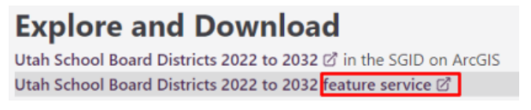

4. Now go back to the SGID homepage (linked in step 1\) and select “Search the Index”

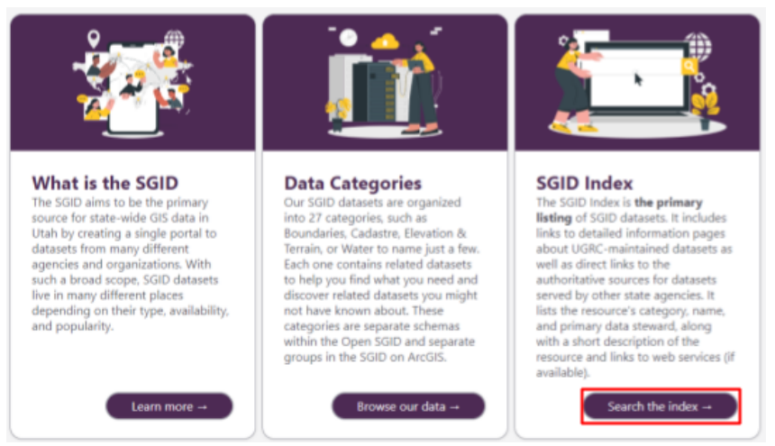

5. Type “bears” in the search bar for an example. Note how each search result includes a category, data type, source, and a “feature service” link. Most results will also have a download option on their individual pages.

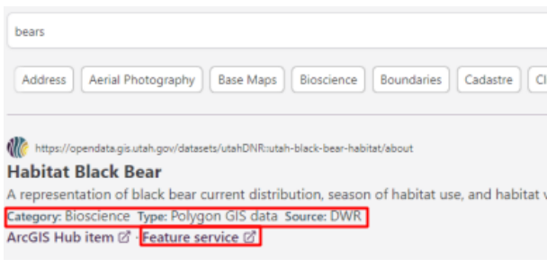

> [!NOTE]
> This index lets you search a larger collection of data that also includes items from the DWR, UDOT, and other state agencies. As long as you can still find the required information and files, feel free to use any of these datasets for this assignment.

### **Step 2: Choose Three Datasets and Write Your Question**

6. Choose your 3 datasets and a question they help answer, and create a table with them  
7. Give your table one row per dataset and these five columns:  
    1. **Dataset name**: the title shown on its SGID page or in the Index (e.g., “Utah Quaternary Faults”).  
    2. **Download size**: how large the file would be if you downloaded it instead of streaming it. Look on the dataset’s download page; you do not have to download anything to find it. Many pages don’t list a size. If yours doesn’t, write “not listed”. That is a full-credit answer.  
    3. **Geometry type**: point, line, polygon, or raster. The Index result lists a type, and once the layer is in QGIS its icon in the Layers panel shows it too.  
    4. **Source**: the organization that made the data, as listed in the Index (often a state agency such as UGS, DWR, or UDOT). This is not UGRC unless UGRC actually made the data.  
    5. **Access methods**: every way the dataset is offered, such as file download (name the formats, e.g., shapefile, file geodatabase, CSV) and feature service. Also say which method you used. For this lab it should be the web service.  

    | Dataset name | Download size | Geometry type | Source | Access methods (✓ = used) |
    | --- | --- | --- | --- | --- |
    | *your first dataset* | | | | |
    | *your second dataset* | | | | |
    | *your third dataset* | | | | |

8. Write an introductory paragraph explaining your question and chosen datasets. What is the question you are trying to answer? How will you use each dataset in answering your question?

> [!TIP]
> **Write a question your map can actually answer.** A good Lab 6 question asks *where* something is, *how close* two things are, or *whether* two patterns line up, because a map can show all of those. Questions that start with “why” usually need data a map doesn’t carry.
>
> - Answerable: “Are Utah’s state parks within 10 kilometers of a lake or reservoir?”
> - Answerable: “Which Utah cities sit within a few kilometers of a Quaternary fault?”
> - Too vague: “What is interesting about Utah’s rivers?” (no comparison, so nothing to conclude)
> - Not mappable: “Why do people like hiking in Utah?”
>
> Pick the question first and the datasets second. If you start from three datasets that look interesting, it is hard to write a conclusion, and the introduction and conclusion are worth 14 of the 30 points.

### **Step 3: Connect to the Web Service and Add the Data**

> [!TIP]
> In the following steps, I’m going to make a map that answers the question “Is there a correlation between Utah’s oil/gas field locations and recent geologic activity?” **In your project, find and use different data to answer your own question.**

9. Open QGIS and start a **new project**  
10. Open the Data Source Manager  
11. Select “ArcGIS REST Server” and click New  
12. Name the connection “Utah SGID.”  
13. Paste this UGRC services link into the URL field (this is the web service that hosts the SGID data you browsed in the index): [https://services1.arcgis.com/99lidPhWCzftIe9K/ArcGIS/rest/services](https://services1.arcgis.com/99lidPhWCzftIe9K/ArcGIS/rest/services)  
14. Leave “Authentication” set to “No Authentication”. These services are public and need no sign-in. (Older versions of this lab had you enter “ugrc” as the username and password on the “Basic” tab. Try that only if the connection fails without it.)  
15. Click “OK” and then “Connect” (remember that sometimes the Data Source Manager can drop behind the main QGIS window, check there if it disappears)  
16. You should now have a new item under ArcGIS Rest Servers in the Data Source Manager. Expand the dropdown to see the full list of datasets that you’ve connected to — more than 900 of them when this was last checked, all served live from UGRC’s servers.

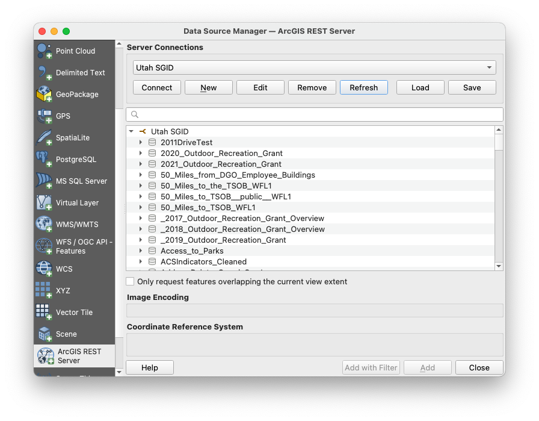

> [!WARNING]
> **If the connection fails, or a layer refuses to add, it is probably not your mistake.** QGIS 3.44 cannot add a UGRC layer whose published definition has no extent, and it reports this as *Could not retrieve layer extent*. When we checked in October 2026, about a third of the layers on this server had that problem (including the Quaternary Volcanic Vents used in the example below), and the server itself is sometimes slow to answer. If Connect spins, or a layer you need will not add, skip to the **[backup method](#backup-method-connect-to-the-open-sgid-database-instead)** at the end of this step. It reaches the same UGRC data through a different door and counts for full credit.


> [!TIP]
> **If “Connect” fails,** check the URL first. A space before or after it, or a missing `/rest/services` at the end, are the usual culprits. Paste it again straight from this page.
>
> **Don’t scroll through 900 names.** Type part of the name in the Data Source Manager’s search box, as in the figure under step 18. The list shows each dataset’s *service name*, which is written without spaces and rarely matches the friendly title in the Index exactly. Search for a short word like `fault`, `park`, or `river` rather than the full title.

17. Find three useful datasets and add them to your map by using the “Add” button. I added data on oil/gas fields in Utah, quaternary faults, and quaternary volcanic vents.  

> [!WARNING]
> Most of the data in the UGRC library will be under the first link, but it is not all stored under that connection. **If you have more trouble** with finding the data that you want through the web service connection, do not just download it, **ask a TA** or Dr. Ames for help instead\!

18. If a dataset you found by searching the index is **not appearing in this list**, it may be stored in a different place (in testing this lab, this happened with the Utah Oil and Gas Fields data). To get around this, repeat steps 10-15 with this link ([https://services.arcgis.com/ZzrwjTRez6FJiOq4/ArcGIS/rest/services](https://services.arcgis.com/ZzrwjTRez6FJiOq4/ArcGIS/rest/services)) and a different connection name like “Utah SGID 2”. That second server carries a much larger catalog, over two thousand services, so if something is missing from the first connection it is very likely here.  

> [!TIP]
> **Read the dataset’s feature service URL to find its server.** Each dataset’s page on the UGRC site has a feature service link. The start of that link tells you which connection it lives on, and the part just before `/FeatureServer` is the name to search for:
>
> | The link starts with | Use connection |
> | --- | --- |
> | `services1.arcgis.com/99lidPhWCzftIe9K/...` | Utah SGID (step 13) |
> | `services.arcgis.com/ZzrwjTRez6FJiOq4/...` | Utah SGID 2 (step 18) |
>
> For example, the Quaternary Faults page links to `services.arcgis.com/ZzrwjTRez6FJiOq4/.../Utah_Quaternary_Faults_20201207/FeatureServer`, so it is on the second connection under the name `Utah_Quaternary_Faults_20201207`. The second server also holds working copies and look-alikes that other agencies uploaded, so several services may match your search. Use the one the dataset page links to.

> [!WARNING]
> **Big statewide layers are slow over a web service.** The server sends features in batches, so a layer with hundreds of thousands of features takes many requests. Utah Roads, for example, has over 400,000 road segments and the server sends 2,000 at a time. Statewide roads, parcels, address points, and soils are all this large. Panning stalls, and the layout export can sit for minutes. Zoom the map to your study area *before* you add a big layer, or choose a smaller dataset that answers the same question (e.g., major highways instead of every road).

19. Also, select a basemap that is useful to your project’s purpose. For this example, I chose the Google Satellite Hybrid. If it is not in your XYZ list (QGIS saves it on the computer where you set it up, so a different lab machine or a fresh install won’t have it), add it again as in [Lab 1, step 17](../lab-01/README.md#step-2-create-the-map).  

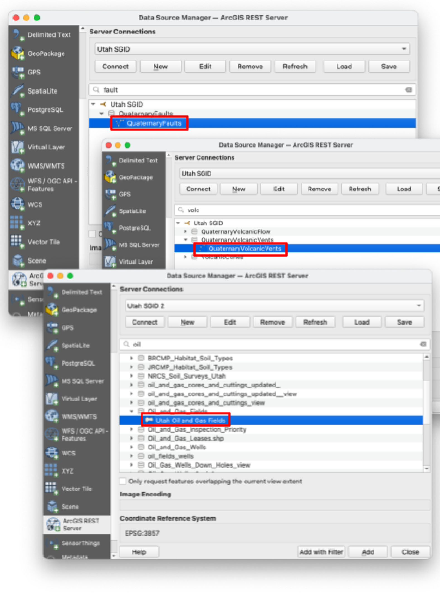

20. You may add more layers, but only 3 are necessary to get full points. I ended up adding Utah’s state boundaries in the example (easily found by typing “bound” in the search bar). 

> [!TIP]
> **If your layers land in different places** (or one is nowhere to be seen), right-click it in the Layers panel and choose **Zoom to Layer(s)**. Then check each layer’s coordinate reference system under **Properties → Source**. Also, don’t download a dataset just because it is hard to find through the service. Ask a TA, as the warning above says. Using the web service is the point of the lab.

#### **Backup Method: Connect to the Open SGID Database Instead**

UGRC also publishes the whole SGID as a public **PostGIS database** called the [Open SGID](https://gis.utah.gov/documentation/sgid/open-sgid/). It holds the same curated datasets, organized under the same category names you browsed in Step 1, and QGIS reads it through its **PostgreSQL** connection instead of the ArcGIS REST one. In the terms of the Background section this is takeout rather than delivery, but nothing is downloaded or unzipped and the data stay current at the source, so it serves the purpose of this lab. If you use it, say so in your data table under "methods available for accessing the data."

1. Open the Data Source Manager, choose **PostgreSQL** in the left-hand list, and click **New**.  
2. Fill in the connection exactly as shown. Name: `opensgid.agrc.utah.gov` (any name works). Host: `opensgid.agrc.utah.gov`. Port: `5432`. Database: `opensgid`. SSL mode: **disable**. Under Authentication, on the **Basic** tab, user name `agrc` and password `agrc`, with both **Store** boxes checked. These are UGRC's published public credentials, not a secret. (UGRC's documentation now spells the host `opensgid.ugrc.utah.gov`; both names reach the same server.)

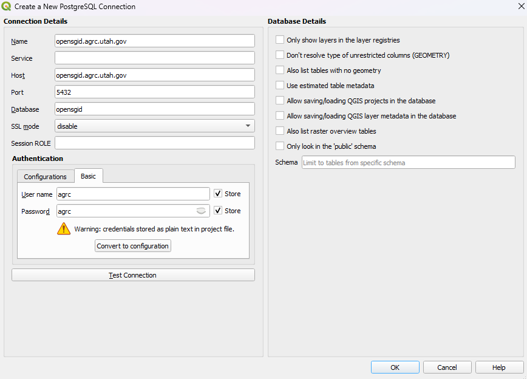

3. Click **Test Connection**. A green check mark and "Connection to opensgid.agrc.utah.gov was successful" at the top means you typed everything correctly. If it fails, the usual causes are a typo in the host name or an SSL mode other than *disable*.

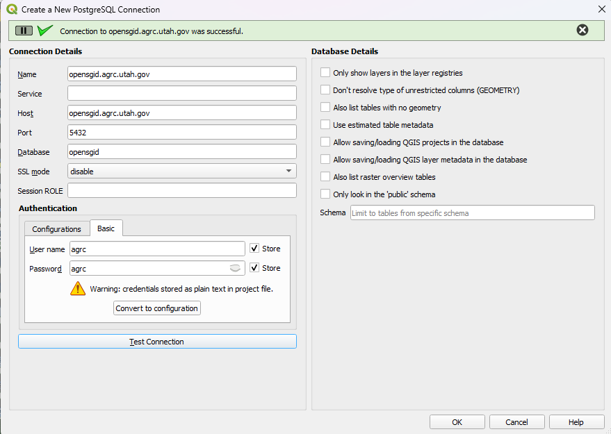

4. Click **OK**, and OK again on anything that pops up. QGIS warns that the password will be stored in plain text, which is fine for a public password.  
5. Back in the Data Source Manager, click **Connect**. The schemas appear, one per SGID category: boundaries, transportation, water, and so on. Expand a schema to see its tables, or type part of a name in the search box, the same way you searched the REST connection.

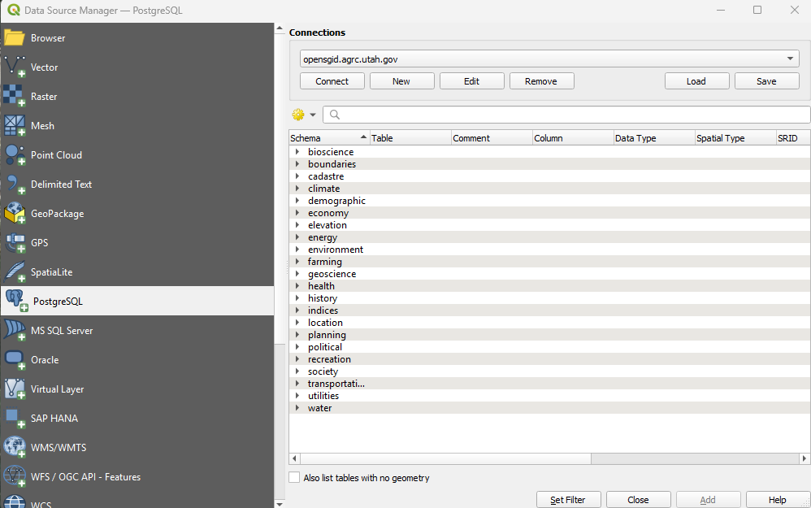

6. Select a table and click **Add**. It arrives as a normal layer, already in UTM Zone 12N (EPSG:26912), so it lines up with everything else in your project.  
7. Continue with Step 4. The rest of the lab is the same whichever door you came through.

> [!TIP]
> **A second trick, for one stubborn layer.** Every SGID Index result has a *feature service* link that ends in `/FeatureServer/0`. Add this to the end of that link:
>
> ```
> /query?where=1%3D1&outFields=*&f=json
> ```
>
> Then give the whole URL to QGIS as a vector dataset: Data Source Manager > **Vector**, leave Source Type on *File*, paste the URL into the **Vector Dataset(s)** box in place of a file name, and click **Add**. QGIS hands the URL to GDAL, which reads the service's own JSON, pages through the whole layer, and does not care about the missing extent. We checked it with Utah County Boundaries (29 features, one of the layers the REST connection refuses) and with the 414,000-segment Utah Roads layer. Use the *File* box, not the *Protocol: HTTP(S)* option: that route reads only the first 2,000 features and stops without telling you. It is one layer at a time, so set up the Open SGID connection if you need several.

### **Step 4: Design the Map and Layout**

21. Modify the symbology from the default colors and outlines to symbols that make sense for the data layers you have added, ensuring the map is clearly readable.

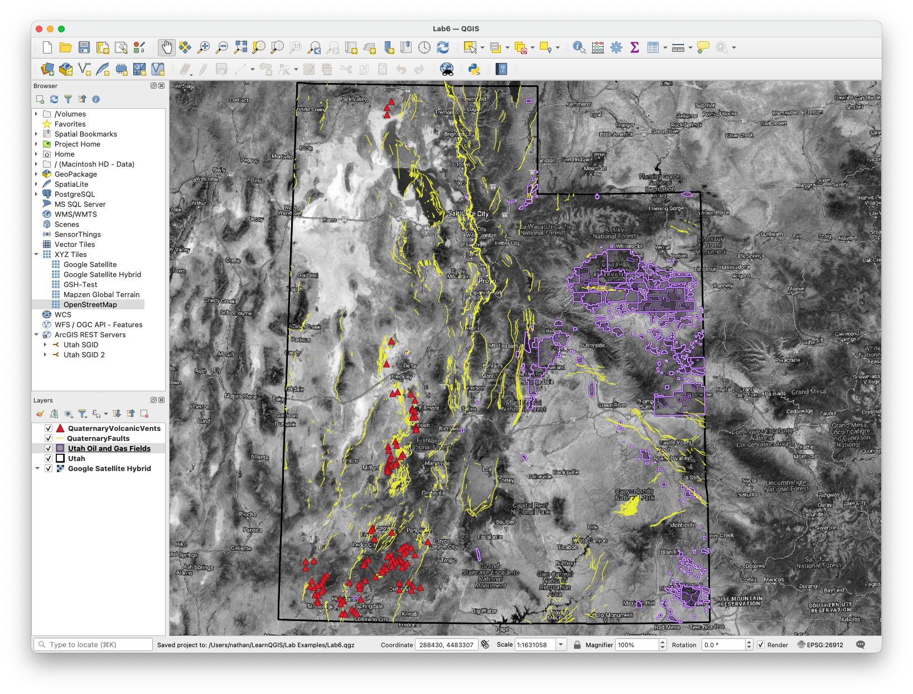

22. Create a layout for your map and include all required map elements (e.g., map legend, scale bar, title).

> [!TIP]
> **Clean up the legend before you export.** Web-service layers arrive with service names like `Utah_Quaternary_Faults_20201207`, and the basemap shows up in the legend too. Rename each layer in the Layers panel (right-click → **Rename Layer**) to something a reader understands, such as “Quaternary faults”. In the layout, select the legend and, in its **Item Properties**, uncheck **Auto update**. You can then remove the basemap entry and any you don’t want. Add a credit line naming UGRC and each dataset’s source. If the export hangs, see the warning about big layers in Step 3.

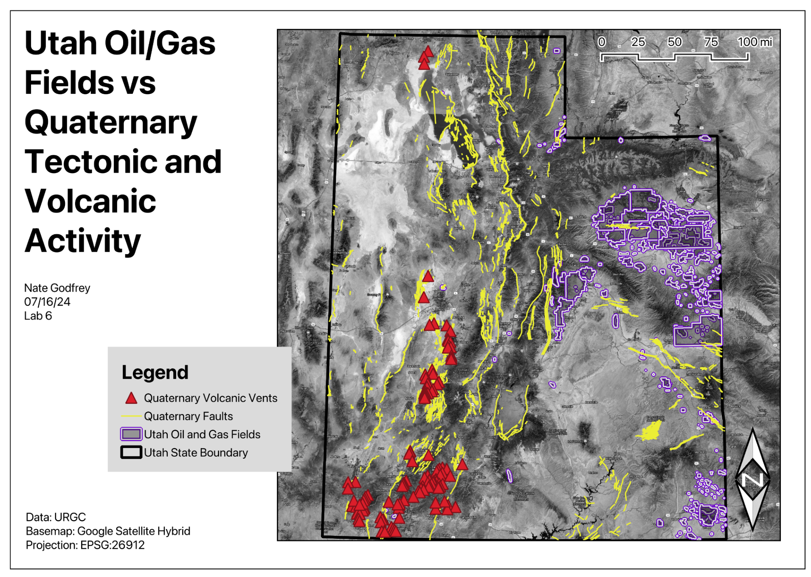

### **Step 5: Write Your Conclusion**

23. Write a brief conclusion paragraph indicating which datasets you used and **what purpose your final map serves** (e.g., emergency response, recreation planning, real estate development, environmental analysis). If your map did not settle your question, say so and say what data you would need next — a negative result you can explain is worth full marks here.

## **Deliverables**

Submit a PDF file that contains:

1. Your name, date, and lab number  
2. Your data table  
3. Your introductory paragraph (see step 8\)  
4. Your layout shows all 3 of your datasets, including modified symbology and all required map elements  
5. Your conclusion paragraph (see step 23\)  
6. The grading rubric, filled in with your self-evaluation

## **Grading Rubric**

The following rubric will be used to evaluate your lab assignment. Use this as a guide to ensure you include all required elements for this lab. Shown under “Score” is the maximum possible points you can receive for each item. 

Sometimes, points are awarded on a "yes or no" basis, giving full points if something is present and none if it is not. Other times, points are awarded on a scale based on how well you complete the task. Please keep this in mind. For example, if there is a written answer required, grading will be based on a scale of points, depending on the quality and completeness of your written answer.

Copy the rubric and paste it into your lab report. Fill in your self-evaluation of the rubric, showing how many points you feel you have earned for each item.

| Requirement | Score |
| ----- | ----- |
| Provide the requested data table: Table with your 3 chosen datasets and each required point of information *(3 pts)* | /3 |
| Present a complete and thoughtful introductory paragraph: Your complete question *(5 pts)* A brief explanation of how each dataset is relevant and will be used *(2 pts)* | /7 |
| Create and include the required map layout: Basemap layer is visible *(1 pt)* All three datasets are clearly displayed *(6 pts)* All required cartographic elements *(6 pts \- see previous labs for details)* | /13 |
| Provide a complete and thoughtful conclusion paragraph: Your process sufficiently answers your question, and/or produces a hypothesis for further analysis *(7 pts)* | /7 |
| **Total** | **/30** |

## **Using AI on This Lab**

This lab asks you to invent your own GIS question, and that is exactly where AI tools like ChatGPT or Gemini can be a useful thinking partner. Use them to brainstorm candidate questions ("here are three Utah datasets I found, what could they answer together?"), to check whether your question is actually answerable with the data you picked, to explain what a feature service or REST URL really is, or to decode a cryptic QGIS error when a connection refuses to load. What they should not do is your work: don't have AI write your introductory or conclusion paragraphs, invent claims about a map it has never seen, or fill in your self-evaluation for you. The written parts of this lab are graded on your reasoning about your map, so AI-written filler is easy to spot and earns you nothing.

* Good: pasting an exact QGIS or connection error message and asking what it means.  
* Good: asking AI to quiz you on the difference between WMS, WFS, and a feature service.  
* Not okay: submitting AI-written paragraphs or "results" about a map you didn't actually make.

If you do use AI anywhere in this lab, say so in your report, and be ready to explain and defend every answer as your own understanding.
