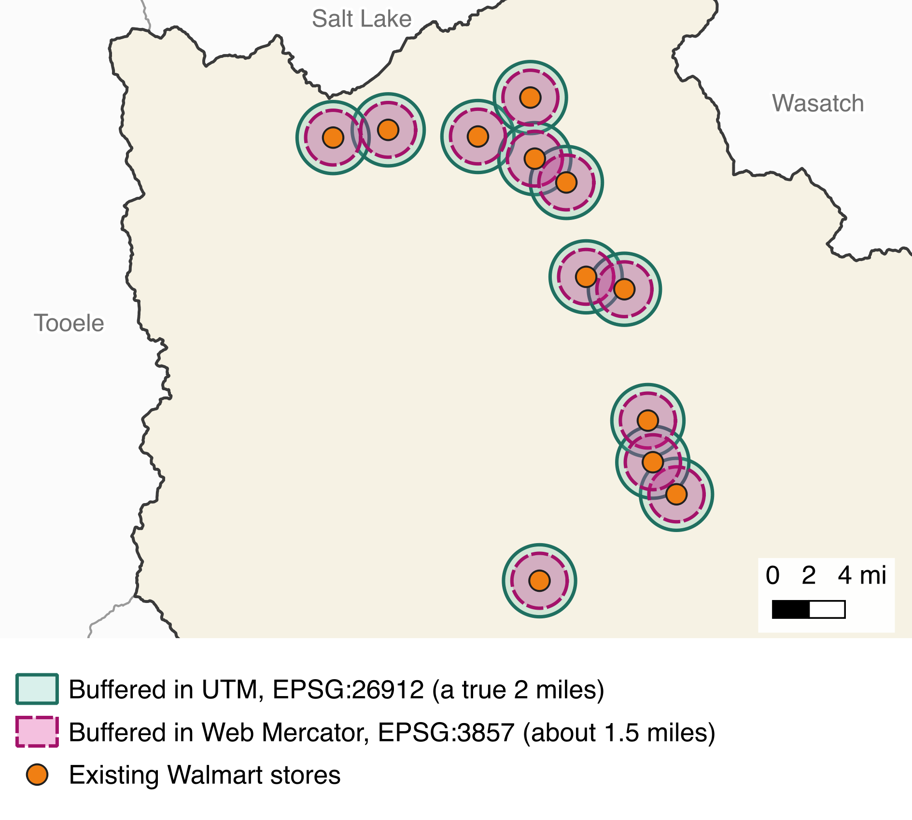
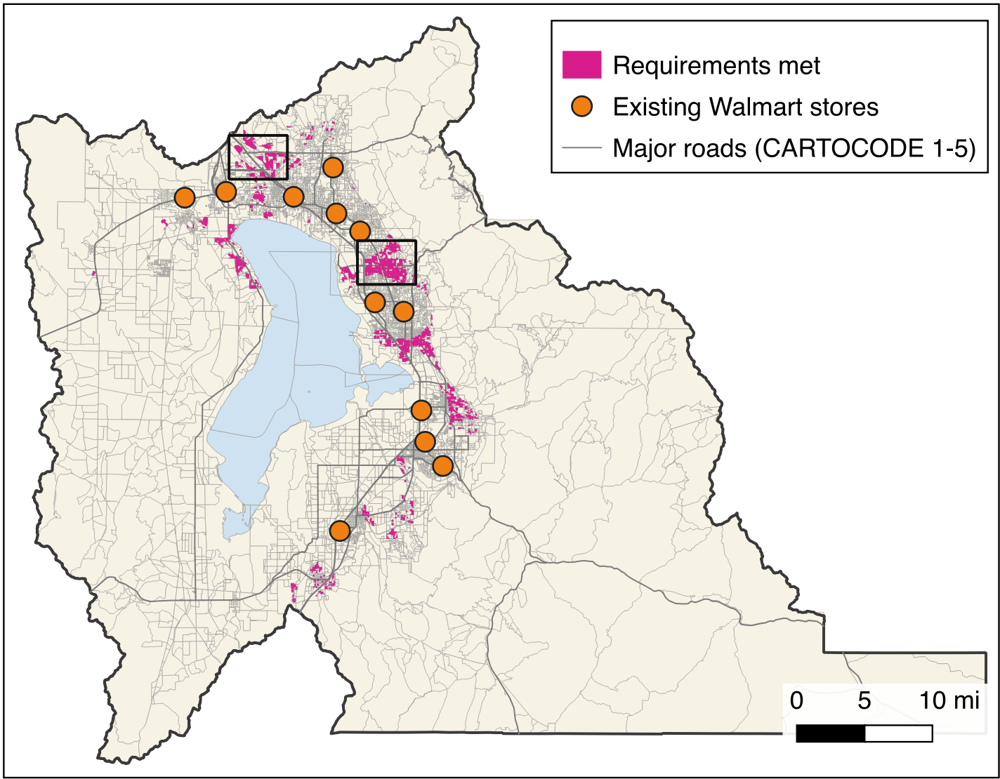

# Week 12 Hands-On — Workflow Walkthrough and Exam 2 Kahoot

**Hands-On Practice**{ .badge .badge-handson } · *Day 23 · Thursday of [Week 12 — Project Site Selection](../weeks/week-12.md)*

> [!NOTE]
> Concepts Exam 2 is taken in the Testing Center this week.

### Topics

- Review workflow diagrams and the Lab 11 model
- Geoprocessing as cookie cutting, in QGIS tool names
- Exam 2 review Kahoot

### Slides

- [Workflow Walkthrough](https://byu-hydroinformatics.github.io/cce114-geomatics/slides/day-23/workflow-walkthrough.html)
- [Concepts Review](https://byu-hydroinformatics.github.io/cce114-geomatics/slides/day-23/concepts-review.html)

<!-- runsheet -->
**Feeds** [Lab 11](../assignments/lab-11/README.md) and next week's [Lab 12](../assignments/lab-12/README.md) · ends with the Exam 2 Kahoot.

### At a glance

| | |
| --- | --- |
| **Goal** | Students see the Walmart site-selection workflow as a diagram, as a Model Designer model, and as a sequence of cookie cuts with QGIS tool names, and review for Concepts Exam 2. |
| **Why this week** | Tuesday's lecture presented site selection as a process of elimination, and showed why every layer must be reprojected out of Web Mercator before it is buffered. Lab 11 asks for a workflow diagram and a GeoPackage-based analysis; Lab 12, introduced next Tuesday, is the same pattern on a problem and county each student chooses. Concepts Exam 2 closes in the Testing Center Saturday. |
| **Students bring** | Laptop with QGIS 3.44. A phone for Kahoot. |
| **Graded item** | None. |
| **Feeds** | Lab 11: Walmart Site Selection, due Saturday. Lab 12, which starts next Tuesday. Concepts Exam 2. |

### Practice run before class

> [!TIP]
> Thirty minutes, and most of it is building the model in advance. Do not build it live; the
> session is a walkthrough of a finished model, not a construction exercise.

**What you need.** QGIS 3.44 LTR and the Lab 11 Walmart site-selection layers.

**Do this, in order.**

1. Work Lab 11 through once yourself if you have not. You cannot narrate the model without having
   run the analysis by hand.
2. **Processing > Model Designer**. Build the analysis half of Lab 11 (steps 22 to 28) as a model,
   using the lab's own tools: inputs on the left (the census blocks, MajorRoads and
   CurrentLocations from a finished UtahCounty.gpkg); Field Calculator, Extract by Attribute,
   Reproject Layer, Buffer and two Extract by Location in the middle; PotentialCustomers on the
   right. Save it as `walmart.model3`. A correct run gives 1,871 blocks.
3. Run the model from the toolbar, filling the inputs with the Lab 11 layers, and confirm the
   outputs appear in the Layers panel.
4. Double-click the buffer algorithm, change the distance, and run again. Timing this is worth it:
   the speed of the rerun is the argument for models.
5. Click **Export as Python** and glance at the script. You only need to show it for thirty
   seconds, but know where the button is.
6. Draw the Lab 11 workflow diagram by hand the way you will draw it on the board, with the
   convention the decks and the self-check quiz teach: layers as rectangles, tools as ovals,
   every layer labeled with its geometry type and, from step 25 on, its CRS.

**You are ready when** the model runs end to end from a cold start and you can change one
parameter and rerun without reading the screen.

**The one that bites.** A model that refuses to run with "Missing parameter" has an unconnected
input. Hover the red exclamation mark on the algorithm box to find which one.

### Before class

- [ ] The two decks open: [Workflow Walkthrough](https://byu-hydroinformatics.github.io/cce114-geomatics/slides/day-23/workflow-walkthrough.html) and [Concepts Review](https://byu-hydroinformatics.github.io/cce114-geomatics/slides/day-23/concepts-review.html). Press P for speaker notes.
- [ ] A Model Designer model of Lab 11 steps 22 to 28 built in advance (field calculator, extract by attribute, reproject, buffer, extract by location) saved as `walmart.model3`, so the demo is a walk-through and not a build.
- [ ] The Exam 2 Kahoot from the Learning Suite **Kahoot** page (*Exam 2 Review*, or one of the *CCE 114 Exam 2* variants) at the lobby screen.
- [ ] The "Some Examples" workflow diagram slides from the Week 12 Thursday entry on Learning Suite.

### Plan (50 minutes)

| Time | Segment |
| --- | --- |
| 0:00 | Mini-devotional |
| 0:03 | Workflow diagrams: the examples, then the Lab 11 diagram, box by box |
| 0:12 | Model Designer: open the model, run it, change one parameter, rerun |
| 0:22 | Cookie cutting, in QGIS names: the second half of the Workflow Walkthrough deck, and its order quiz |
| 0:32 | Kahoot: Exam 2 review |
| 0:46 | Lab 11 pointers; exam closes Saturday; Lab 12 starts next Tuesday |

### Walkthrough

#### 1. Diagrams first

Show two or three of the example workflow diagrams. Then draw the *shape* of the Lab 11 one, not every box (the full diagram is 10 points of the lab students are finishing this week): Walmart points, roads and census blocks in; extracts, a reproject and buffers in the middle; PotentialCustomers out. Name the shape convention (rectangles are layers, ovals are tools, every layer labeled with its geometry) because the Lab 12 report requires the diagram too and graders look for it. Put the Reproject Layer oval in on purpose and ask why it is there.

Say the elimination logic out loud: start with everything, remove what fails each criterion, what is left is the answer. Show the "all suitable areas" layer as its own output, not just pins, because Lab 12 asks for the same kind of output.

#### 2. Model Designer

1. **Processing > Model Designer**, open `walmart.model3`. The canvas is the diagram, executable. Inputs on the left, algorithms in the middle, outputs on the right.
2. Run it from the toolbar. Fill the inputs with the Lab 11 layers. The outputs appear in the Layers panel.
3. Double-click the buffer algorithm, change the distance, run again. The whole chain reruns in seconds. That is the point of a model: the analysis is reproducible and the parameters are arguments.
4. Show **Export as Python** briefly. The same chain as a script; CCE 414 lives here.

#### 3. Cookie cutting, in QGIS names

Switch to the second half of the Workflow Walkthrough deck. Each slide is one cut: start with everywhere, cut to the county, keep what is inside the 2-mile I-15 band (Intersection), punch out the 2-mile store circles (Difference), and what is left is the answer. It is the same photo series students saw on Tuesday's cookie slide, one image at a time. Then the slide that names each cut as a QGIS tool. Run the order quiz in the middle of the deck and make them defend an answer before you give it; the speaker note explains why order gives the same polygons in this chain but not in general.

End with one line about next Tuesday: Lab 12, Choose Your Own Adventure, is the same pattern on a problem and county each student picks, done individually. Do not hand it out today.

### Kahoot (14 minutes)

Run the Exam 2 review. Reread the questions most people miss. Exam 2 covers everything since Exam 1: projections and coordinate systems, metadata, geoprocessing, site selection. The book is not available in the Testing Center.

### Common snags

- **Model Designer will not run: "Missing parameter."** An input is unconnected. Hover the red exclamation on the algorithm box.
- **The model output is a temporary layer.** Right-click the output box and set a destination, or save the layer afterwards.
- **A student's Lab 11 count is near 2,500 instead of about 1,871.** They buffered in Web Mercator. Have them look for `[EPSG:3857]` in the Buffer dialog's input box and redo steps 25 and 26 with Reproject Layer first.

  

  A correct result looks like this: about 1,871 blocks in clusters around Orem, Provo, Lehi, Saratoga Springs and Springville, none within 2 miles of an orange store.

  
- **The Walmart layer will not add.** They connected to the older STORE_STATUS service or typed the URL wrong. Lab 11 step 7 has the exact URL; the layer is Walmart\_Facilities\_(Public) > Fieldlocations.
