<!-- _class: lead -->
<!-- _paginate: skip -->

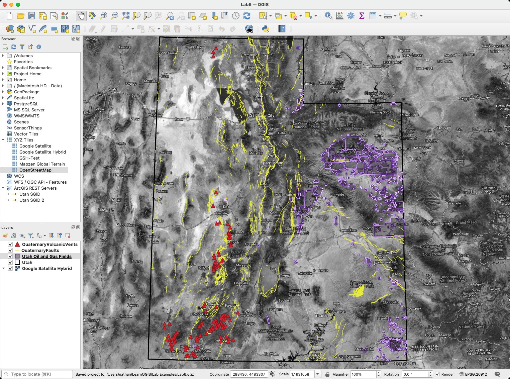

# Web Services

## Getting data without downloading it

CCE 114 Geomatics
Brigham Young University
Civil & Construction Engineering

Dr. Dan Ames and Dr. James Halgren

<!-- Thursday lecture plus a short follow-along. Today is a light introduction to web services built around one question, whether a service sends a picture or the features, then students follow along in QGIS: connect to UGRC's services, add three live layers, and upload a quick layout for the in-class activity. A rough budget for the 50 minutes: 15 minutes of slides, 15 to 20 minutes of follow-along, 10 minutes for the Map Experience pitch. The map on the right was made entirely from web services: no downloads, no unzipping. Concepts Exam 1 closed yesterday, so expect a tired room. -->

---

<!-- _paginate: skip -->
<!-- _footer: "" -->

<!-- Announcement before we start. BYU's Student Innovator of the Year competition: students compete for part of $50k in prizes to make an idea real. Applications close November 1, at sioy.byu.edu (or scan the QR code). Worth a look for anyone who has a project idea, including a mapping or GIS one. -->

---

# Today's Goals

By the end of class you should be able to:

- Say what a **web service** is, and when you would stream data instead of downloading it
- Answer the one question that matters for any service: *do I get a **picture**, or the **features**?*
- Connect **QGIS** to UGRC and make a quick map from **three live layers**: a running start on **Lab 6**

<!-- Students need laptops with QGIS today: the second half of the hour is a follow-along of Lab 6, Step 3, ending in a quick layout they upload as the in-class activity. -->

---

# Download or stream?

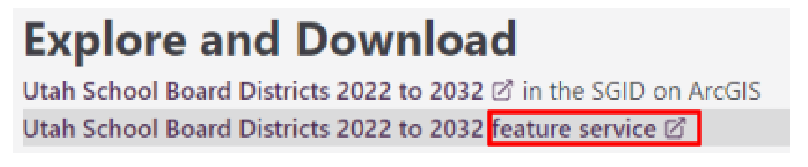

**Download** — like a song you saved to your phone
- A file lands on your disk
- Yours forever, works offline
- Frozen the moment you downloaded it

**Web service** — like Spotify ← *today*
- QGIS reads it from the server, live
- Always current, nothing to store
- Needs a network, and the server must be up

<!-- A one-minute recap of Tuesday's last slide. Almost every SGID dataset offers both a download and a feature service link; today is entirely about the right-hand column. The Spotify comparison carries the whole trade-off: nothing to store and always the current version, but no signal, no music. If someone asks about databases (Lab 6's Open SGID backup is one), they sit in between: also live, also someone else's server, just a different kind of connection. -->

---

# Why bother? Because data moves.

- **Live data**: wildfire perimeters, streamflow, road closures, air quality
- **Big data**: statewide imagery you would never want on your laptop
- **Shared data**: everyone on the project sees the same layer, updated at the source
- **No version confusion**: no `roads_final_v3_REALLY_final.shp`

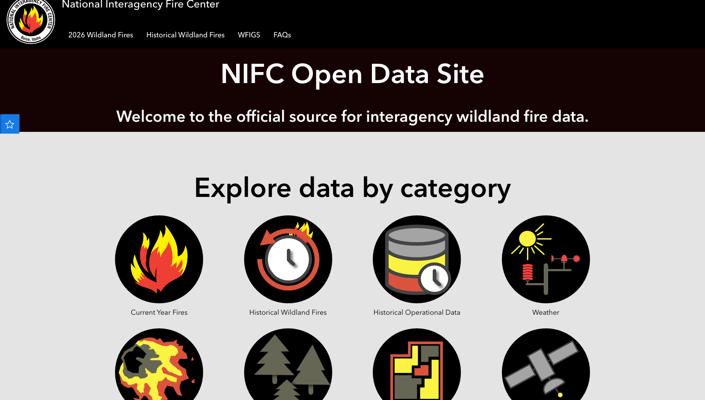

<!-- The National Interagency Fire Center publishes live fire perimeters as a public feature service that refreshes as often as every five minutes; it is the same feed behind the fire maps on the news. Nobody downloads and unzips a shapefile while the fire is still moving. https://data-nifc.opendata.arcgis.com/ -->

---

# A picture, or the features?

**A picture** — a screenshot of the spreadsheet

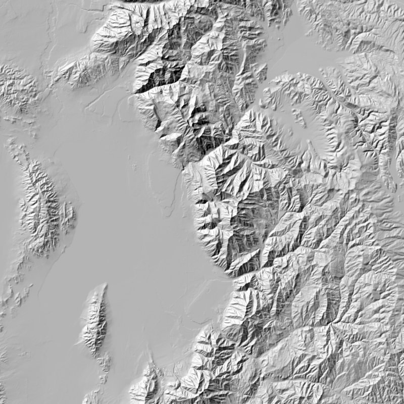

- The server draws the map and sends an image
- Fast, but you can only **look** at it
- **WMS**, **WMTS**, **XYZ tiles**: every basemap

**The features** — the spreadsheet itself

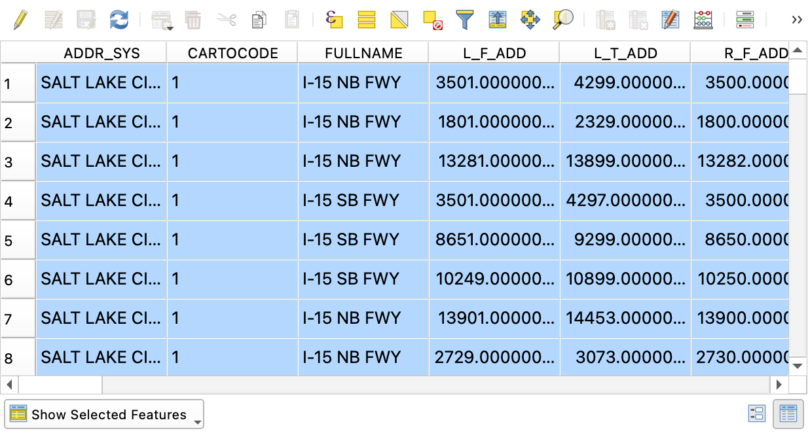

- Real geometry and attributes arrive
- You can select, query, and **buffer** them
- **WFS**, and an Esri **feature service**: what **UGRC** uses

<!-- This is the one idea of the day. A screenshot of a spreadsheet looks exactly like the spreadsheet, but you cannot sort it, sum it, or fix a typo in it. A WMS layer is the same: the hillshade on the left is a real WMS response from the USGS 3DEP elevation service, the Wasatch Front with Utah Lake, and nothing about the elevation values came with it. The table on the right is what a feature service gives you: every road segment with its attributes. All of these buttons sit at the bottom of the QGIS Data Source Manager list. If asked: WCS is the feature-style service for rasters (cell values, not a picture), vector tiles are tiles that carry features, and OGC is the standards body that defines WMS and WFS, like a USB standard for maps. None of that is on the lab; the picture-or-features question is. -->

---

<!-- _class: quiz -->

# You need to buffer a stream network by 100 m. Which service?

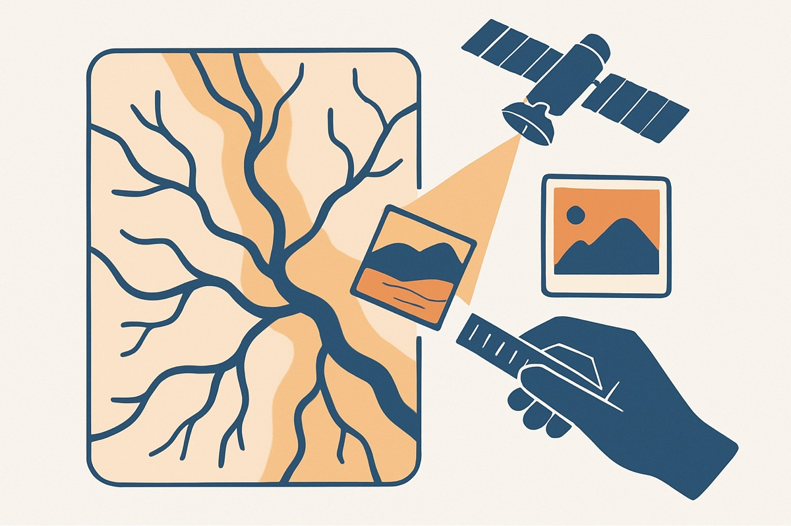

<ol type="A">
<li>WMS</li>
<li>WMTS</li>
<li>WFS or an ArcGIS feature service</li>
<li>XYZ tiles</li>
</ol>

- And a follow-up: you want a **satellite basemap** behind your map. Which one now?

<!-- Answer: C. A buffer is a geometry operation, so you need the geometry, which means features, not a rendered image. The follow-up answer is XYZ or WMTS: for a basemap you only need it to look right, and tiles are far faster. -->

---

# A web service is just a URL

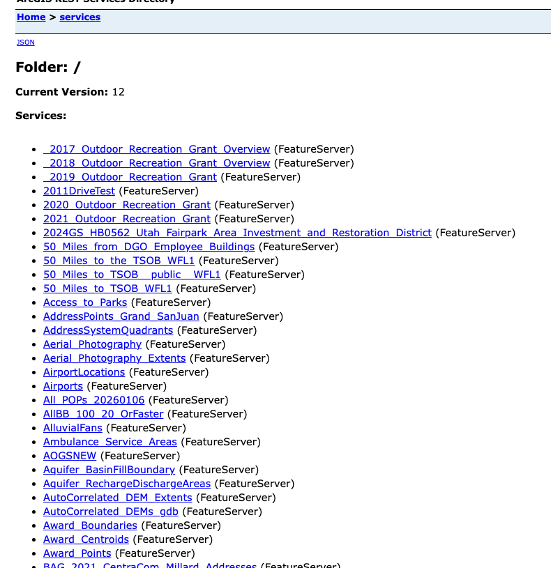

<code>services1.arcgis.com/99lidPhWCzftIe9K/ArcGIS/rest/services</code> — UGRC, <strong>more than 900 services</strong>. This is the URL you paste into QGIS.

<!-- This is UGRC's ArcGIS REST endpoint, opened in a browser. Every link is a dataset you can add to QGIS, and you can click your way down it like any web directory. When you hit Connect, QGIS's first question to the server is "what layers do you have?" (for WMS and WFS that request is called GetCapabilities), and the answer fills the list in the Data Source Manager. After that QGIS just builds URLs and draws what comes back. If there is time, paste the URL into a browser live; if not, skip straight to QGIS. -->

---

<!-- _class: lead -->

# Into QGIS

## Follow along on your laptop

<!-- Switch to QGIS here and have everyone follow along; the next two slides are the fallback if the projector or network misbehaves. Connect to the UGRC endpoint, search for QuaternaryFaults, add it, add two more layers, and open the attribute table to show the features really came across. If the room's Wi-Fi struggles, the Clyde 234 lab machines are wired. -->

---

# Connecting QGIS to a service

1. **Data Source Manager** (the toolbar button, or `Ctrl`/`Cmd` + `L`)
2. Pick the service type in the left-hand list — for UGRC, **ArcGIS REST Server**
3. Click **New**, name the connection, paste the service URL
4. **OK**, then **Connect**
5. Expand the connection, find your layer, click **Add**

UGRC: <code>services1.arcgis.com/99lidPhWCzftIe9K/ArcGIS/rest/services</code>

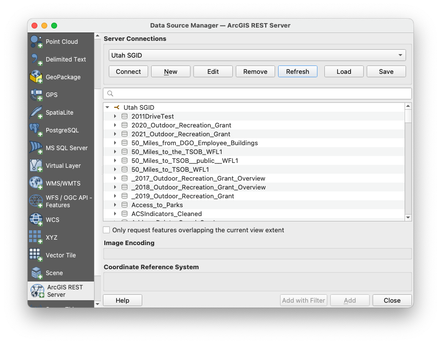

<!-- Walk through this on screen if the projector allows. Two things that trip students up every year: the Data Source Manager window likes to hide behind the main QGIS window, and the connection is saved in your QGIS profile, so you only set it up once. Lab 6 gives the exact UGRC URL and authentication settings. -->

---

# Finding your layer among 900-plus

- Use the **search box**, not your eyes: `fault`, `bound`, `oil`
- Names are **database names**: `QuaternaryFaults`, not "Quaternary Faults"
- Not there? UGRC has a **second server** (Lab 6, step 18)
- *Could not retrieve layer extent*? **Not your mistake.** Use **Isabel's** Open SGID fix at the end of **Lab&nbsp;6, Step&nbsp;3**

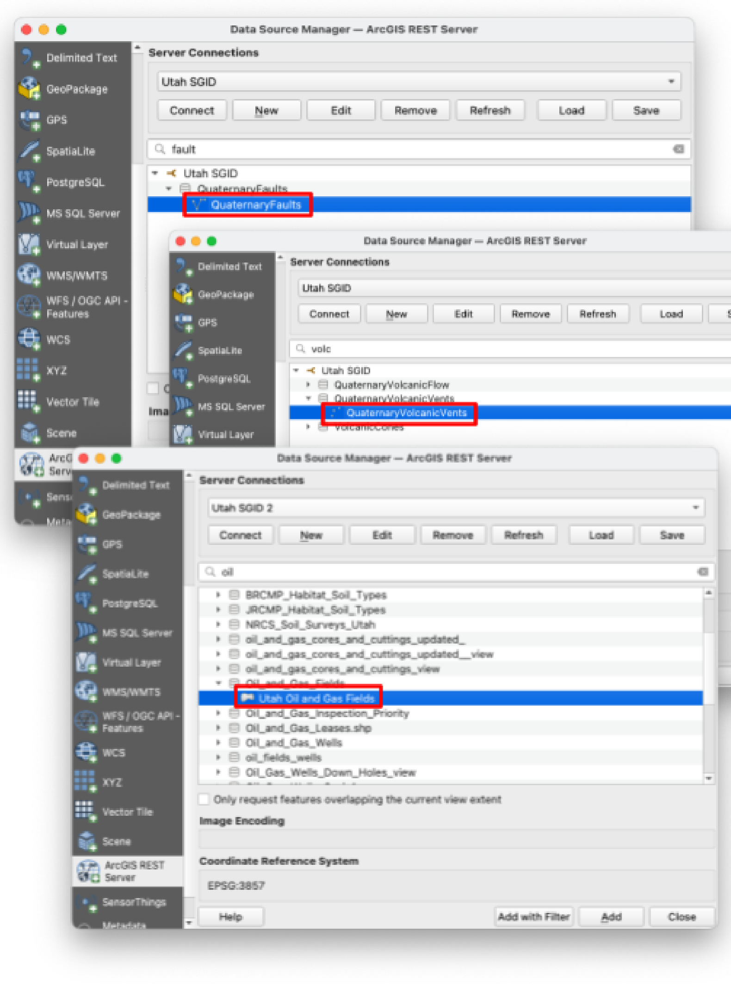

<!-- The searching is the real skill here. Tell students to search a fragment: "fault", "bound", "oil". If a dataset they found in the SGID Index does not appear, it is probably on a different UGRC endpoint; Lab 6 gives a second URL for exactly this case. Known problem since October 2026: about a third of the layers on UGRC's main server publish no extent, and QGIS 3.44 refuses to add those with "Could not retrieve layer extent". Lab 6 Step 3 now ends with a backup method, the Open SGID PostgreSQL connection (host opensgid.agrc.utah.gov, port 5432, database opensgid, user and password agrc, SSL disabled); have it set up on the projector machine before class and switch to it the moment the REST connection misbehaves. -->

---

<!-- _class: activity -->

# In-class activity: three live layers and a map

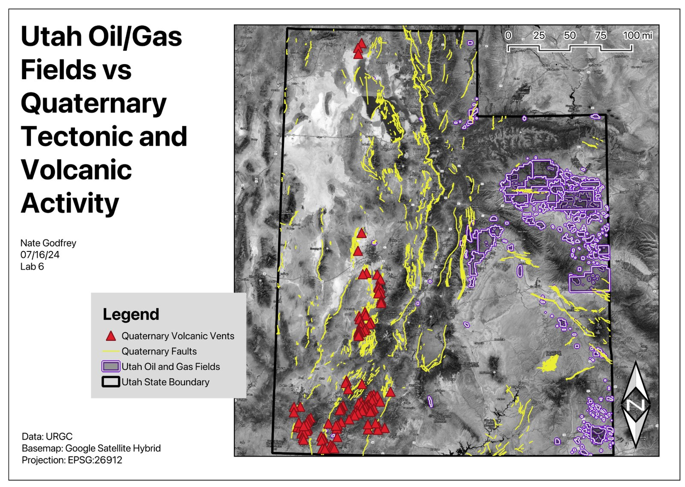

1. Connect to **UGRC's ArcGIS REST services** (previous slides)
2. Add **three or more layers** that interest you: a polygon, a line, and a point layer works well
3. Style them so a reader can tell them apart
4. **Project → New Print Layout**: map, legend, scale bar, north arrow, title, and a credit line naming **UGRC**
5. Export a **PNG** and upload it to **In Class Activity: Getting Data through Web Mapping Services** on Learning Suite before you leave

<!-- The example on the right is the Lab 6 layout: three web-service datasets over a basemap, with every element from Lab 2. Full credit for three service layers and a layout; a screenshot of the map canvas earns partial credit. Common snags: "Failed to connect" usually means a trailing space or a missing /rest/services in the URL; a huge layer such as statewide parcels draws slowly, so pick something smaller or zoom in first; if layers do not overlap, check each layer's CRS under Properties > Source. -->

---

<!-- _class: activity -->

# Lab 6: your turn

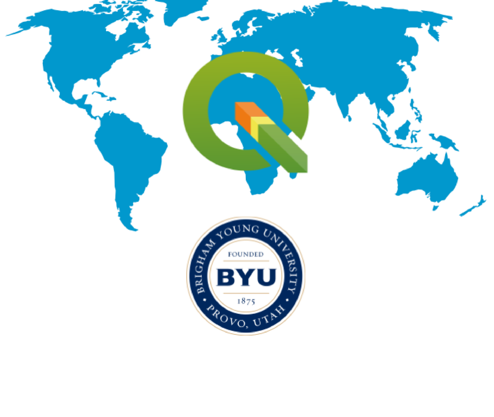

- Today's map was a running start on **Lab 6**; the lab asks for more
- Write **one question** you can answer with **three** SGID datasets
- Add all three to QGIS **as web services**, not downloads
- Style them, build a **layout** with every required map element, and write a short conclusion
- Live layers need the server: **export your layout early**, not at 11:58 on Saturday
- Due **Saturday at 11:59 pm**: [Lab 6 instructions](https://byu-hydroinformatics.github.io/cce114-geomatics/assignments/lab-06/)

<!-- Steps 1 and 2 (explore the SGID, choose the datasets, write the question) were possible after Tuesday; Step 3 is what students just did in the follow-along. Remind students that the Clyde 234 lab machines have QGIS 3.44 and a wired network if their laptop or the Wi-Fi gives them trouble. The professional version of the export-early bullet: a live service is a dependency, so on a real project you decide deliberately which layers stay live and which you keep a local copy of, because you cannot afford them to vanish the night before a submittal. Services usually publish in Web Mercator and QGIS reprojects on the fly, so check the CRS before measuring anything. -->

---

# Map Experience: due Week 10

The **Community and Professional Map Experience**, due **Wednesday of Week 10**:

- Attend a **real** event: a city council or planning commission meeting, a UDOT open house, an ASCE or AGC chapter speaker
- Photograph the event, and any **map** that was shown
- Map where it was held in **QGIS**, plus what the agenda item was about, from UGRC's services
- Write it up: **what data, what analysis, what decision**

<!-- A ten-minute pitch. The easy option is a city council meeting: Provo and Orem post agendas online, and most have a public-works or land-use item every week. Meetings are usually Tuesday evenings, so there are only three or so chances left; tell students to pick one tonight. Full details are on the Assignments page of the course site. -->

---

# Before Next Class

- **Lab 6: [Spatial Data Web Services](https://byu-hydroinformatics.github.io/cce114-geomatics/assignments/lab-06/)** is due **Saturday at 11:59 pm**
- Next week: **Geodesy, Projections, and Coordinate Systems**
- Read **Chapter 3** of *GIS Fundamentals* (Bolstad & Manson) before Tuesday
- **Quiz 6** opens Tuesday on Learning Suite; open book, due **Saturday** of next week
- Pick your **Community and Professional Map Experience** event
- Questions? Office hours: [calendly.com/dan-ames/office-hours](https://calendly.com/dan-ames/office-hours)

<!-- Confirm the Quiz 6 dates on Learning Suite before class. -->

<!-- Deck notes (2026-10-09): split out of the Day 12 deck "Finding Spatial Data and Web Services" when Week 7's Thursday became a short lecture with a follow-along activity in place of the full hands-on session. Every slide from "Three ways to put data in a map" through "Cautions" is the second half of that deck, unchanged except for American spelling, the UGRC service count, and the old layout-example slide, which became the in-class activity. New: the title and goals slides, the Tuesday recap, the "Into QGIS" divider, the Lab 6 slide, the Community and Professional Map Experience pitch (from the Week 7 hands-on run sheet), and Before Next Class. The QGIS screenshots are genuine QGIS 3.x captures reused from Lab 6. web-rest-directory.png and web-rest-featureserver.png show Esri's REST services directory as served by UGRC, in a browser; they are correct as they stand. The WMS hillshade on the OGC slide is a real GetMap response from the USGS 3DEP elevation service for the Wasatch Front, fetched with the URL on the "A web service is just a URL" slide. UGRC's REST endpoint listed 905 services on 2026-10-09 (891 on 2026-09-02); the slides say "more than 900", which will drift.

Revised 2026-10-15 after the first teaching, which ran long and felt like too much: the food-delivery analogy (fridge, takeout, delivery; WFS as raw ingredients) did not land, and the acronym tour buried the one idea students need. Now: the recap uses download versus Spotify; the OGC, WFS/WCS, and "outside the standards" slides became one "A picture, or the features?" slide built on a screenshot-versus-spreadsheet comparison, using the real WMS hillshade and a QGIS attribute table (web-features-table.png, copied from the Day 22 deck); the URL, REST directory, and single-service slides became one; the "Three ways", "They behave like any other layer", "Cautions", and "Lab 6 update" slides were cut, with the Open SGID fallback moved onto "Finding your layer" and the export-early caution onto the Lab 6 slide. WCS, vector tiles, OGC, and GetCapabilities now live only in speaker notes. web-source-types.png, web-wfs-ingredients.png, web-btn-*.png, web-service-url.jpg, web-rest-featureserver.png, web-opensgid-browse.png, and web-cautions.jpg are no longer used. -->

---

<!-- _class: activity -->

# Your Turn — A Picture, or the Features?

Seven questions on your phone:

- A **picture**, or the features?
- A service is just a **URL**
- Utah's data, **into QGIS**

Not graded, and every answer explains itself. Good practice for Lab 6.

byu-hydroinformatics.github.io/cce114-geomatics/quizzes/services/

<!-- Five minutes, in pairs, then a show of hands on the two worth arguing about: what a WMS actually sends back, and which service you need before you can buffer anything. Those are the two that decide whether a Lab 6 map works. If the room has no signal, put the URL on the board. The page is linked from the Week 7 page too. -->
