<!-- _class: lead -->
<!-- _paginate: skip -->

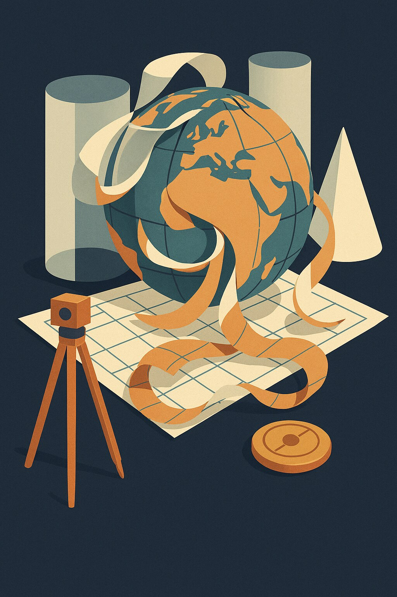

# Geodesy, Projections, and Coordinate Systems

Part 1

CCE 114 Geomatics
Civil & Construction Engineering
Brigham Young University
Dr. Dan Ames and Dr. James Halgren

<!-- Tuesday concept lecture, week 8. Thursday is the hands-on session, where students set project and layer CRSs in QGIS and reproject data. This is the lecture that Quiz 6 and Lab 7 are built on, so flag both early. The hero image is generated (gpt-image-1, October 2026): a globe peeling onto a gridded flat map, cylinder and cone projection surfaces, and a surveyor's tripod and benchmark disc, the three threads of the lecture. The Tater Mercator shirt now lives on the Idaho UTM slide. -->

<!-- stamp:begin -->
<!-- _footer: 'CCE 114 · Day 14 — Geodesy, Projections, and Coordinate SystemsLast Updated: 2026-10-28© 2026 Daniel P. Ames · <a href="https://creativecommons.org/licenses/by/4.0/">CC BY 4.0</a>' -->
<!-- stamp:end -->

---

<!-- go-cougs:begin -->
<!-- generated by make_go_cougs.py; re-running replaces these two slides -->

# Go Cougs!

**No. 8 BYU 28, No. 2 Notre Dame 24**
Saturday night, LaVell Edwards Stadium

- **1:47** left: Bear Bachmeier's 6-yard touchdown pass to Walker Lyons
- Notre Dame reached the BYU 9; the last pass fell **incomplete**
- Notre Dame's **16-game** win streak is over; BYU is **6–0**

<svg xmlns="http://www.w3.org/2000/svg" viewBox="0 0 435 580" width="435" height="580"><defs><clipPath id="gc-clip"><rect width="435" height="580" rx="18"/></clipPath></defs><g clip-path="url(#gc-clip)"><rect width="435" height="580" fill="#002e5d"/><image href="images/go-cougs-01.jpg" x="0" y="0" width="435" height="580" preserveAspectRatio="xMidYMid slice"/><image class="gc-img gc-0" href="images/go-cougs-01.jpg" x="0" y="0" width="435" height="580" preserveAspectRatio="xMidYMid slice"/><image class="gc-img gc-1" href="images/go-cougs-02.jpg" x="0" y="0" width="435" height="580" preserveAspectRatio="xMidYMid slice"/><image class="gc-img gc-2" href="images/go-cougs-03.jpg" x="0" y="0" width="435" height="580" preserveAspectRatio="xMidYMid slice"/><image class="gc-img gc-3" href="images/go-cougs-04.jpg" x="0" y="0" width="435" height="580" preserveAspectRatio="xMidYMid slice"/><image class="gc-img gc-4" href="images/go-cougs-05.jpg" x="0" y="0" width="435" height="580" preserveAspectRatio="xMidYMid slice"/></g></svg>

<!-- Celebration slide for the start of class: No. 8 BYU beat No. 2 Notre Dame 28-24 at LaVell Edwards Stadium on Saturday night, October 17, 2026 (ESPN recap and Deseret News takeaways, linked on the next slide). The go-ahead score was a 6-yard pass from Bear Bachmeier to Walker Lyons with 1:47 left; Notre Dame's last pass, from the BYU 9, fell incomplete. The photos are from the stands and crossfade on their own when the slide opens; they carry no location data. -->

---

<video src="images/go-cougs-field.mp4" poster="images/go-cougs-field.jpg" autoplay muted loop playsinline style="width: 330px; height: 587px; object-fit: cover; border-radius: 18px; display: block;"></video>

# Storming the Field

**Highlights**

- [BYU Football](https://www.youtube.com/watch?v=sSh5GVfViLo)
- [ESPN](https://www.youtube.com/watch?v=zX_CzDNg_74)
- [Fans storm the field](https://www.youtube.com/watch?v=Fc3pV2hcAs4)

**News**

- [ESPN recap](https://www.espn.com/college-football/recap?gameId=401856809)
- [Deseret News: 3 takeaways](https://www.deseret.com/sports/2026/10/17/byu-football-upsets-notre-dame-3-takeaways/)

<!-- The clip is from the stands after the final play, as the students came over the wall; it loops silently (the audio was removed). Video links are the official BYU Cougars and ESPN YouTube uploads, checked October 19, 2026; news links checked the same day. -->

---

<!-- go-cougs:end -->

# Today's Goals

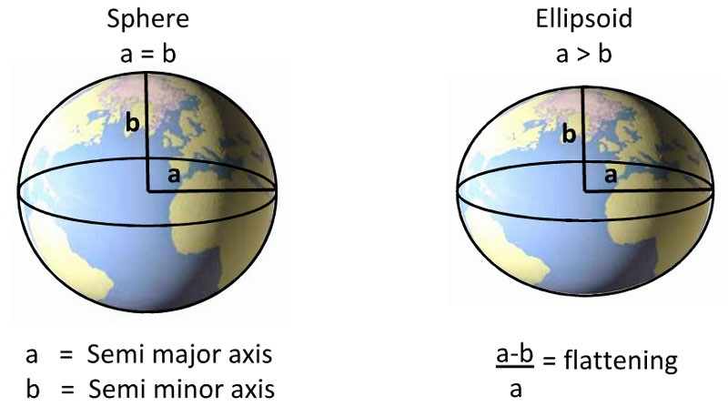

- By the end of class you should be able to:
  - Say what **geodesy** is (the science of measuring the shape of the Earth and positions on it), and why that is a hard problem
  - Distinguish the **geoid**, the **ellipsoid**, and a **datum**
  - Explain why every flat map **distorts** something, and name what a given projection preserves
  - Tell a **geographic** coordinate system from a **projected** one
  - Choose between **UTM** and **State Plane** for an engineering project, and defend the choice
- Thursday, in the hands-on session, you do all of this in QGIS

<!-- Set expectations. Today is concepts; Thursday is the software. Reading is GIS Fundamentals chapter 3, which this lecture follows. -->

---

<!-- _class: lead -->

# Part 1

## Distance on a round Earth

<!-- Part 1 covers measuring distance on a curved Earth, great circles, and why a flat-Earth view misleads. Anime-style cartoon generated with gpt-image-2.5-flare, October 2026; prompt in tools/divider-images/gap-fill-2026-10.json. -->

---

# How far is it from BYU to the University of Utah?

| | Latitude | Longitude |
| --- | --- | --- |
| **BYU** | 40.2518° N | 111.6493° W |
| **U of U** | 40.7649° N | 111.8421° W |

- Work it out on paper, in kilometers
- Two minutes, no phones

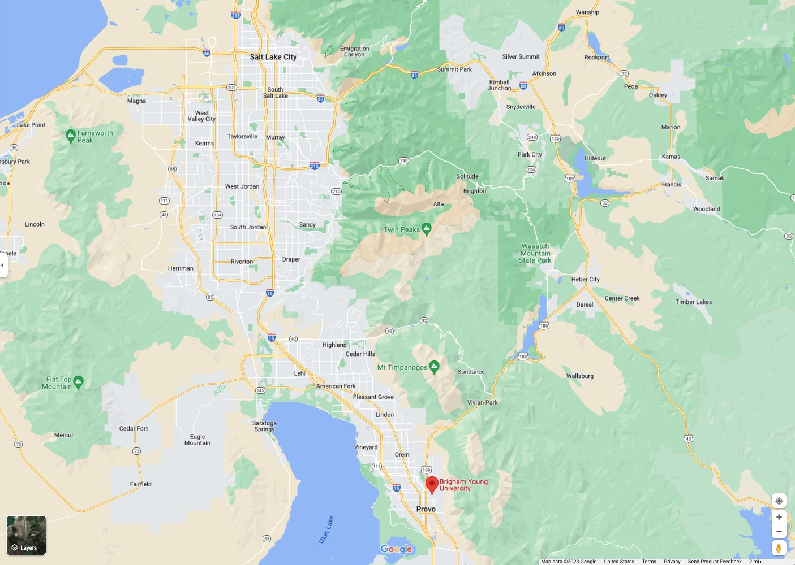

<!-- Let them try before you say anything. Most will subtract and run Pythagoras on the degrees, which gives about 0.55, of no unit at all. The catch is that a degree is not a fixed distance: a degree of latitude is about 111 km, but at 40 degrees north a degree of longitude is only about 85 km (111 times the cosine of the latitude). Degrees are angles, not lengths. Hold the answer for the next slide. -->

---

# Same question, in UTM Zone 12N

| | Easting (m) | Northing (m) |
| --- | --- | --- |
| **BYU** | 444,780 | 4,455,907 |
| **U of U** | 428,927 | 4,513,000 |

- Now it is a right triangle in **meters**
- This is what a **projected** coordinate system buys you

<!-- Same two points in NAD 83 / UTM zone 12N (EPSG:26912), computed from the latitudes and longitudes on the previous slide with pyproj (treating them as NAD 83; the WGS 84 difference is about a meter). Difference in easting 15,853 m, in northing 57,093 m, so the straight-line distance is about 59.3 km. The geodesic distance on the GRS 80 ellipsoid is 59.27 km, so the flat answer is off by about 20 m over 59 km: that is what UTM costs you. Come back to this on the geographic vs. projected slide. The Fall 2024 deck printed slightly different UTM values for these points and labeled the easting "W"; these are recomputed. The map is a Google Maps screenshot from that deck, cropped. -->

---

# Things to play with

- **Map projection transitions** — one projection morphs into another:
  [jasondavies.com/maps/transition](https://www.jasondavies.com/maps/transition/)
- **The True Size Of…** — drag a country and watch it grow:
  [thetruesize.com](https://www.thetruesize.com/)
- **XKCD 977, "Map Projections"** — what your favorite says about you:
  [xkcd.com/977](https://xkcd.com/977/)
- **Interactive Album of Map Projections** (Penn State):
  [projections.mgis.psu.edu](https://projections.mgis.psu.edu/)
- **Compare Map Projections**, with distortion circles:
  [map-projections.net/imglist.php](https://map-projections.net/imglist.php)

<!-- Open at least the Jason Davies transitions page live: sliding from Mercator to Mollweide to orthographic does more in ten seconds than a slide can. Come back to The True Size at the Greenland question. XKCD 977 is a good end-of-class laugh. -->

<!-- The 2021 deck demonstrated Tissot circles live in ArcGIS Pro. In this version use map-projections.net (last link above), which draws Tissot indicatrices for every projection; the QGIS Indicatrix plugin is an alternative if you want it live in QGIS. -->

---

<!-- _class: activity -->

# Globe Activity: The Great Circle

- Choose a country or city in **Europe** — you are flying there from **Salt Lake City**
- Which states and other countries will you pass over? Write your list down **before** you touch a globe

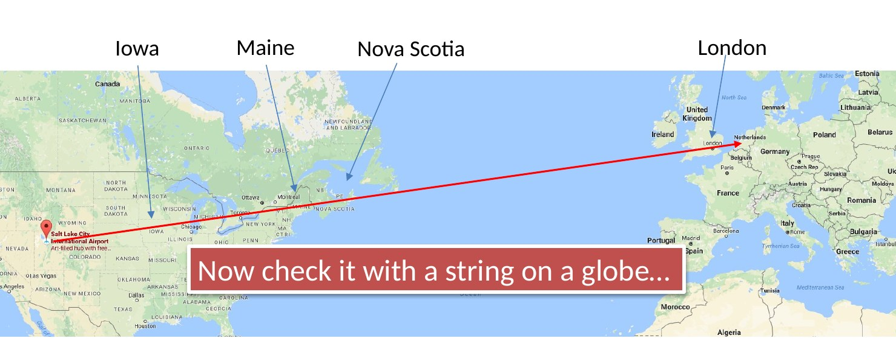

<!-- Do this first, before they look at the globes. On a flat wall map the straight line from Salt Lake to London runs over Iowa, Maine, Nova Scotia. Everyone will give some version of that answer, because that is what the map in their head looks like. -->

---

# Now check it with a string on a globe

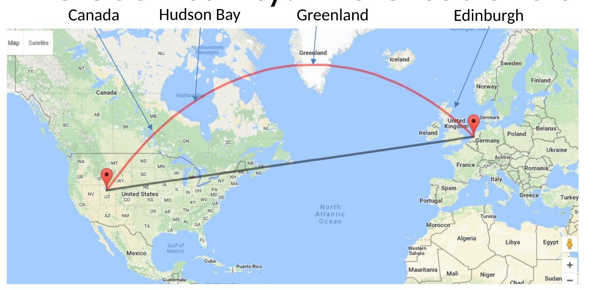

<!-- Hand out globes, one per three students, and a piece of string. The shortest path from Salt Lake City to Edinburgh runs up over Canada, Hudson Bay, and Greenland. Ask them to explain why. The shortest path on a sphere is a great circle, and the flat map turned that curve into something that looked wrong. This is the whole course in one activity: the map is not the Earth. -->

---

# Problem 1: humans perceive the Earth's surface as flat

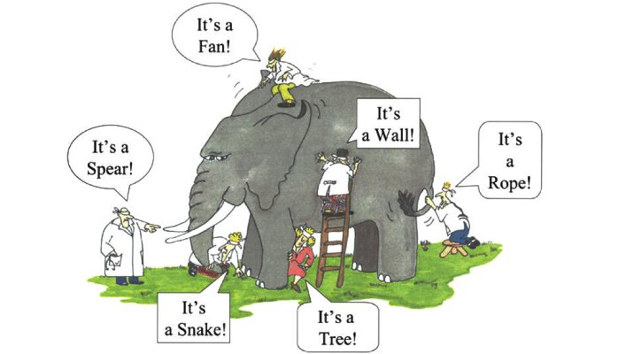

- At our scale, we don't see the curve of the Earth
- Each of us measures a small patch and reports what we felt
- Every local measurement is *correct*, and none of them is the whole shape

<!-- The blind men and the elephant. A surveyor working a half-mile site can treat the Earth as a plane and be right to within their instrument's precision. Stitch enough of those flat patches together across a continent and they no longer fit. -->

---

# It's a very old idea, and a persistent one

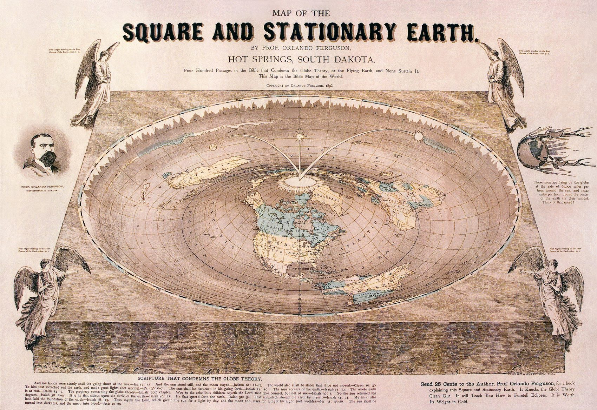

- Orlando Ferguson's *Square and Stationary Earth* (1893), sold as scriptural proof
- And it is still a thing: the Flat Earth Society has an active social-media following

<!-- Fun fact: some have argued the Earth is flat to validate biblical language such as "the four corners of the earth." The point for us is not to mock it, it is that flatness is the intuitive model, and geodesy is the work of getting past intuition. -->

---

<!-- _class: lead -->

# Part 2

## Map projections and distortion

<!-- Anime-style cartoon generated with gpt-image-2.5-flare, October 2026; prompt in tools/divider-images/gap-fill-2026-10.json. -->

---

# Projections

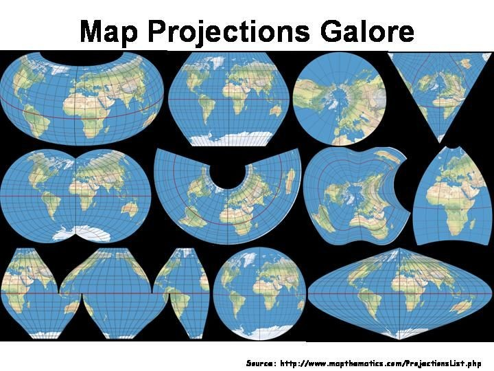

- **Question:** how do we represent the curved Earth on a flat map?
- A **map projection** is a mathematical rule that turns latitude and longitude into flat *x, y*
- There are hundreds of them, and none is "correct"
- Watch one become another: [jasondavies.com/maps/transition](https://www.jasondavies.com/maps/transition/)

<!-- Run the Jason Davies transitions page here for a minute. The point is that these are all the same data; the differences are all choices about distortion. -->

---

# Geographic vs. projected coordinate systems

**Geographic (GCS)**

- Coordinates are **angles**: latitude and longitude
- Measured on an ellipsoid, from a **datum**
- Degrees, not meters — a degree of longitude is 111 km at the equator and 0 km at the pole
- Example: WGS 84 (EPSG:4326)

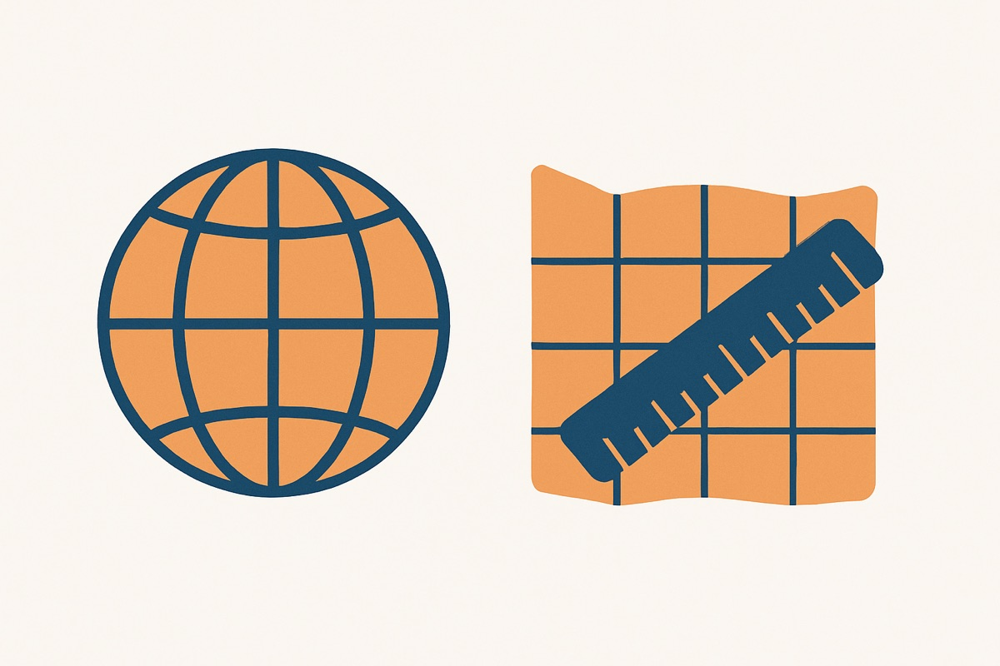

**Projected (PCS)**

- Coordinates are **distances**: easting and northing
- A GCS **plus** a projection
- Meters or feet, so you can compute length and area directly
- Example: UTM Zone 12N, NAD 83 (EPSG:26912)

<!-- Every projected coordinate system is built on a geographic one; you need both halves to place a point. This is the slide students should photograph. In QGIS the CRS chooser shows both kinds in one list, which is exactly why people mix them up. QGIS measures on the ellipsoid by default, so area in EPSG:4326 still comes out right; switch the project to Planimetric measurement and a layer in degrees gives square degrees, which mean nothing. Thursday's hands-on shows both. -->

---

# Every projection distorts something

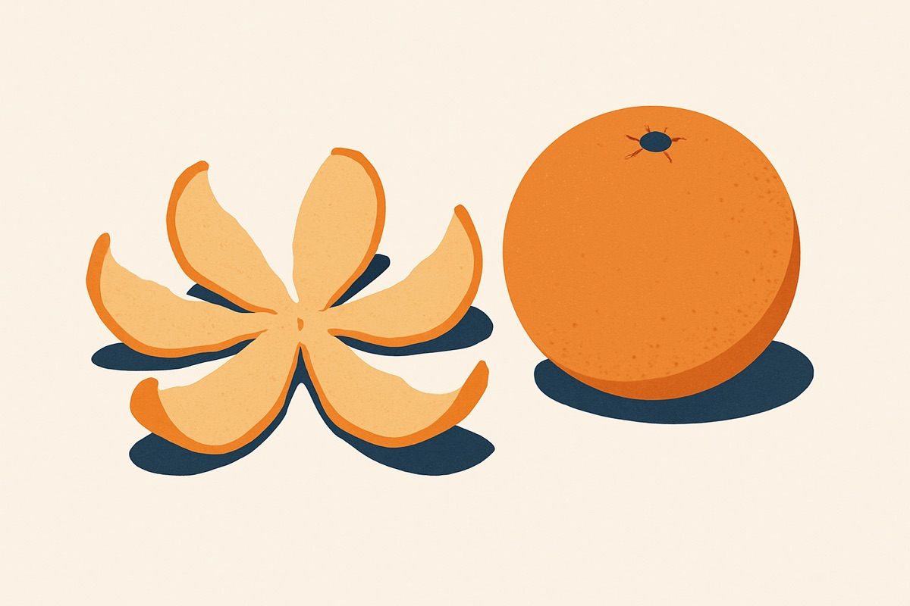

- A flat map cannot preserve all four of these at once:
  - **Shape** (angles) — a *conformal* projection preserves it locally
  - **Area** — an *equal-area* projection preserves it
  - **Distance** — an *equidistant* projection preserves it, but only from certain points or along certain lines
  - **Direction** — an *azimuthal* projection preserves it from the center
- So the real question is never "which projection is right?" but **"what am I willing to distort?"**
- Distortion is smallest near where the projection surface touches the globe, and grows with distance from it

<!-- Write the four words on the board and leave them up. The rest of the hour is an application of the last bullet: find where the surface touches, and ask how far your area of interest is from it. -->

---

# The world you have been looking at

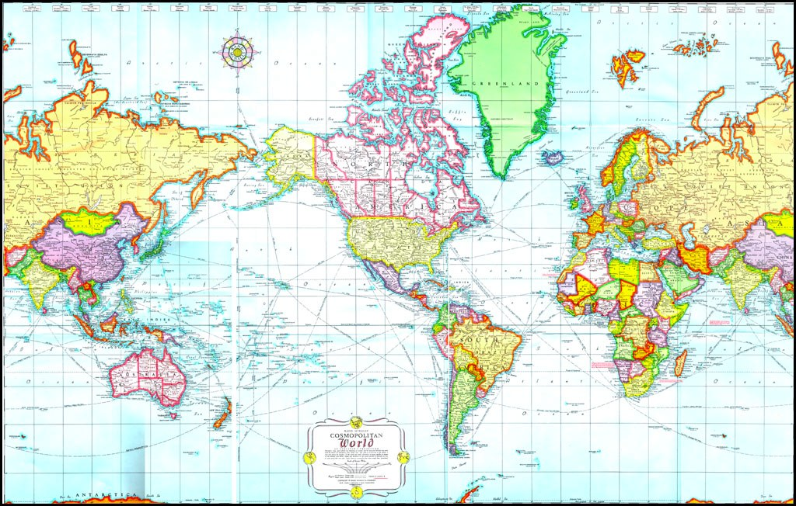

Greenland looks about the size of Africa. Is it? [thetruesize.com](https://www.thetruesize.com/)

<!-- A typical classroom map of the world, in Mercator. What is the dominant feature? Russia, Canada, and Greenland look like the dominant countries on Earth. Ask what Greenland is closest in size to (Africa, Delaware, Russia, Mexico): it is Mexico, about 2.2 million km2 to Mexico's 2.0 million, while Africa is fourteen times larger. Open thetruesize.com and drag Greenland down to the equator, then drag Africa up to the Arctic. Mercator's virtue is that a line of constant compass bearing is a straight line, which is why it won the age of sail and why it is still the default for web maps. -->

---

# The Peters map: equal area, not equal shape

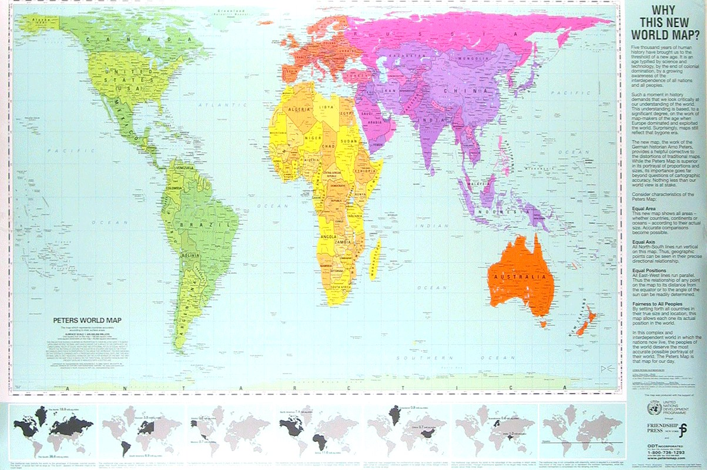

<!-- This is the Peters map. It is not conic and it is not Mercator: it is a cylindrical equal-area projection. The north-south spacing of the parallels is compressed so that every country keeps its correct relative area. North-south and east-west directions are maintained and area is maintained; shape is squashed, so it is not conformal. It was promoted for political reasons, to communicate the relative importance of countries by their true size. -->

---

# How do projections work?

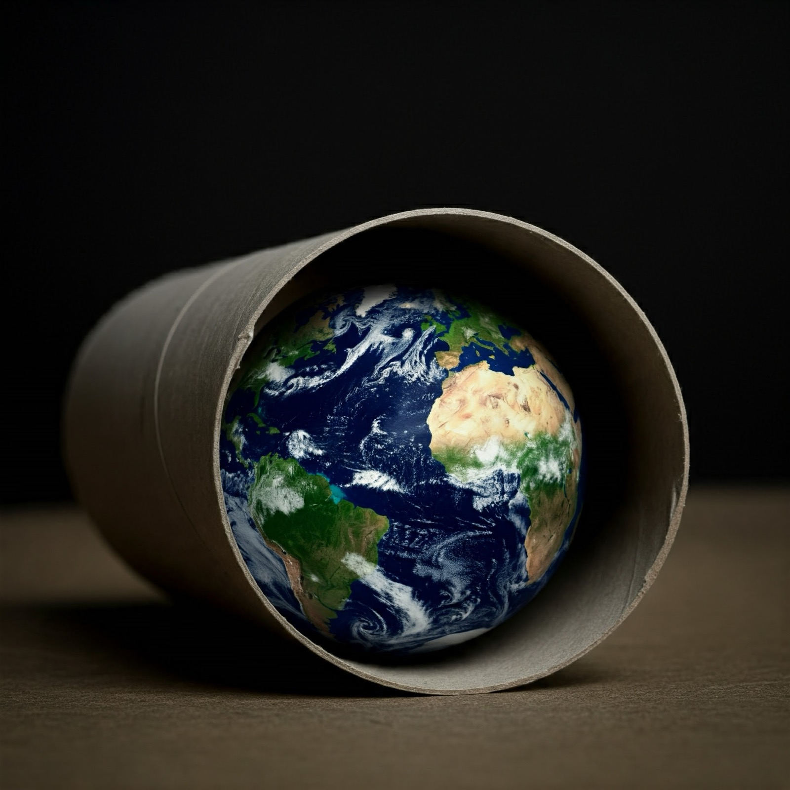

<!-- AI-generated image from the Fall 2024 deck. Put the globe in a tube: if a light at the center cast the coastlines out onto the paper, where would the picture be true, and where stretched? True where the paper touches the globe, worse the farther away it gets. Unroll the tube and you have a cylindrical projection. The next slide is the textbook version of the same picture. -->

---

# How do we get a map like that? A projection surface

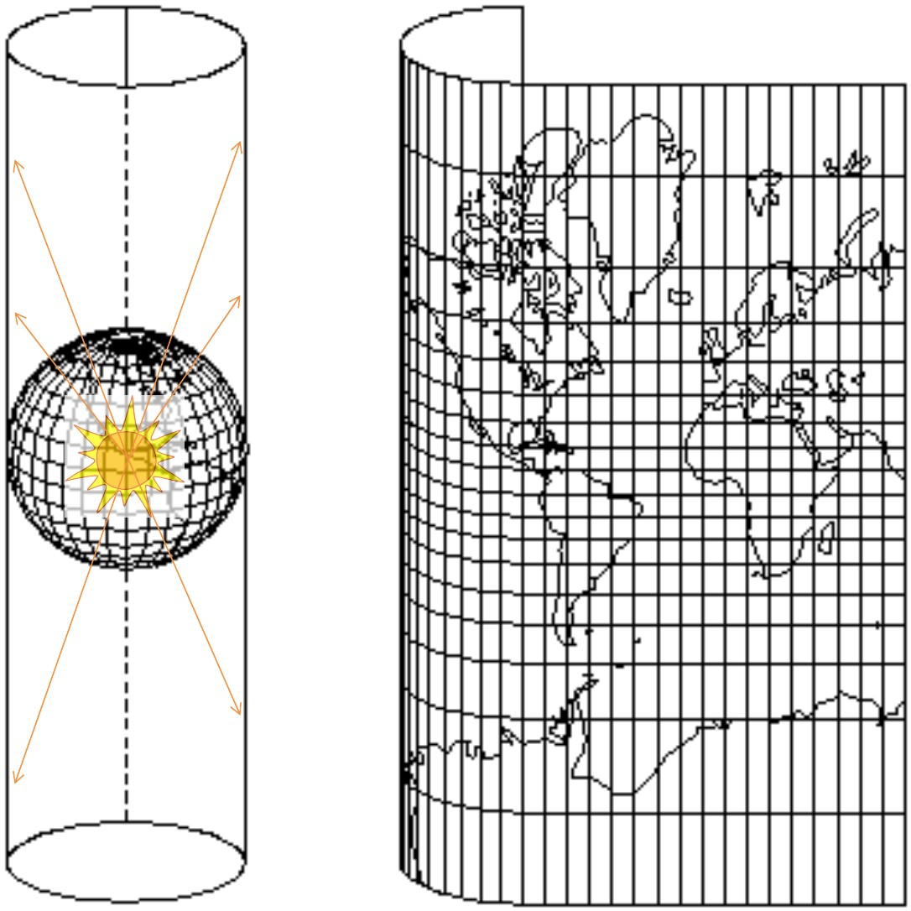

<!-- Put a light at the center of the globe, wrap a sheet of paper into a cylinder around it, and trace where the graticule falls on the paper. Unroll the cylinder and you have a flat map. Everything that follows is a variation on the shape of that sheet and where it touches the globe. -->

---

# Tangent or secant?

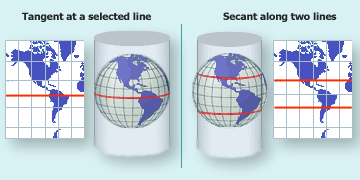

- **Tangent**: touches the globe along **one** line — zero distortion there
- **Secant**: cuts through, touching along **two** lines — distortion spread over a wider band

<!-- The red lines are the lines of true scale. Secant is the usual engineering choice: you accept a small error over a wide area instead of no error in one place and a large error everywhere else. -->

---

# Transverse and oblique Mercator

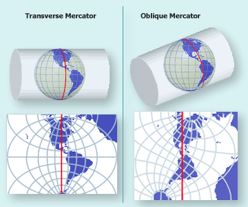

<!-- Two other cylindrical variants: transverse (the cylinder is rotated 90 degrees, so it touches along a meridian) and oblique (rotated to any angle). In each case there is a ring around the globe where distortion is minimized. Now ask the key question: what if you could re-center that line over your area of interest? What if you rotated the transverse cylinder all the way around, stopping every 6 degrees? -->

---

# UTM zones: 60 of them, 6° wide

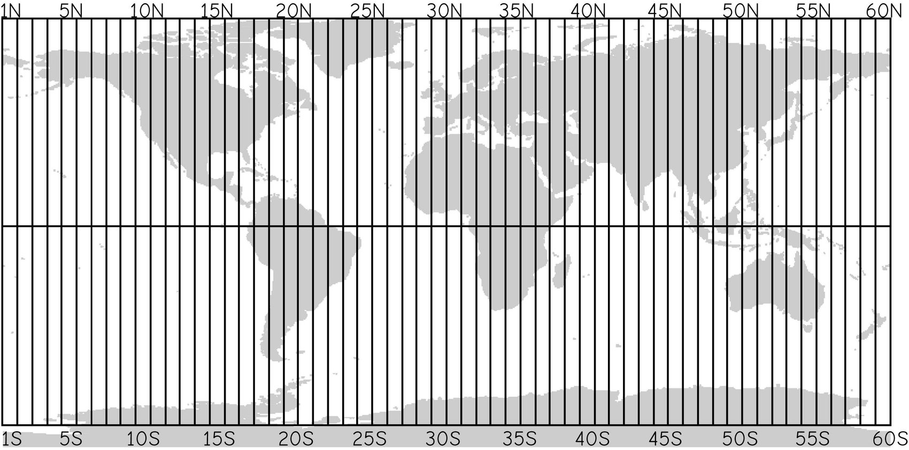

<!-- Sixty zones, each 6 degrees of longitude wide, numbered eastward from the antimeridian. Each zone is its own projection with its own central meridian, which is why UTM coordinates are meaningless until you say which zone. -->

---

# Line of least distortion for UTM Zone 12

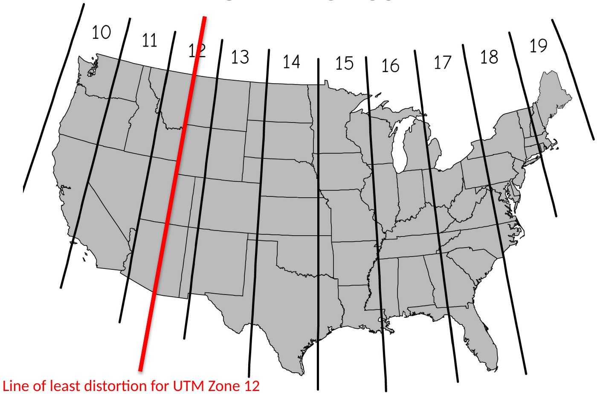

<!-- The red line is the central meridian of Zone 12, at 111 degrees west. That is the line of least distortion, and it runs right down the middle of Utah, which is why UTM Zone 12N is a perfectly good working CRS for most of this state. Distortion grows toward the zone edges, and nothing about UTM favors one hemisphere. A site that straddles two zones, which happens along the Utah-Colorado line, means picking one zone and accepting the error at the far edge, or moving to State Plane or a custom projection. -->

---

<!-- idaho-utm:begin -->
<!-- the map is generated by tools/make_idaho_utm_svg.py; re-run it and paste between these markers -->

# One state, two UTM zones: Idaho

- Idaho straddles the **UTM 11 / 12** line at **114° W**
- Pick either zone and part of the state falls **outside** it
- Idaho's answer: **IDTM**, one Transverse Mercator zone for the whole state
- Its central meridian is **114° W**: UTM's worst line is IDTM's best

<svg xmlns="http://www.w3.org/2000/svg" viewBox="0 0 620 560" width="620" height="560" font-family="inherit"><defs><clipPath id="id-badge-clip"><rect x="456" y="14" width="150" height="138" rx="14"/></clipPath></defs><rect width="620" height="560" rx="14" fill="#f4f7fa"/><path d="M189.3,86.3L183.9,218.7L187.3,224.9L188.3,229.8L186.3,232.7L189.0,238.0L114.1,234.4L110.7,236.8L93.6,236.7L90.3,239.3L80.6,240.3L73.6,242.3L69.7,244.6L61.1,245.3L55.5,243.9L54.0,245.1L45.6,247.5L40.7,246.5L36.4,247.7L35.0,244.3L32.7,242.9L24.7,241.4L40.7,76.0L189.3,86.3ZM64.1,434.5L58.1,520.5L0.0,516.0L7.5,430.0L64.1,434.5ZM32.7,242.9L35.0,244.3L36.4,247.7L40.7,246.5L45.6,247.5L54.0,245.1L55.5,243.9L61.1,245.3L69.7,244.6L73.6,242.3L80.6,240.3L90.3,239.3L93.6,236.7L110.7,236.8L114.1,234.4L189.0,238.0L190.3,242.7L193.0,246.4L195.5,247.1L200.9,251.1L203.1,256.7L203.4,258.8L196.0,271.4L193.3,281.2L189.0,287.5L189.2,290.5L187.5,295.5L184.9,299.3L181.3,302.0L177.6,311.0L174.5,314.5L173.9,318.9L174.5,323.8L176.4,325.6L177.9,324.2L179.9,326.0L182.5,325.6L182.8,327.9L185.3,330.4L184.1,333.5L182.3,334.2L183.4,338.4L181.9,344.6L179.5,347.8L176.7,440.4L7.5,430.0L24.7,241.4L32.7,242.9ZM289.0,528.4L289.0,442.4L401.9,440.5L403.7,491.1L480.5,487.6L482.5,523.0L289.0,528.4ZM395.2,313.2L391.5,309.4L391.0,307.0L387.7,302.5L385.3,301.4L382.2,303.6L382.7,306.0L381.2,307.2L380.9,310.2L382.6,311.4L382.5,311.9L375.0,311.3L370.0,313.4L367.7,311.7L360.1,313.1L354.2,311.7L351.1,313.4L350.1,316.7L349.0,317.4L338.4,315.2L335.8,316.1L333.3,318.8L333.8,321.2L332.8,321.8L327.0,317.4L326.5,315.7L327.1,314.0L324.3,310.1L325.1,308.0L321.6,301.7L318.2,299.6L314.6,300.9L314.2,299.6L311.0,297.4L309.3,293.9L310.7,292.3L310.8,289.4L308.3,284.3L306.4,283.9L305.2,280.2L300.8,274.9L300.8,271.3L299.4,269.8L299.0,268.4L299.2,264.8L297.3,263.4L298.1,260.7L297.6,259.8L294.8,258.5L294.3,257.2L291.0,255.0L290.7,257.4L288.9,258.3L286.7,261.5L282.7,263.0L280.0,266.0L278.5,265.9L274.6,262.2L271.2,261.5L271.8,260.1L271.4,258.5L272.9,256.9L273.1,254.8L271.7,252.9L271.1,250.8L273.1,247.7L275.7,247.1L276.9,245.5L275.9,243.5L276.3,240.6L273.9,239.2L273.6,237.0L274.7,234.4L272.9,231.8L275.4,230.2L274.6,226.2L277.6,216.9L276.6,214.5L278.8,212.8L279.3,206.2L278.1,205.6L274.2,207.0L270.8,207.2L268.4,205.7L268.9,203.4L267.5,201.9L264.1,203.5L263.9,200.6L259.1,197.1L258.8,193.0L254.2,189.2L253.9,187.8L249.4,181.7L246.4,179.0L244.6,175.5L239.0,173.4L236.0,169.1L231.4,166.3L231.7,165.3L234.3,164.4L231.2,160.5L233.2,158.0L231.8,155.1L231.8,153.2L228.4,149.2L227.4,145.8L224.6,143.2L221.0,137.5L222.3,87.4L573.8,72.4L595.9,274.5L396.5,288.6L397.4,314.0L395.2,313.2ZM289.0,442.4L289.0,528.4L58.1,520.5L64.1,434.5L289.0,442.4ZM403.7,491.1L396.5,288.6L595.9,274.5L616.5,477.1L403.7,491.1ZM616.5,477.1L620.0,512.5L482.5,523.0L480.5,487.6L616.5,477.1Z" fill="#e3e8ee" stroke="#ffffff" stroke-width="1.5"/><path d="M222.3,87.4L221.0,137.5L224.6,143.2L227.4,145.8L228.4,149.2L231.8,153.2L231.8,155.1L233.2,158.0L231.2,160.5L234.3,164.4L231.7,165.3L231.4,166.3L236.0,169.1L239.0,173.4L244.6,175.5L246.4,179.0L249.4,181.7L253.9,187.8L254.2,189.2L258.8,193.0L259.1,197.1L263.9,200.6L264.1,203.5L267.5,201.9L268.9,203.4L268.4,205.7L270.8,207.2L274.2,207.0L278.1,205.6L279.3,206.2L278.8,212.8L276.6,214.5L277.6,216.9L274.6,226.2L275.4,230.2L272.9,231.8L274.7,234.4L273.6,237.0L273.9,239.2L276.3,240.6L275.9,243.5L276.9,245.5L275.7,247.1L273.1,247.7L271.1,250.8L271.7,252.9L273.1,254.8L272.9,256.9L271.4,258.5L271.8,260.1L271.2,261.5L274.6,262.2L278.5,265.9L280.0,266.0L282.7,263.0L286.7,261.5L288.9,258.3L290.7,257.4L291.0,255.0L294.3,257.2L294.8,258.5L297.6,259.8L298.1,260.7L297.3,263.4L299.2,264.8L299.0,268.4L299.4,269.8L300.8,271.3L300.8,274.9L305.2,280.2L306.4,283.9L308.3,284.3L310.8,289.4L310.7,292.3L309.3,293.9L311.0,297.4L314.2,299.6L314.6,300.9L318.2,299.6L321.6,301.7L325.1,308.0L324.3,310.1L327.1,314.0L326.5,315.7L327.0,317.4L332.8,321.8L333.8,321.2L333.3,318.8L335.8,316.1L338.4,315.2L349.0,317.4L350.1,316.7L351.1,313.4L354.2,311.7L360.1,313.1L367.7,311.7L370.0,313.4L375.0,311.3L382.5,311.9L382.6,311.4L380.9,310.2L381.2,307.2L382.7,306.0L382.2,303.6L385.3,301.4L387.7,302.5L391.0,307.0L391.5,309.4L395.2,313.2L397.4,314.0L401.9,440.5L176.7,440.4L179.5,347.8L181.9,344.6L183.4,338.4L182.3,334.2L184.1,333.5L185.3,330.4L182.8,327.9L182.5,325.6L179.9,326.0L177.9,324.2L176.4,325.6L174.5,323.8L173.9,318.9L174.5,314.5L177.6,311.0L181.3,302.0L184.9,299.3L187.5,295.5L189.2,290.5L189.0,287.5L193.3,281.2L196.0,271.4L203.4,258.8L203.1,256.7L200.9,251.1L195.5,247.1L193.0,246.4L190.3,242.7L188.3,235.7L186.3,232.7L188.3,229.8L187.3,224.9L183.9,218.7L189.3,86.3L222.3,87.4Z" fill="#c9dcef" stroke="#002e5d" stroke-width="2.5" stroke-linejoin="round"/><g fill="none" stroke="#5a6b7d" stroke-width="2" stroke-dasharray="7 6"><path d="M58.2,520.5L59.0,508.2L59.8,495.8L60.7,483.5L61.5,471.2L62.4,458.8L63.3,446.5L64.1,434.2L65.0,421.8L65.9,409.5L66.8,397.2L67.6,384.8L68.5,372.5L69.4,360.2L70.3,347.8L71.2,335.5L72.1,323.2L73.0,310.9L73.9,298.5L74.8,286.2L75.7,273.9L76.7,261.5L77.6,249.2L78.5,236.9L79.5,224.5L80.4,212.2L81.3,199.9L82.3,187.5L83.2,175.2L84.2,162.9L85.1,150.5L86.1,138.2L87.1,125.9L88.0,113.6L89.0,101.2L90.0,88.9L90.9,76.6L91.9,64.2L92.9,51.9L93.9,39.6"/><path d="M290.6,528.4L290.6,516.1L290.6,503.7L290.6,491.4L290.6,479.1L290.6,466.8L290.6,454.4L290.6,442.1L290.6,429.8L290.6,417.5L290.6,405.1L290.6,392.8L290.6,380.5L290.6,368.2L290.6,355.8L290.6,343.5L290.6,331.2L290.6,318.8L290.6,306.5L290.6,294.2L290.6,281.9L290.6,269.5L290.6,257.2L290.6,244.9L290.6,232.5L290.6,220.2L290.6,207.9L290.6,195.5L290.6,183.2L290.6,170.8L290.6,158.5L290.6,146.2L290.6,133.8L290.6,121.5L290.6,109.2L290.6,96.8L290.6,84.5L290.6,72.1L290.6,59.8L290.6,47.4"/><path d="M523.1,520.5L522.2,508.2L521.4,495.8L520.5,483.5L519.7,471.2L518.8,458.8L517.9,446.5L517.1,434.2L516.2,421.8L515.3,409.5L514.5,397.2L513.6,384.8L512.7,372.5L511.8,360.2L510.9,347.8L510.0,335.5L509.1,323.2L508.2,310.9L507.3,298.5L506.4,286.2L505.5,273.9L504.5,261.5L503.6,249.2L502.7,236.9L501.8,224.5L500.8,212.2L499.9,199.9L498.9,187.5L498.0,175.2L497.0,162.9L496.1,150.5L495.1,138.2L494.2,125.9L493.2,113.6L492.2,101.2L491.2,88.9L490.3,76.6L489.3,64.2L488.3,51.9L487.3,39.6"/></g><g font-size="17" font-weight="700" fill="#5a6b7d" text-anchor="middle"><text x="175" y="504">UTM 11</text><text x="406" y="504">UTM 12</text><text x="560" y="495">UTM 13</text></g><rect class="id-band" x="169.2" y="76.3" width="242.7" height="376.0" rx="6" fill="#e8590c" fill-opacity="0.16" stroke="#e8590c" stroke-width="3" stroke-dasharray="10 6"/><path class="id-cm" d="M290.6,528.4L290.6,516.1L290.6,503.7L290.6,491.4L290.6,479.1L290.6,466.8L290.6,454.4L290.6,442.1L290.6,429.8L290.6,417.5L290.6,405.1L290.6,392.8L290.6,380.5L290.6,368.2L290.6,355.8L290.6,343.5L290.6,331.2L290.6,318.8L290.6,306.5L290.6,294.2L290.6,281.9L290.6,269.5L290.6,257.2L290.6,244.9L290.6,232.5L290.6,220.2L290.6,207.9L290.6,195.5L290.6,183.2L290.6,170.8L290.6,158.5L290.6,146.2L290.6,133.8L290.6,121.5L290.6,109.2L290.6,96.8L290.6,84.5L290.6,72.1L290.6,59.8L290.6,47.4" pathLength="1" stroke-dasharray="1" fill="none" stroke="#c92a2a" stroke-width="4"/><g class="id-tag" font-weight="700" text-anchor="middle"><text x="291" y="66" font-size="19" fill="#c92a2a">IDTM, centered on 114° W</text></g><g class="id-badge"><image href="images/crs-tater-mercator-badge.jpg" x="456" y="14" width="150" height="138" clip-path="url(#id-badge-clip)" preserveAspectRatio="xMidYMid slice"/><rect x="456" y="14" width="150" height="138" rx="14" fill="none" stroke="#ffffff" stroke-width="5"/></g></svg>

<!-- When the slide opens, the IDTM zone grows out from its central meridian and the Tater Mercator shirt (a gift from students) pops in with it. Idaho runs from about 117.2 to 111.05 degrees west, so the UTM boundary at 114 W cuts it roughly in half. IDTM is NAD83 / Idaho Transverse Mercator, EPSG:8826: central meridian 114 W, scale factor 0.9996, latitude of origin 42 N, false easting 2,500,000 m and false northing 1,200,000 m. Statewide agencies use it so the whole state sits in one projected system. Montana is the extreme case: it spans three UTM zones (11, 12, and 13) and uses a single State Plane zone instead. -->

<!-- idaho-utm:end -->

---

# Conic surfaces: tangent and secant

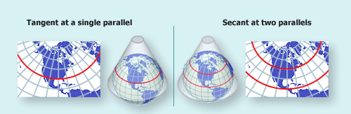

<!-- Same idea with a cone instead of a cylinder. Tangent at a single parallel, or secant at two parallels. Cones fit mid-latitude regions that are wider east-west than north-south, which describes most of the United States. -->

---

# Standard parallels and the central meridian

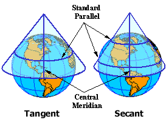

<!-- The parallels where the cone touches are the standard parallels: those are the lines of true scale. The central meridian is the line of symmetry. When you pick a conic CRS in QGIS these are the numbers in its definition, and they are chosen to bracket the area you care about. Lambert conformal conic, tangent or secant, is the conic you will meet most; conformal means shape and angle are preserved locally, which is what you want for surveying and engineering drawings. -->

---

# Scale error on a conic projection

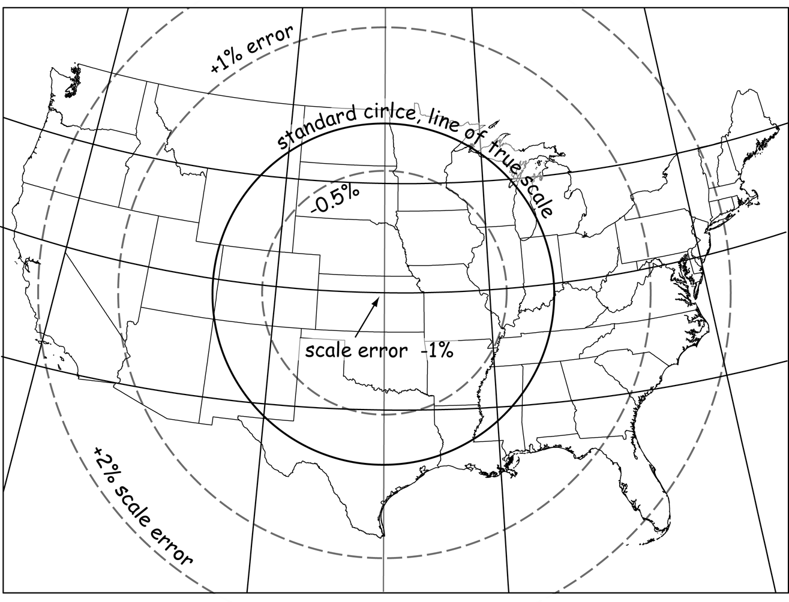

<!-- The solid circle is the standard circle, the line of true scale. The dashed contours are 0.5%, 1%, and 2% scale error. Distortion depends only on distance from that circle, so any two places sitting on the same contour are equally distorted, no matter which direction they lie in. Southeastern Florida and northeastern Washington sit on about the same contour, so they carry about the same distortion; a line from Utah to Kentucky crosses the standard circle, so the error along it varies a lot. What matters is not the compass direction from the center, it is the distance from the line of true scale. -->

---

# Match the surface to the shape: Tennessee

**UTM Zone 16**: true scale runs north–south, across the narrow width

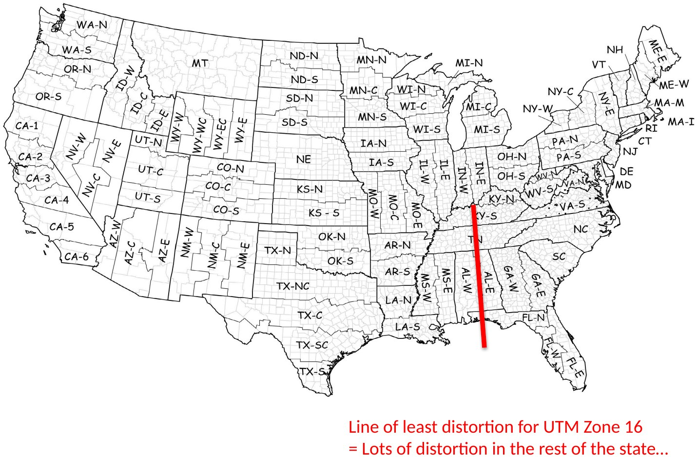

**Lambert conformal conic**: true scale runs east–west, along the long axis

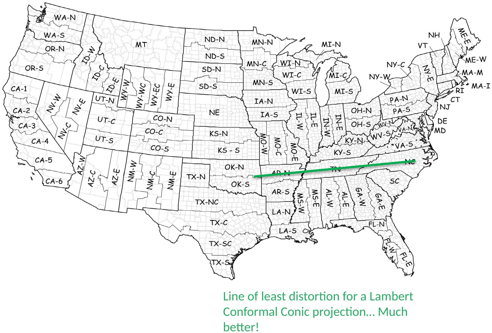

- Long **east–west** → **conic**; long **north–south** → **transverse cylindrical**, such as UTM

<!-- Tennessee is a long, thin, east-west state. Ask which they would pick before you point at the lines. The UTM Zone 16 central meridian touches the state for about eighty miles and leaves the rest of it a long way from true scale; a conic with standard parallels running east-west puts the line of least distortion along the long axis. That is exactly what the Tennessee State Plane zone does, and why the background of both maps is the State Plane zone map: someone already did this analysis for every state. -->

---

# State Plane Coordinate System (SPCS)

- One or more zones **per state**, each with its own projection
- **East-west** states get **Lambert conformal conic**; **north-south** states get **Transverse Mercator**
- Zones are kept small so scale error stays under about **1 part in 10,000**
- Traditionally in **survey feet**; check the units before you compute anything
- Utah has three zones: **North, Central, South**

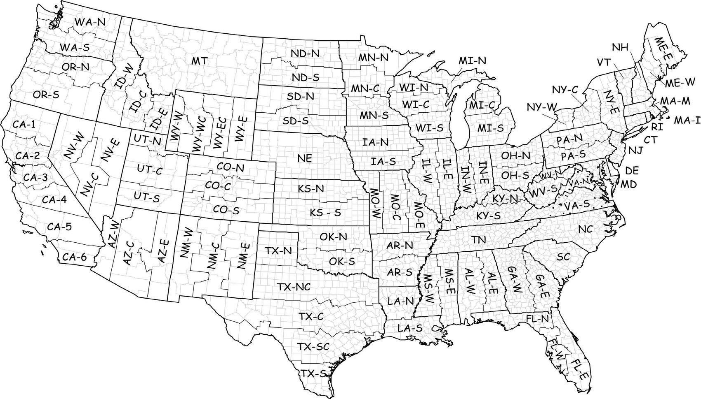

<!-- The trade: UTM is one system for the whole world with moderate accuracy, State Plane is a patchwork tuned for high accuracy inside each state. Civil and survey work in the U.S. is usually specified in State Plane; regional and environmental work is usually UTM. Utah Central, NAD 83, is what most Utah County engineering data arrives in. -->

---

<!-- _class: lead -->

# Part 3

## The shape of the Earth: geoid, ellipsoid, datum

<!-- Anime-style cartoon generated with gpt-image-2.5-flare, October 2026; prompt in tools/divider-images/week08.json. -->

---

# Problem: the Earth has an irregular shape

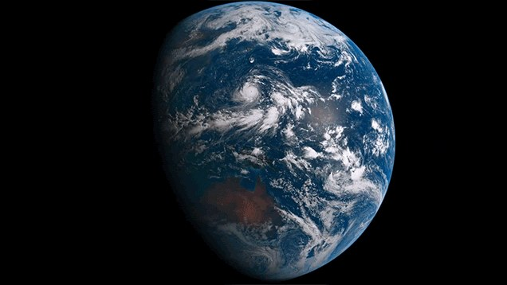

<!-- We have been drawing the Earth as a perfect sphere all hour. It is not one. It is not even a perfect ellipsoid. Every projection is built on a mathematical figure that only approximates the real thing. -->

---

# So then… what is the "geoid"?

- An **equigravitational surface**
- An imaginary surface of the Earth based on the **expected sea surface level everywhere**
- Sea surface level varies because **gravity** varies
- Gravity varies because **earth density** varies
- The geoid is the closest description of the real Earth; the **ellipsoid** is the closest *mathematical* one, and the one coordinates are computed on

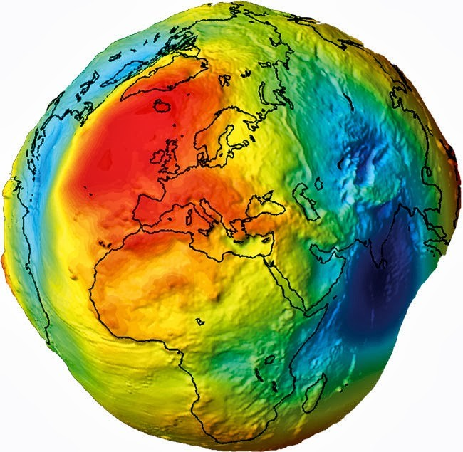

<!-- The Earth is not really shaped like this: the relief in the picture is exaggerated enormously to make the geoid visible. The real departures from an ellipsoid are on the order of a hundred meters. This is the surface your elevations are measured from, which is why orthometric height and ellipsoid height are different numbers for the same point. -->

---

# One benchmark, three NAD 83 coordinates

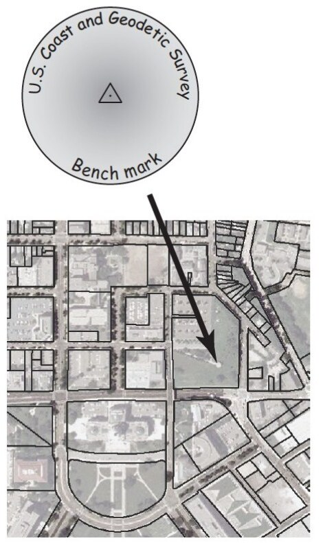

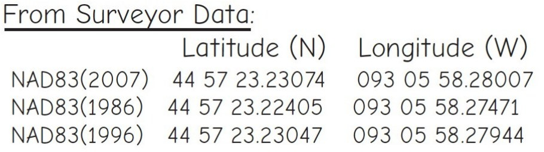

- Same brass disc, same spot on the ground
- Three published positions, up to about **20 cm** apart
- The monument did not move; the **datum** was re-measured and re-fit

<!-- The same physical benchmark carries three different NAD 83 coordinates, one per realization (1986, 1996, 2007). The latitudes differ by up to 0.0067 seconds, about 21 cm on the ground, and the longitudes by about 12 cm. The monument did not move; the reference surface it is measured against was re-surveyed and re-fit each time. A datum is an ellipsoid plus the anchoring that ties it to the actual Earth, and "NAD 83" alone does not say which anchoring. The next slide shows how big that effect is across the whole country. -->

---

# NAD 83 (2007) versus NAD 83 (2011): horizontal

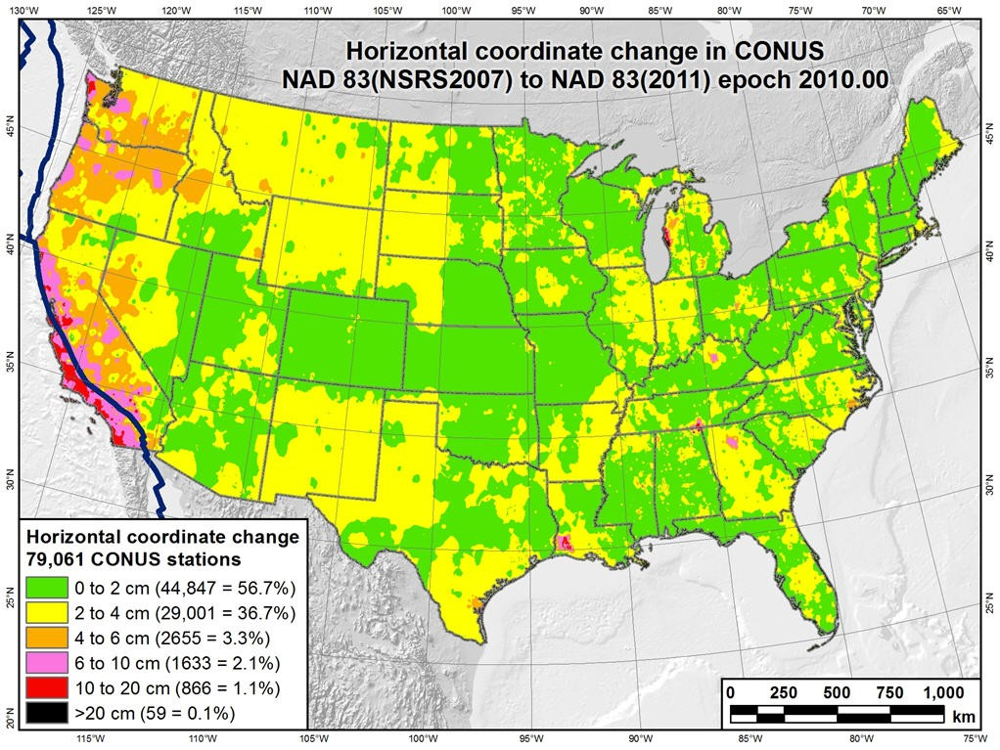

<!-- Horizontal coordinate change across 79,061 CONUS stations between the two realisations. Most of the country moved 0 to 4 cm; the west coast moved much more. Same datum name, different numbers. -->

---

# How to deal with it? Let the GIS handle it

In **QGIS**:

- **Project → Properties → CRS** sets the project CRS
- Layers keep their own CRS; QGIS reprojects **on the fly** for display
- **Layer → Set CRS** only *declares* a CRS — it does not move the data
- **Processing Toolbox → Reproject Layer** actually writes reprojected data
- If a layer is *declared* wrong, no transformation will save it

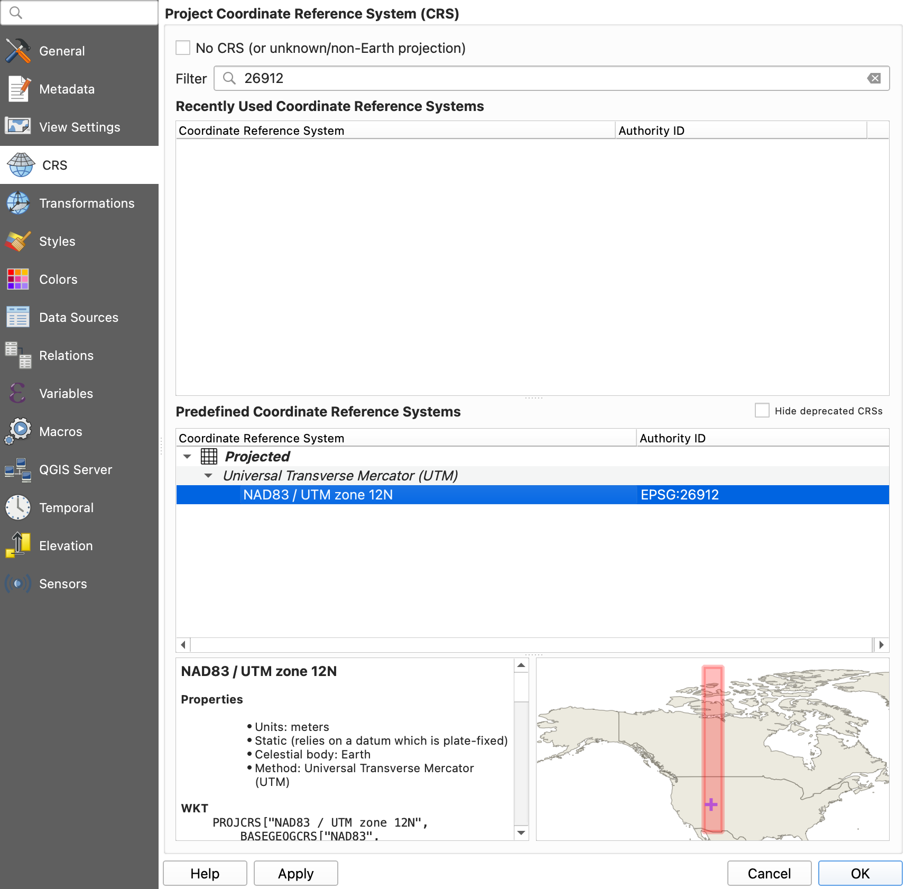

<!-- The screenshot is the QGIS 3.44 Project Properties, CRS page, filtered to 26912 with NAD83 / UTM zone 12N selected, the same dialog students use in Lab 4. Datum transformation choices live on the Transformations page just below it. Emphasize the distinction between declaring a CRS and reprojecting, because it is the single most common student mistake in Lab 7. -->

---

# Public Land Survey System (PLSS)

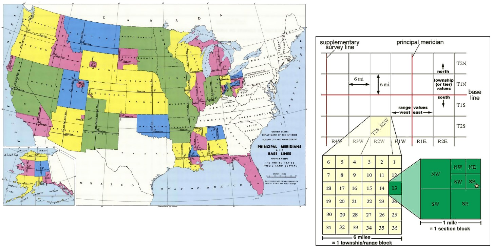

<!-- A lot of western U.S. civil engineering happens at the local scale using the PLSS: township, range, and section, measured from a principal meridian and base line. A section is one square mile and a township is 36 sections. It is not a coordinate system in the projected sense, but legal descriptions and parcel data are written in it, so you will meet it. -->

---

# Choosing a coordinate system

- Ask, in order:
  1. **Where** is the project, and how big is it?
  2. What am I going to **measure** — lengths, areas, angles?
  3. What CRS is my **incoming data** already in, and what does the client require?
- Rules of thumb:
  - Global or web display → **Web Mercator** (EPSG:3857); never compute area in it
  - Regional, a few hundred km → **UTM** zone, NAD 83 or WGS 84
  - A single U.S. state, survey-grade → **State Plane**, in that state's zone and units

<!-- Fourth rule of thumb, say it aloud: anything with lat/long in degrees is a geographic CRS, fine for storage and wrong for measurement. This is the slide that answers "what do I put in the QGIS box?" It is also, more or less, the rubric for the Lab 7 write-up. -->

---

<!-- _class: activity -->

# Thursday: hands-on in QGIS

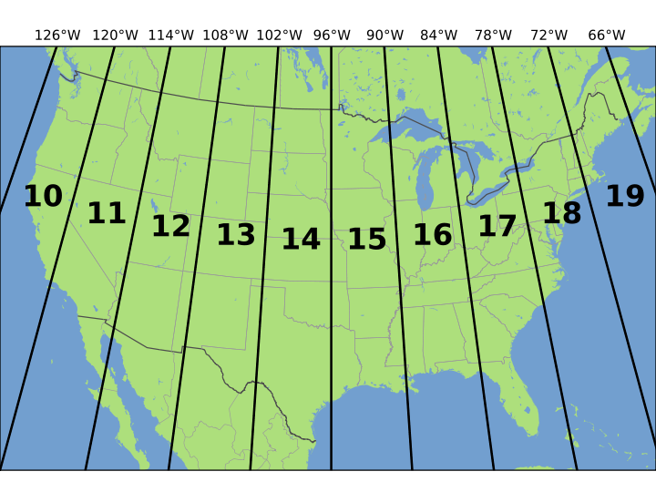

- Explore projections in **QGIS**:
  - Set the **project CRS**, and see what changes
  - Inspect each **layer's CRS**, and see what does not change
  - Watch **on-the-fly reprojection** line up layers that are stored differently
  - **Reproject** a layer for real, and compare measured lengths and areas before and after
- Then **choose a projection for an engineering problem** and justify it

<!-- Preview of Thursday. The choose-a-projection exercise is the bridge into Lab 7. -->

---

<!-- _class: activity -->

# Final Thoughts

**Quiz: Why Is Greenland So Big?** Eight questions on your phone: what every flat map **gives up**, fitting the **surface** to the ground, and the shape underneath and the **CRS box** in QGIS. **Scan the code**, or open the link under it.

- Not graded, and every answer explains itself
- Good practice for this week's open-book quiz

**Before next class**

- Read **Chapter 3, *Geodesy, Datums, Map Projections, and Coordinate Systems***, in *GIS Fundamentals*
- Take **Quiz 6, Map Projections and Coordinate Systems**, open book, on Learning Suite — **due Saturday**
- **Lab 7: Projections and Coordinate Systems** — also **due Saturday**:
  [Lab 7 instructions](https://byu-hydroinformatics.github.io/cce114-geomatics/assignments/lab-07/)
- Questions? Office hours: [calendly.com/dan-ames/office-hours](https://calendly.com/dan-ames/office-hours)

byu-hydroinformatics.github.io/cce114-geomatics/quizzes/projections/

<!-- Confirm the Saturday due dates against Learning Suite before class. Point students at The True Size and the Jason Davies transitions page again; they are the fastest way to build intuition before the lab. -->

<!-- Conversion notes (2026-09-02): converted from "Coordinate Systems and Projections.pptx" (2021 archive, 51 slides). Dropped: source slide 8, a screenshot of the Flat Earth Society Facebook page showing the presenter's logged-in account, folded into a bullet on the Ferguson map slide; source slide 11, hidden in the original, an equal-area globe-drawing activity that could be restored if there is time. Added, not in the source: Today's Goals, geographic vs. projected coordinate systems, "every projection distorts something", the State Plane summary slide, "choosing a coordinate system", the Thursday preview, and Before Next Class. Software wording updated from ArcGIS to QGIS throughout. ArcGIS screenshots still in the deck: images/crs-arcgis-transformation-dialog.png on the "How to deal with it" slide, which needs a QGIS re-shoot. Open TODO: find a QGIS equivalent for the ArcGIS Pro Tissot-circle demo referenced on the "Things to play with" slide. -->

<!-- Update 2026-10-20: cut from 58 lecture slides to 36. Dropped the in-deck multiple-choice quizzes (geodesy, Greenland, conic, UTM, Tennessee, registration, ellipsoid) and the eight full-screen projection-surface identification slides; their teaching points moved into the notes of the slides they relied on, and the Final Thoughts self-check quiz carries the practice. Also dropped as duplicates: A round Earth on flat paper, the plain Mercator slide, the CONUS UTM zones map, Lambert conformal conic (tangent), the surveyor-on-a-cliff slide, and the NAD 83 ellipsoid-height map. Restored from the Fall 2024 deck (Past Years/2024 Fall), which this conversion had missed: the BYU to University of Utah distance exercise and the globe-in-a-tube image. Later the same day: a generated title image replaced the Tater Mercator shirt, which moved to a new animated Idaho slide (UTM 11/12 vs. IDTM), and the balloon was cut from the datum-discrepancy slide, which was rebuilt around the benchmark and its three NAD 83 coordinates. -->

<!-- Update 2026-09-02: ArcGIS-era screenshots replaced with QGIS 3.44 captures made by tools/qgis_reshoot_screens.py: crs-qgis-project-crs-dialog.png replaces the ArcMap transformation dialog; Tissot TODO resolved via map-projections.net. -->

<!-- Five minutes, in pairs, then a show of hands on the two worth arguing about: why an area measured in Web Mercator is wrong even though it is in meters, and why the same benchmark has three NAD 83 coordinates. If the room has no signal, put the URL on the board. The page is linked from the Week 8 page too. -->
