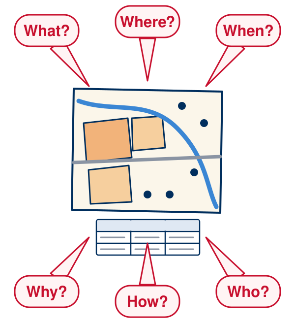

<!-- _class: lead -->
<!-- _paginate: skip -->

# Spatial Metadata

CCE 114 Geomatics
Civil & Construction Engineering
Brigham Young University
Dr. Dan Ames and Dr. James Halgren

<!-- Tuesday concept lecture, Week 9. Today is the "what and why" of metadata: what it is, why data without it is a risk, the six questions every record answers, and why good data can still be wrong for your job. Thursday opens with the second half of this material (standards, where metadata lives, fitness for use; the Day 17 deck), then goes hands-on in QGIS. The title cartoon is generated (gpt-image-2.5-flare, October 2026; prompt in tools/divider-images/week09.json): today's melodrama on stage, Data the map in the spotlight, the villains Unreliability and Irrelevance on the left, the six metadata heroes swooping in on the right. -->

<!-- stamp:begin -->
<!-- _footer: 'CCE 114 · Day 16 — MetadataLast Updated: 2026-10-27© 2026 Daniel P. Ames · <a href="https://creativecommons.org/licenses/by/4.0/">CC BY 4.0</a>' -->
<!-- stamp:end -->

---

# Today's Goals

By the end of class you should be able to:

- Say what **metadata** is, and why data without it is nearly useless
- Answer the six metadata questions: what, where, when, why, how, who
- Explain why good data can still be the **wrong data for your job**

<!-- Set expectations. This is the concepts day. The six red words are the heart of the hour: by the end, students should be able to ask all six of any dataset, which is what the sketch on the right shows. The self-check quiz at the end covers all three goals. Quiz 7 Part 1 covers the linked readings on what metadata is and on metadata standards, plus today's video and melodrama; the standards half is Thursday's opening slides. -->

---

# Where does your spatial data come from?

- **DGPS**: you stood on the spot with a differential GPS receiver. Why differential?
- **Digitize**: you clicked on the map to draw your own features. How good can it be?
- **Download**: you take someone else's data. Where do you get it? **What *is* it?**
- You collected the first two yourself, so you know how they were made
- The last one is a stranger's work: today is about answering **"what is it?"** first

<b>DGPS</b>

<b>Digitize</b>

<b>Download</b>

More personally connected to the dataLess personally connected

<!-- The three D's of acquiring vector data, in order of how close you are to the data. With DGPS you stood on the point yourself; when you digitize you at least chose every vertex; when you download, you were not there at all. Walk the arrow left to right: the further right you go, the less of the data's story is in your head, so the more of it has to travel with the file. Metadata is how it travels. -->

---

<!-- _class: lead -->

# Making Metadata Fun

## "I swear in my wrath that I will make metadata less boring." — Dr. Ames

<!-- A little lightheartedness. Say it out loud: yes, metadata is a dry, boring topic, and everyone in the room knows it. We are going to try to liven it up a bit. The next few slides count the efforts, one by one. Divider cartoon generated with gpt-image-2.5-flare (prompt in tools/divider-images/week09.json): a wizard zapping a yawning stack of paperwork into confetti while a file folder in a party hat dances on the globe. -->

---

# What is Metadata? Data about the data!

Effort #1 to make this a fun topic: a cute cartoon

<!-- Cartoon: "I liked it better before big data and metadata when we just had good old regular data." The joke works because metadata feels like paperwork right up until you need it. Andertoons cartoon from the original deck. -->

---

<!-- _class: quiz -->

# What is Metadata? Data about the data!

Effort #2 to make this a fun topic: a dramatic Word of Wisdom problem

You are at an off-campus party and someone hands you this bottle. Would you drink it?

<ol type="A">
<li>Yes</li>
<li>No</li>
</ol>

<!-- Show the unlabeled brown bottle. Take a quick show of hands. Almost nobody says yes. Ask why not: it might be perfectly good, or it might be something they have covenanted not to drink. They have no way to know. -->

---

# What is Metadata? Data about the data!

Effort #2 to make this a fun topic: a dramatic Word of Wisdom problem

Would you drink it <em>now</em>?

- What's different?
- **Metadata!**
- Same bottle. The label says it is root beer, not beer: what is in it, who brewed it, and enough to know it fits the Word of Wisdom

<!-- Same bottle, now with a label. The label is metadata: brand, ingredients, contents, serving instructions. The bottle did not change; your ability to decide about it did. For a room of Latter-day Saint students the stakes of the first slide were real, which is the point: without the label you cannot tell root beer from beer, and without metadata you cannot tell a usable dataset from one that will burn you. -->

---

# What is Metadata? Data about the data!

Effort #2 to make this a fun topic: a dramatic Word of Wisdom problem

**On the bottle**

- Brand and brewer
- Ingredients
- Volume and units
- "Serve chilled"
- Best-by date

**On a dataset**

- Title and originating agency
- Attributes and their meanings
- Coordinate system and units
- Use constraints and license
- Publication and revision dates

<svg viewBox="0 0 1200 800" aria-hidden="true">
<defs><marker id="md-ah" viewBox="0 0 10 10" refX="7" refY="5" markerWidth="5" markerHeight="5" orient="auto-start-reverse"><path d="M0 0 L10 5 L0 10 Z" fill="#c8102e"/></marker></defs>
<g class="pop"><rect x="400" y="40" width="780" height="120" rx="60" fill="#fff4f4" stroke="#c8102e" stroke-width="6"/>
<text x="790" y="114" text-anchor="middle" font-size="46" font-weight="800" fill="#c8102e" font-family="Avenir Next, Segoe UI, Helvetica, Arial, sans-serif">Information about the content</text></g>
<path class="draw" d="M640 160 C 560 260, 500 330, 455 420" fill="none" stroke="#c8102e" stroke-width="10" stroke-linecap="round"/>
<path class="draw" d="M900 160 C 960 330, 900 520, 800 625" fill="none" stroke="#c8102e" stroke-width="10" stroke-linecap="round"/>
<path class="head" d="M455 420 L 452 426" stroke="#c8102e" stroke-width="10" marker-end="url(#md-ah)"/>
<path class="head" d="M800 625 L 795 630" stroke="#c8102e" stroke-width="10" marker-end="url(#md-ah)"/>
</svg>

<!-- Draw the parallel line by line. The bubble and arrows animate in when the slide opens: one idea, two labels. The label on the bottle and the little tag on the map are the same thing, information about the content. Every field on the dataset side exists for the same reason as the field on the bottle side: so a stranger can decide whether to consume it. Ask which of the dataset items would worry them most if it were missing. -->

---

# What is Metadata? Data about the data!

Effort #3 to make this a fun topic: a cute animated bear and panda talk about data

<a href="https://youtu.be/N2zK3sAtr-4" target="_blank">youtu.be/N2zK3sAtr-4</a>

<!-- Short animated video, about 4:40. Click the thumbnail to open it in a new tab. A researcher asks a colleague for data and gets a file that nobody can interpret. Quiz 7 has a question on the video's take-home message. -->

---

<!-- _class: quiz -->

# What is Metadata? Data about the data!

Effort #3 to make this a fun topic: a cute animated bear and panda talk about data

**Discussion**

- Why can't the **panda** use the **data**?
- What kind of **metadata** would make the file **useful**?
- Why do scientists, researchers, students, and engineers so often **not write metadata**?

<!-- Let the third question run. Usual answers: no time, the project is over, "I know what it means," nobody asked, it was never budgeted. Then point out that in every one of those cases the person who suffers is the next engineer, who is often you six months later. -->

---

# Case Study: A Real-World Metadata Failure

The sad tale of the Mars Climate Orbiter

- 1999: NASA lost a **$125 million** spacecraft
- Ground software delivered thruster data in **English units**; the onboard software expected **metric**
- Nobody wrote down which
- The numbers were not wrong. They were **undocumented**
- One missing line of metadata, one lost mission. Your freeway alignment has the same failure mode

Reichhardt, T. (1999). NASA reworks its sums after Mars fiasco. <em>Nature</em> 401, 517. <a href="https://doi.org/10.1038/43974" target="_blank">doi.org/10.1038/43974</a>

<!-- This example also appears in the Lab 8 background reading. The point is not that engineers are careless; the point is that units, datums, and coordinate systems are exactly the kind of thing that is obvious to the person who made the file and invisible to everyone else. The Nature news article under the picture was published two weeks after the loss and is the citation to give anyone who wants to read more. -->

---

# What is Metadata? Data about the data!

Effort #4 to make this a fun topic: a brief live melodrama performance

- A short story about what happens when data has no metadata.
- Follow along here: <a href="http://t.ly/rPYx" target="_blank">t.ly/rPYx</a>
- What are the questions every metadata record should answer?

<!-- At this point gather nine volunteers and hand out the papers. The spatial data actor gets all of the "spatial data" sheets; everyone else gets just one sheet. The cast is Data, the villains Unreliability and Irrelevance, and the six heroes What, Where, When, Why, How, and Who; the full script and run notes are on the Week 9 activity page (docs/activities/week-09.md). The rest of the class follows along at t.ly/rPYx. Lead the applause. The melodrama introduces the six questions; the divider that follows names them formally. Quiz 7 has a question on the melodrama. The illustration is the hero, Metadata, tied to the tracks by the villain. -->

---

<!-- _class: lead -->

# What goes into a metadata record?

## Six questions every dataset should be able to answer

<!-- The melodrama just introduced the six heroes; now name them properly, three at a time. -->

---

# The six questions: what, where, when

- **What?** What do the data represent, in what file format, and what do the attribute columns mean?
- **Where?** Where were the data collected, what area do they cover, and in what coordinate system and units?
- **When?** When were the data collected, when were they last updated, and how often are they revised?

<!-- Have students call out a dataset from Lab 7 and answer these three for it out loud. Most will stall on "what do the attribute columns mean," which is the single most common gap in real-world metadata. -->

---

# The six questions: why, how, who

- **Why?** What was the intended purpose? Why was the dataset created in the first place?
- **How?** How were the data created, by what collection method, and what geoprocessing steps came after?
- **Who?** Which organization and which individuals collected the data, and who do you email when something looks wrong?

<!-- "Why" is the field students skip and professionals read first: data collected for a statewide overview map is not automatically valid for a site-scale design. "How" is the lineage, and it is what lets you decide whether you trust the numbers. The illustration was regenerated on 2026-10-27 (gpt-image-2.5-flare) because the earlier one gave the engineer three arms. -->

---

# Fit for *its* purpose is not fit for *yours*

- A parcel layer digitized for **tax assessment** is not a survey boundary
- A statewide roads layer at **1:100,000** will not place a curb
- A land-cover raster from **2011** will not show last year's subdivision
- Nothing here is wrong data. It is **right data, wrong job**
- The metadata is what lets you catch that before you design against it

<!-- This is the sentence to repeat all semester. Almost no engineering GIS disaster comes from data that was wrong; most come from good data used outside its intended purpose, scale, or era. -->

---

# Thursday: hands-on in QGIS

- A short set of slides first: **metadata standards** (FGDC CSDGM and ISO 19115) and where the record lives in a download
- **Reading a record for fitness for use**: a checklist and a worked example, the Utah County boundaries that open Lab 8
- Then **in QGIS**: read a real record, write your own in Layer Properties > Metadata, and save it as a `.qmd` so it travels with the data
- **In-class activity**: evaluate one published dataset from [gis.utah.gov](https://gis.utah.gov/data/) and add a row to the class sheet

<!-- Preview of Day 17, which is its own deck and runs the whole Thursday session: about twelve minutes of slides on standards and fitness for use, then the QGIS run sheet, then the AGRC Metadata activity. Thursday is where students write metadata rather than just read it. -->

---

<!-- _class: activity -->

# Final Thoughts

**Quiz: Would You Drink It?** Nine questions on your phone: why an undocumented dataset is a **risk**, the **six questions** every record answers, and **right data, wrong job**. **Scan the code**, or open the link under it.

- Not graded, and every answer explains itself
- Questions may appear on the second midterm exam.

**Before next class**

- **Quiz 7: Metadata** opens on Learning Suite after class today. Part 1 is the two linked readings on what metadata is and on standards, an example metadata record, and today's video and melodrama; Part 2 sends you to [gis.utah.gov/data](https://gis.utah.gov/data/) and [data.gov](https://www.data.gov)
- **Quiz 7** and **[Lab 8: Metadata](https://byu-hydroinformatics.github.io/cce114-geomatics/assignments/lab-08/)** are due **Saturday, 11:59 pm**
- **Quiz 8** opens Thursday — start it early
- Questions? Office hours: [calendly.com/dan-ames/office-hours](https://calendly.com/dan-ames/office-hours)

byu-hydroinformatics.github.io/cce114-geomatics/quizzes/metadata/

<!-- Remind them that Lab 8 Part 1 is the Utah County Boundaries XML that Thursday's slides walk through, so they can start the lab after Thursday. Quiz 7 opens at 2:00 pm today and closes Saturday at 11:59 pm (checked in Learning Suite 2026-10-27); its Part 1 now asks about today's animated video and the melodrama, so anyone who missed class should watch the video and read the melodrama script. -->

<!-- Conversion notes (2026-09-02): built from Metadata.pptx (2025, 9 slides), supplemented by "9 - Finding Spatial Data Part 1 - Metadata.pptx" (2017) for the UGRC/gis.utah.gov material. Dropped from the source: nothing substantive; the 2017 deck's AGRC logo image and its Google-Docs class-activity slide were dropped (dead goo.gl link), and the 2025 deck's "Day 2 – But How?" slide became the Thursday preview. The FGDC/ISO 19115 standards section, the Mars Climate Orbiter slide, the fitness-for-use checklist, and the Utah County Boundaries worked example are new material written for this deck, drawn from the Day 16 topic list and the Lab 8 background. Saturday due dates for Quiz 7 and Lab 8, and Quiz 8's Thursday opening, checked against Learning Suite 2026-10-26. -->

<!-- Split 2026-10-26: Tuesday ran long, so everything from the "Metadata standards and styles" divider through "Where to find data with metadata", plus the QGIS Metadata dialog slide, moved to slides/day-17/metadata-standards.md for Thursday. The Today's Goals and Thursday preview were rewritten to match. -->

<!-- Update 2026-10-27 (a): divider cartoons added (prompts in tools/divider-images/week09.json, gpt-image-2.5-flare, same meme-comic style as the CE 414 dividers), and the side-panel illustrations and text enlarged to fill white space. -->

<!-- Update 2026-10-27 (b): standard title slide (medallion, department, university, stamp) and a new melodrama title cartoon; the six-questions sketch on Today's Goals (md-six-questions.svg, hand-written SVG); the data sources reordered DGPS, Digitize, Download along a "personal connection" axis (panels cropped from md-three-sources.jpg); a "Making Metadata Fun" divider and the four numbered "Effort #N" subtitles; the Word of Wisdom bottle framing; animated callout on the label slide; Nature citation on the Mars slide; the "What goes into a metadata record?" divider moved after the melodrama; the Tuesday in-class activity slide removed, since Thursday carries the week's activity. -->
