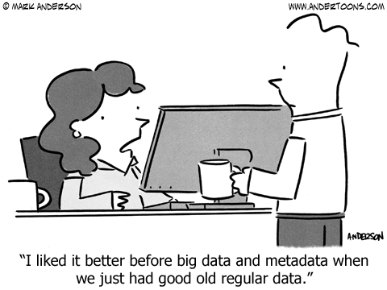
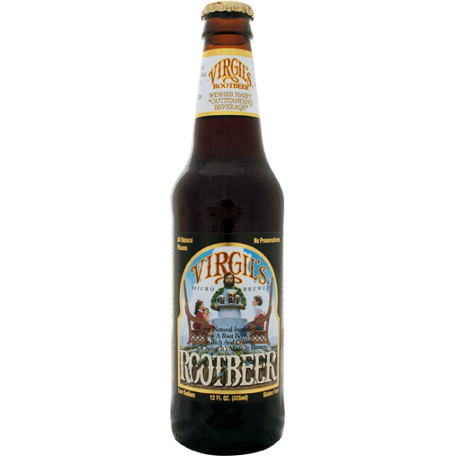

<!-- _class: lead -->
<!-- _paginate: skip -->

# Spatial Metadata

CCE 114 Geomatics
Dr. Dan Ames and Dr. James Halgren

<!-- Tuesday concept lecture, Week 9. Today is the "what and why" of metadata: what it is, why data without it is a risk, the six questions every record answers, and why good data can still be wrong for your job. Thursday opens with the second half of this material (standards, where metadata lives, fitness for use; the Day 17 deck), then goes hands-on in QGIS. -->

---

# Today's Goals

By the end of class you should be able to:

- Say what **metadata** is, and why data without it is nearly useless
- Answer the six metadata questions: *what, where, when, why, how, who*
- Explain why good data can still be the **wrong data for your job**

<!-- Set expectations. This is the concepts day. Quiz 7 Part 1 covers the linked readings on what metadata is and on metadata standards; the standards half is Thursday's opening slides. -->

---

# Where does your spatial data come from?

- **Digitize** — click on the map to draw your own features. How good can it be?
- **Download** — take someone else's data. Where do you get it? **What *is* it?**
- **DGPS** — differential GPS field collection. Why differential?
- You digitized or surveyed the first and third yourself, so you know how they were made
- The middle one is a stranger's work: today is about answering **"what is it?"** first

<!-- The three D's of acquiring vector data. Point out that when you digitize or survey, you carry the knowledge of how the data were made in your head. The moment you download somebody else's file, that knowledge has to travel with the file, and metadata is how it travels. -->

---

# Metadata: data about the data

<!-- Cartoon: "I liked it better before big data and metadata when we just had good old regular data." The joke works because metadata feels like paperwork right up until you need it. Andertoons cartoon from the original deck. -->

---

<!-- _class: quiz -->

# Would you drink it?

Poll:

<ol type="A">
<li>Yes</li>
<li>No</li>
</ol>

<!-- Show the unlabeled brown bottle. Take a quick show of hands. Almost nobody says yes. Ask why not - it might be perfectly good. You have no way to know. -->

---

# Would you drink it *now*?

- What's different?
- **Metadata!**
- Same liquid. The label tells you what is in it, who brewed it, what is *not* in it, and how to serve it

<!-- Same bottle, now with a label. The label is metadata: brand, ingredients, contents, serving instructions. The bottle did not change; your ability to decide about it did. The original speaker note quoted the manufacturer's marketing copy at length; the short version is that the label lists the ingredients, the brewing method, and how to serve it, which is exactly what a metadata record does for a dataset. -->

---

# A label is a metadata record

**On the bottle**

- Brand and brewer
- Ingredients
- Volume and units
- "Serve chilled"
- Best-by date

**On a dataset**

- Title and originating agency
- Attributes and their meanings
- Coordinate system and units
- Use constraints and license
- Publication and revision dates

<!-- Draw the parallel line by line. Every field on the right exists for the same reason as the field on the left: so a stranger can decide whether to consume it. Ask which of the right-hand items would worry them most if it were missing. -->

---

# Why metadata?

<a href="https://youtu.be/N2zK3sAtr-4" target="_blank">youtu.be/N2zK3sAtr-4</a>

<!-- Short animated video, about 4:40. Click the thumbnail to open it in a new tab. A researcher asks a colleague for data and gets a file that nobody can interpret. -->

---

<!-- _class: quiz -->

# Discussion

- Why can't the panda use the data?
- What kind of metadata would make the file useful?
- Why do scientists, researchers, students, and engineers so often *not* write metadata?

<!-- Let the third question run. Usual answers: no time, the project is over, "I know what it means," nobody asked, it was never budgeted. Then point out that in every one of those cases the person who suffers is the next engineer, who is often you six months later. -->

---

# When metadata is missing: Mars Climate Orbiter

- 1999: NASA lost a **$125 million** spacecraft
- Ground software delivered thruster data in **English units**; the onboard software expected **metric**
- Nobody wrote down which
- The numbers were not wrong. They were **undocumented**
- One missing line of metadata, one lost mission. Your freeway alignment has the same failure mode

<!-- This example also appears in the Lab 8 background reading. The point is not that engineers are careless; the point is that units, datums, and coordinate systems are exactly the kind of thing that is obvious to the person who made the file and invisible to everyone else. -->

---

<!-- _class: lead -->

# What goes into a metadata record?

## Six questions every dataset should be able to answer

---

# A brief metadata melodrama

- A short, silly story about what happens when data has no documentation
- Read it here: <a href="http://t.ly/rPYx" target="_blank">t.ly/rPYx</a>
- Then we will name the six questions every metadata record answers

<!-- "A brief metadata melodrama" is linked from the Day 16 page on the course site: http://t.ly/rPYx. Walk through a few slides of it live if there is time, or assign it as a two-minute read. The illustration is the hero, Metadata, tied to the tracks by the villain. -->

---

# The six questions: what, where, when

- **What?** What do the data represent, in what file format, and what do the attribute columns mean?
- **Where?** Where were the data collected, what area do they cover, and in what coordinate system and units?
- **When?** When were the data collected, when were they last updated, and how often are they revised?

<!-- Have students call out a dataset from Lab 7 and answer these three for it out loud. Most will stall on "what do the attribute columns mean," which is the single most common gap in real-world metadata. -->

---

# The six questions: why, how, who

- **Why?** What was the intended purpose? Why was the dataset created in the first place?
- **How?** How were the data created, by what collection method, and what geoprocessing steps came after?
- **Who?** Which organization and which individuals collected the data, and who do you email when something looks wrong?

<!-- "Why" is the field students skip and professionals read first: data collected for a statewide overview map is not automatically valid for a site-scale design. "How" is the lineage, and it is what lets you decide whether you trust the numbers. -->

---

# Fit for *its* purpose is not fit for *yours*

- A parcel layer digitized for **tax assessment** is not a survey boundary
- A statewide roads layer at **1:100,000** will not place a curb
- A land-cover raster from **2011** will not show last year's subdivision
- Nothing here is wrong data. It is **right data, wrong job**
- The metadata is what lets you catch that before you design against it

<!-- This is the sentence to repeat all semester. Almost no engineering GIS disaster comes from data that was wrong; most come from good data used outside its intended purpose, scale, or era. -->

---

<!-- _class: activity -->

# In-class activity: What I learned about metadata

- Write down **a couple of things you learned about metadata today**
- One of them should be something you will actually check the next time you download data
- Record your completion on **Learning Suite**
- Stuck? Which question do you skip most? What do you check before using a stranger's file? Which "wrong job" example surprised you?

<!-- Give five minutes. Collect two or three answers out loud before the Thursday preview. Completion is recorded on Learning Suite. -->

---

# Thursday: hands-on in QGIS

- **Metadata standards**: FGDC CSDGM and ISO 19115, and where the record lives in a download
- A **fitness-for-use checklist** for deciding whether to trust a dataset
- **Creating and editing metadata in QGIS**: Layer Properties > Metadata, saved as a `.qmd` so it travels with the data
- **Finding and evaluating datasets** on [gis.utah.gov](https://gis.utah.gov/data/) and [data.gov](https://www.data.gov)
- Bring your laptop with QGIS 3.44 LTR installed

<!-- Preview of Day 17: a short set of slides on standards and fitness for use, then students write metadata rather than just read it. -->

---

<!-- _class: activity -->

# Final Thoughts

**Quiz: Would You Drink It?** Eight questions on your phone: why an undocumented dataset is a **risk**, and the **six questions** every record answers. **Scan the code**, or open the link under it.

- Not graded, and every answer explains itself
- Good practice for Quiz 7 and Lab 8

**Before next class**

- Do the linked readings for **Quiz 7: Metadata** — Part 1 is what metadata is and metadata standards; Part 2 sends you to [gis.utah.gov/data](https://gis.utah.gov/data/) and [data.gov](https://www.data.gov)
- **Quiz 7** and **[Lab 8: Metadata](https://byu-hydroinformatics.github.io/cce114-geomatics/assignments/lab-08/)** are due **Saturday, 11:59 pm**
- **Quiz 8** opens Thursday — start it early
- Record today's activity on Learning Suite
- Questions? Office hours: [calendly.com/dan-ames/office-hours](https://calendly.com/dan-ames/office-hours)

byu-hydroinformatics.github.io/cce114-geomatics/quizzes/metadata/

<!-- Remind them that Lab 8 Part 1 is the Utah County Boundaries XML that Thursday's slides walk through, so they can start the lab after Thursday. -->

<!-- Conversion notes (2026-09-02): built from Metadata.pptx (2025, 9 slides), supplemented by "9 - Finding Spatial Data Part 1 - Metadata.pptx" (2017) for the UGRC/gis.utah.gov material. Dropped from the source: nothing substantive; the 2017 deck's AGRC logo image and its Google-Docs class-activity slide were dropped (dead goo.gl link, replaced by the current Learning Suite activity), and the 2025 deck's "Day 2 – But How?" slide became the Thursday preview. The FGDC/ISO 19115 standards section, the Mars Climate Orbiter slide, the fitness-for-use checklist, and the Utah County Boundaries worked example are new material written for this deck, drawn from the Day 16 topic list and the Lab 8 background. Saturday due dates for Quiz 7 and Lab 8, and Quiz 8's Thursday opening, checked against Learning Suite 2026-10-26. -->

<!-- Split 2026-10-26: Tuesday ran long, so everything from the "Metadata standards and styles" divider through "Where to find data with metadata", plus the QGIS Metadata dialog slide, moved to slides/day-17/metadata-standards.md for Thursday. The Today's Goals, activity prompts, and Thursday preview were rewritten to match. -->

<!-- Update 2026-09-02: ArcGIS-era screenshots replaced with QGIS 3.44 captures made by tools/qgis_reshoot_screens.py: md-qgis-metadata-panel.png re-shot in QGIS 3.44 (now in the Day 17 deck). -->

<!-- Five minutes, in pairs. The two worth arguing about out loud are the 1:100,000 roads layer and the Lehi footprints question, where the better-documented dataset is still not the right answer. If the room has no signal, put the URL on the board. The page is linked from the Week 9 page too. -->

<!-- Update 2026-10-27: divider cartoons added (prompts in tools/divider-images/week09.json, gpt-image-2.5-flare, same meme-comic style as the CE 414 dividers), and the side-panel illustrations and text enlarged to fill white space. -->
