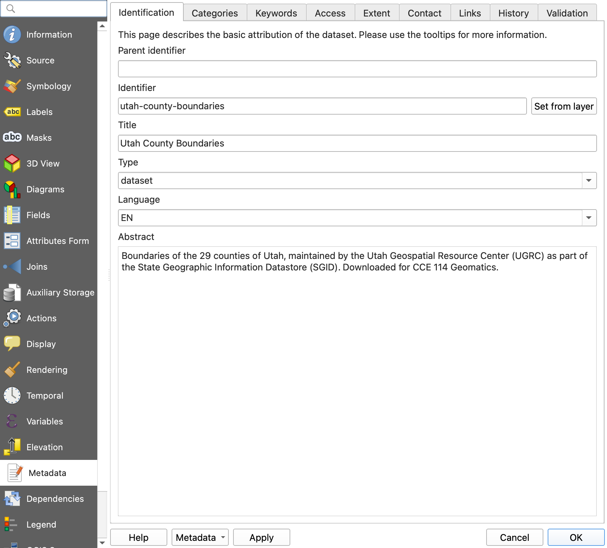

<!-- _class: lead -->
<!-- _paginate: skip -->


# Metadata Standards and Fitness for Use

CCE 114 Geomatics
Civil & Construction Engineering
Brigham Young University
Dr. Dan Ames and Dr. James Halgren

<!-- Thursday, Week 9. The deck runs the whole session and follows the Week 9 hands-on guide. About twelve minutes of slides up to the "Now in QGIS" divider: the standards, where the record sits in a download, and reading one for fitness for use. After the divider, each slide is one segment of the run sheet's 50-minute plan, to leave up while you demo. Tuesday covered what metadata is, why it matters, and the six questions. -->

<!-- stamp:begin -->
<!-- _footer: '<span>CCE 114 · Day 17 — Metadata Standards<span class="updated">Last Updated: 2026-10-27</span></span><span>© 2026 Daniel P. Ames · <a href="https://creativecommons.org/licenses/by/4.0/">CC BY 4.0</a></span>' -->
<!-- stamp:end -->

---

# Today's Goals


<div style="font-size:1.08em">

By the end of class you should be able to:

- Name the main metadata **standards**: FGDC CSDGM and ISO 19115
- Find where metadata **lives** in a download: `.xml`, `.qmd`, GeoPackage, `.prj`
- Read a metadata record and judge whether the data are **fit for your use**
- **Write** metadata for a layer in QGIS and save it so it travels with the data

</div>

<!-- Recap Tuesday in one breath: a label is a metadata record, and every record answers what, where, when, why, how, and who. Today is the formal version of that label, then you write one yourself. -->


---

<!-- _class: lead -->


# Metadata standards and styles

## Same fields, same places, so anyone can find them

---

# Why standardize metadata at all?

<div class="columns" style="grid-template-columns: 1fr 1fr;">
<div style="font-size:1.02em">

- If everyone invents their own fields, nothing is **searchable**
- A standard fixes the **field names** and the **expected content**, so software can index them and a "date" is a date
- It makes records **portable** between agencies and software
- A **standard** says what has to be there; a **style** or **profile** says how one organization fills it in
- Same idea as a survey report template: fixed headings, local content

</div>
<div>


</div>
</div>

<!-- The library-catalog analogy works well: a card catalog is only useful because every card has the same fields in the same places. A metadata standard is a card catalog for data. -->


---

# FGDC: the U.S. federal standard


- **Content Standard for Digital Geospatial Metadata** (CSDGM), from the Federal Geographic Data Committee
- Executive Order 12906 (1994) told federal agencies to document geospatial data this way as part of the National Spatial Data Infrastructure
- Current version is FGDC-STD-001-1998
- Usually travels as a sidecar **`.xml`** file next to the shapefile
- Still everywhere: most Utah and federal downloads you open this semester are FGDC

<!-- This is the standard the students will actually meet in Lab 8: the Utah County Boundaries download ships an FGDC XML file alongside the shapefile. Since 2010 the FGDC has endorsed the ISO standards and encouraged agencies to migrate, but the installed base of FGDC records is enormous, so you still have to be able to read one. -->


---

# The seven sections of FGDC


<ol style="font-size:1.0em">
<li><strong>Identification</strong> — title, abstract, purpose, keywords, bounding coordinates</li>
<li><strong>Data Quality</strong> — accuracy, completeness, <strong>lineage</strong></li>
<li><strong>Spatial Data Organization</strong> — points, vectors, or raster cells</li>
<li><strong>Spatial Reference</strong> — projection, datum, units</li>
<li><strong>Entity and Attribute</strong> — what each column and code means</li>
<li><strong>Distribution</strong> — where to get it, format, constraints</li>
<li><strong>Metadata Reference</strong> — who wrote <em>the metadata</em>, and when</li>
</ol>

<!-- Section 5 is the one nobody fills in and everybody needs. Section 7 matters more than it looks: a 1998 metadata record attached to a 2024 dataset is a warning sign. -->


---

# What an FGDC record looks like inside


<style scoped>pre, pre code { font-size: 23px; line-height: 1.25; }</style>

<div>

```xml
<metadata>
  <idinfo>
    <citation><citeinfo>
      <origin>Utah Geospatial Resource Center</origin>
      <pubdate>20240115</pubdate>
      <title>Utah County Boundaries</title>
    </citeinfo></citation>
    <descript>
      <abstract>...</abstract>
      <purpose>...</purpose>
    </descript>
    <spdom><bounding>
      <westbc>...</westbc><eastbc>...</eastbc>
    </bounding></spdom>
  </idinfo>
  <metainfo><metd>20240115</metd></metainfo>
</metadata>
```

</div>

<!-- Generic skeleton, not a real record: the point is the shape, not the values. Tell students the search terms from Lab 8: Ctrl+F for "metd" to find the metadata date, and "bounding" to find the extent. XML is verbose but it is plain text, so you can always read it in a browser or a text editor. -->


---

# ISO 19115: the international standard


- **ISO 19115, *Geographic information — Metadata***, is the international equivalent
- Richer and more structured than FGDC, but organized the same way: identification, quality, spatial representation, reference system, distribution
- Used across Europe, Australia, Canada, and increasingly by U.S. federal agencies
- **QGIS layer metadata follows the ISO 19115 model**, which is why the panel you will use in a few minutes has fields like *Identification, Extent, Access, Fields, History*

<!-- Current revision is ISO 19115-1; the XML encodings are ISO 19139 and ISO 19115-3 (mention in passing, not on the slide). The practical takeaway for this class: FGDC and ISO ask the same six questions with different tag names. If you can read one you can read the other. QGIS chose ISO, which is one reason FGDC .xml files do not import cleanly into QGIS. -->


---

# Other styles you will meet

<div class="columns" style="grid-template-columns: 1fr 1fr;">
<div style="font-size:1.05em">

- **Dublin Core** — 15 general-purpose elements (title, creator, date, rights…). Not spatial, but it underlies a lot of catalogs
- **DCAT / Project Open Data** — the schema behind [data.gov](https://www.data.gov)
- **STAC** — SpatioTemporal Asset Catalog, for satellite and drone imagery collections
- **Esri metadata styles** — ArcGIS can write FGDC, ISO, or its own style; the same record, different export

</div>
<div>


</div>
</div>

<!-- Do not memorize this list. Recognize the names so that when a download says "ISO 19139 metadata" or "STAC catalog" you know it is the same six questions in a different wrapper. -->


---

# Where does the metadata actually live?

<div class="columns" style="grid-template-columns: 1.1fr 1fr;">
<div style="font-size:1.02em">

- **Shapefile** — sidecar `.xml` beside the `.shp`, plus the `.prj` that holds the coordinate system
- **GeoPackage** — stored *inside* the `.gpkg` file
- **QGIS layer** — a `.qmd` sidecar file, or inside the project file
- **Web service** — in the service's `GetCapabilities` or item page
- **Data portal** — on the download page itself
- Unzip a download and open only the `.shp`, and you threw the metadata away

</div>
<div>


</div>
</div>

<!-- Practical and worth emphasizing: the metadata is usually already in the folder they downloaded. Lab 8 has them open the XML in a browser. Also flag the format mismatch: an FGDC .xml from Utah's portal does not import automatically into QGIS the way it does into ArcGIS Pro, which is why Lab 8 has them create metadata by hand. -->


---

<!-- _class: lead -->


# Reading metadata: is this data fit for use?

## Good data that was made for someone else's job

---

# A fitness-for-use checklist


<ol style="font-size:0.98em">
<li><strong>Scale / resolution</strong> — what is the smallest thing this can represent?</li>
<li><strong>Date</strong> — when collected, when updated?</li>
<li><strong>CRS and units</strong> — projection, datum, feet or meters?</li>
<li><strong>Completeness</strong> — is anything missing or unmapped?</li>
<li><strong>Accuracy and lineage</strong> — how was it made, and from what?</li>
<li><strong>Attributes</strong> — is every column defined?</li>
<li><strong>Constraints</strong> — license, restrictions, required credit</li>
<li><strong>Contact</strong> — who answers questions?</li>
</ol>

<!-- Tell them to run this list on the datasets in Lab 8 and again on every dataset in the site-selection project later in the semester. Anything you cannot answer from the metadata is a risk you are carrying into your design. -->


---

<!-- _class: quiz -->

# Which dataset would you use?


You are laying out a new road west of Lehi and you need building footprints.

<div class="columns" style="align-items:start;">
<div>

**Dataset A**
Collected 2013, 1:24,000, no lineage given, no contact

</div>
<div>

**Dataset B**
Collected 2024, from 6-inch imagery, lineage documented, county GIS contact listed

</div>
</div>

<ol type="A">
<li>A</li><li>B</li><li>Either</li><li>Neither, until you check something else</li>
</ol>

<!-- Hypothetical example. B is the obvious answer, but push on D: you still do not know either dataset's coordinate system or use constraints from what is printed here, and a 2024 footprint layer digitized for planning purposes is still not a survey. The habit to build is "what did the metadata not tell me?" -->

---

# Worked example: county boundaries


<div style="font-size:1.0em">

- Download the shapefile from the Utah portal
- Unzip it and open the `.xml` in a browser: it is plain text
- Search for **`UGRC`** to find *who*
- Search for **`metd`** to find *when*, written `YYYYMMDD`
- Search for **`bounding`** to find *where*
- Read the abstract and keywords for *what*, the purpose for *why*
- The coordinate system is **not** in the XML — it is in the `.prj` file in the same folder

</div>

<!-- This is Part 1 of Lab 8, so treat it as a preview and let them follow along if they have laptops open. The .prj point catches almost everyone: the CRS lives in a separate file from the rest of the metadata. -->


---

# Where to find data *with* metadata


<div class="columns" style="align-items:start;">
<div>

**[gis.utah.gov/data](https://gis.utah.gov/data/)**

- Utah Geospatial Resource Center (UGRC, formerly AGRC)
- The state's official clearinghouse, and one of the oldest in the country
- Nearly everything ships with a metadata record

</div>
<div>

**[data.gov](https://www.data.gov)**

- The U.S. federal open-data catalog
- Hundreds of thousands of datasets, wildly varying metadata quality
- Great practice at deciding what you cannot trust

</div>
</div>

<!-- Quiz 7 Part 2 sends students to both of these. Do not browse them yet: the next section opens a UGRC product page and then a thin data.gov page live. -->


---

<!-- _class: lead -->


# Now in QGIS

## Read a record, then write one that travels with the data

<!-- Hand-off. Everything from here on is the hands-on session in the Week 9 hands-on guide; each slide below is one segment of its 50-minute plan, so leave each one up while you demo. -->


---

# Read a real record first


Open a UGRC product page on [gis.utah.gov](https://gis.utah.gov/products/sgid/) and find, out loud:

- **What** the data are, and **who** stewards them
- **Where**: the coordinate system, usually NAD83 UTM 12N
- **When** it was last updated, and how often
- **Why** it exists, and **how** it was made
- Then the **license**

<!-- Run sheet walkthrough step 1, about four minutes. Use the Utah County Boundaries or Roads page picked before class. If any of the six is missing you are guessing, and Tuesday's melodrama was about what happens when you guess. -->


---

# Write it in QGIS



<ol style="font-size:0.9em">
<li><strong>Identification</strong>: title, type, language, a two-sentence abstract</li>
<li><strong>Categories</strong>: one ISO category</li>
<li><strong>Keywords</strong>: three terms</li>
<li><strong>Access</strong>: fees, license, a rights line</li>
<li><strong>Extent</strong>: <strong>Set from layer</strong></li>
<li><strong>Contacts</strong>: you, as <code>pointOfContact</code></li>
<li><strong>History</strong>: one line per processing step</li>
<li><strong>Validation</strong>: what is still empty</li>
</ol>

<!-- Run sheet walkthrough step 2, about eight minutes. QGIS 3.44 Layer Properties, Metadata page, for the UGRC Utah County Boundaries layer with the identification fields filled in. Right-click the layer, Properties, Metadata, and walk the left-hand pages in this order with the county boundary from the Week 2 data. Validation needs Identifier, Title, Type, Language, Abstract, a Contact, and a License before it stops complaining. -->


---

# Save it so it survives


- Clicking **OK** saves nothing durable: the metadata lives only in the project file
- **Metadata > Save metadata to file** writes a `.qmd` beside the layer
- For a GeoPackage, **Save to database** stores it *inside* the `.gpkg`. Copy the file to a new folder, open it in a fresh project: it is still there
- **Layer Properties > Information** now shows your abstract and contacts. That is what a colleague sees first

<!-- Run sheet walkthrough step 3, about three minutes. Show the .qmd in the Browser panel, then open it in a text editor: it is only XML. Metadata that lives in a Word file on someone's laptop is not metadata. -->


---

<!-- _class: quiz -->

# Bad metadata, on purpose


<div style="font-size:1.3em">

Open the thin [data.gov](https://www.data.gov) page. From the page alone:

- Which of the six questions **can't** you answer?
- What would you have to **assume** to use it in a design?
- What happens when that assumption is **wrong**?

</div>

<!-- Run sheet walkthrough step 4, about three minutes, on the thin data.gov page found before class. Usually two or three of the six are impossible. Tuesday's unlabeled bottle is back on purpose. This is the Quiz 7 Part 2 exercise in miniature. -->


---

<!-- _class: activity -->

# In-class activity: AGRC Metadata


<div style="font-size:0.92em">

- Pick one dataset on [gis.utah.gov](https://gis.utah.gov/data/) or [data.gov](https://www.data.gov), not the one your neighbor took
- Read its metadata and add **one row at the bottom** of the **AGRC Metadata** tab in the class sheet, your name first
- Fill the six answers, plus spatial reference and key attributes. Where the record does not say, write **"not stated"**
- Mark **In Class Activity: AGRC Metadata** complete on Learning Suite, with the dataset name

</div>

<!-- Run sheet "Student activity", about thirteen minutes. Full credit for a complete row. Rows added in the middle overwrite each other, which is why it is the bottom and name first. -->


---

<!-- _class: activity -->

# Final Thoughts

<div class="columns" style="grid-template-columns: 1.7fr 1fr; font-size: 0.74em;">
<div>

**Quiz: Fit for Your Use?** Eight questions on your phone: the **standards** and where the record **lives**, then reading a record and **deciding**. **Scan the code**, or open the link under it.

- Not graded, and every answer explains itself
- Good practice for Quiz 7 and Lab 8

**Before next class**

- **Quiz 7: Metadata** and **[Lab 8: Metadata](https://byu-hydroinformatics.github.io/cce114-geomatics/assignments/lab-08/)** are due **Saturday, 11:59 pm**. Lab 8 Part 1 is today's QGIS metadata on the county boundary and roads; Part 2 is a Lehi wetland layer whose metadata is deliberately incomplete
- **Quiz 8: Geoprocessing** opens today on Learning Suite and is due **Saturday of next week**
- Reading for next week: *GIS Fundamentals*, Chapter 9 (Basic Spatial Analysis)
- Record today's activity on Learning Suite
- Questions? Office hours: [calendly.com/dan-ames/office-hours](https://calendly.com/dan-ames/office-hours)

</div>
<div>


<span style="font-size: 0.45em; color: #4a5568;">byu-hydroinformatics.github.io/cce114-geomatics/quizzes/fitness/</span>

</div>
</div>

<!-- Run sheet 0:46: the Lab 8 pointer and the quiz reminders. Everything Lab 8 needs is in the Metadata dialog they just used. -->

<!-- Split notes (2026-10-26): this deck is the second half of the original Day 16 "Spatial Metadata" deck, moved to Thursday because Tuesday ran long. The break is the "Metadata standards and styles" divider. The QGIS Metadata dialog slide moved from the middle of the standards section to the end so the deck hands off into QGIS. On 2026-10-26 the hand-off became its own section ("Now in QGIS"), one slide per run-sheet segment: read a UGRC record, write it, save it, bad metadata on purpose, and the AGRC Metadata activity. md-read-a-record, md-save-it and md-agrc-activity were generated with gpt-image-1 in the deck's style; md-bottle-unlabeled is Tuesday's bottle, reused as a callback. Due dates checked against Learning Suite 2026-10-26. -->

<!-- Update 2026-10-27: divider cartoons added (prompts in tools/divider-images/week09.json, gpt-image-2.5-flare, same meme-comic style as the CE 414 dividers), and the side-panel illustrations and text enlarged to fill white space. -->

<!-- Update 2026-10-27 (b): the title image and the three divider cartoons redrawn in an anime style, the look now used across all the decks; prompts in tools/divider-images/week09.json. -->
