<!-- _class: lead -->
<!-- _paginate: skip -->

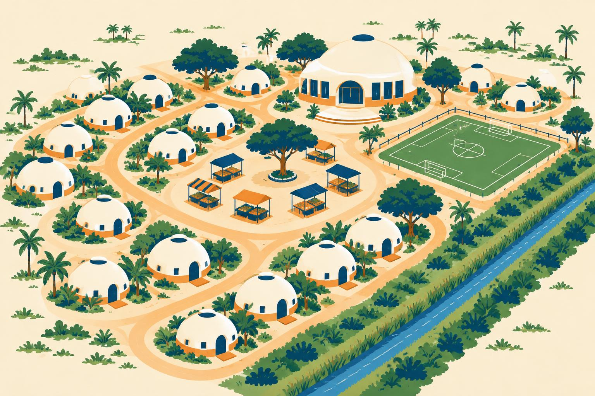

# Geoplanning

## What goes where? Site layout and design with GIS

CCE 114 Geomatics
Civil & Construction Engineering
Brigham Young University
Dr. Dan Ames and Dr. James Halgren

<!-- Tuesday concept lecture, Week 11. This is the thinking behind Lab 10, Domes for Mozambique. Next week's lecture is site selection (where in a county should something go); today is one step smaller: you already have the site, so how do you arrange things on it? -->

<!-- stamp:begin -->
<!-- _footer: 'CCE 114 · Day 20 — Geoplanning: Site Layout and DesignLast Updated: 2026-11-06© 2026 Daniel P. Ames · <a href="https://creativecommons.org/licenses/by/4.0/">CC BY 4.0</a>' -->
<!-- stamp:end -->

---

# Today's Goals

- By the end of class you should be able to:
  - Tell **site selection**, **site layout**, and **site design** apart
  - Separate a project's **program** (what must fit) from its **constraints** (where nothing can go)
  - Turn each constraint and each piece of the program into a **GIS layer and tool**
  - Do the **buffer arithmetic** for footprints, roads, and setbacks
  - Say where GIS layout stops and **engineering design** takes over

<!-- Today is the reasoning; Lab 10 is the clicking. Everything on these goals shows up in the lab. -->

---

# What goes where?

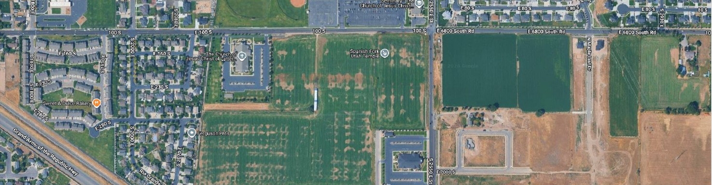

- The empty field from **Lab 4**: the Spanish Fork Utah Temple site, about **8.7 acres** at 100 South and 2550 East
- Somebody has to decide where the building, the parking, the entrances, and the landscaping go, and **why**

<!-- Callback to Lab 4, where students digitized over this exact field. Ask the room: if you were handed this lot and a list of what has to go on it, what would you look at first? Collect a few answers (roads, the neighbors, the slope, the canal, sun, access). Every answer is either a constraint or an opportunity, which is where today goes. -->

---

<!-- _class: lead -->

# Part 1

## Three scales, and the two lists every site plan starts from

<!-- Anime-style cartoon generated with gpt-image-2.5-flare, November 2026; prompt in tools/divider-images/week11.json. -->

---

# Three scales of geoplanning

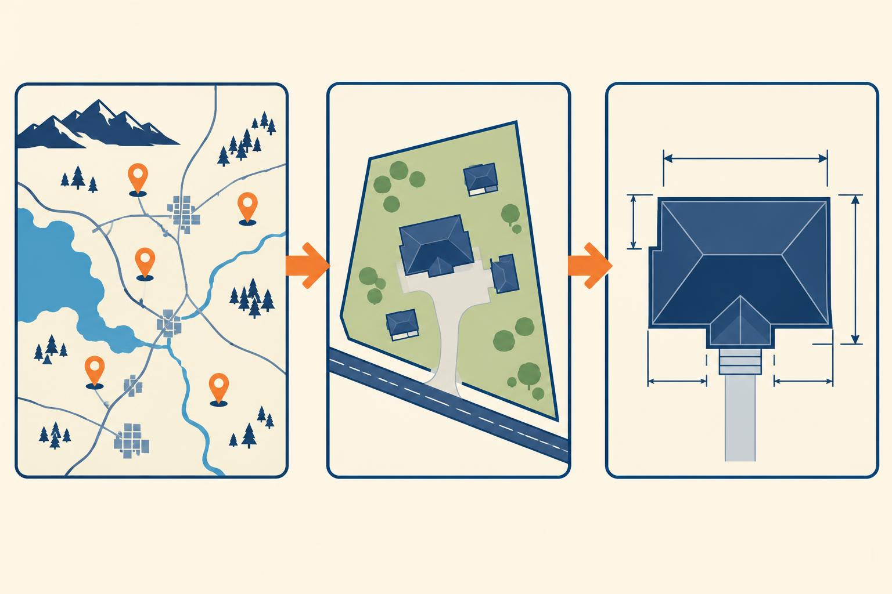

- **Site selection**: *where* in a region should this go?
  - Elimination over many candidate sites: **next week**
- **Site layout**: what goes where on *this* parcel?
  - Footprints, roads, open space: **today and Lab 10**
- **Site design**: the detailed engineering
  - Grading, drainage, utilities: mostly **CAD**
- **Geoplanning** covers all three

<!-- The order in this course is a little backward (layout this week, selection next week), but the ideas stand alone. The point of this slide is the middle bullet: today assumes the site is already chosen. -->

---

# The program and the constraints

**The program**: what has to fit. Lab 10's:

- **80 homes**, each 8 m across
- A **church**, a **mosque**, and a **school**, each 20 m across
- A **market** of at least 4,000 m²
- A **recreation area** for 2 to 4 soccer fields

**The constraints**: where nothing can go

- Flood zones along the **canals**
- **Protected trees** and natural areas
- Anything already there that has to stay

<!-- These are the real numbers from the Lab 10 problem statement, so students hear them once before they meet them in the lab. A site plan is nothing more than the program fitted inside the constraints, with roads tying it together. -->

---

# Constraints become layers

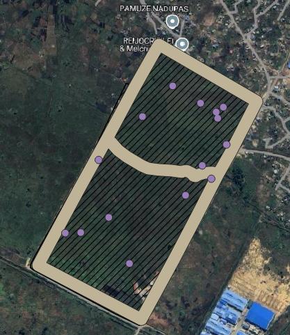

- **Hard constraints**: no exceptions
  - Floodways and setbacks from water
  - Protected habitat, wetlands
  - Easements, existing structures that stay
- **Soft constraints**: allowed, at a cost
  - Steep slope (more grading)
  - Poor soils (deeper foundations)
  - Distance from the road (longer driveways)
- Each one is **its own layer**, usually built with a **buffer**

<!-- The image is the Lab 10 site partway through: the canals digitized and buffered into a tan flood hazard band, and the protected areas as purple points. Ask which of these the students would treat as hard and which as soft. The trees are a judgment call the lab makes for them: they are treated as hard. -->

---

# Opportunities are layers too

- Where can a road **come in** from outside the site?
- Where is the **high ground**?
- Which **utilities** are nearby: water, power, sewer?
- What are the **neighbors**: homes, a highway, a factory?
- Good plans put the program **near** the opportunities and **away** from the constraints

<!-- Constraints say no; opportunities say yes, here. On the Lab 10 site the obvious opportunity is the paved road along the southeast edge, and the obvious neighbor to think about is the industrial yard across it. -->

---

<!-- _class: quiz -->

# Which of these is a constraint, not part of the program?

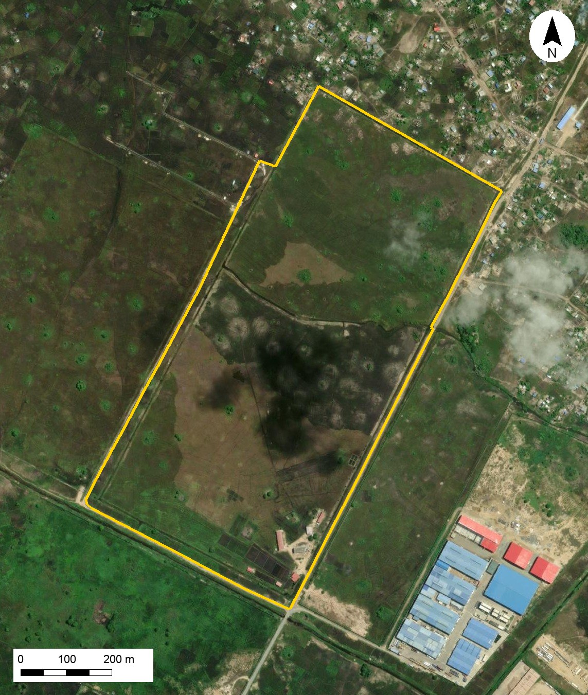

<ol type="A">
<li>A school 20 meters across</li>
<li>A market of at least 4,000 m²</li>
<li>A 25 m flood setback along a canal</li>
<li>Eighty homes</li>
</ol>

<!-- Answer: C. The setback says where things cannot go; the other three are things that must be placed. The image is the Lab 10 site on current imagery with the project boundary in yellow. -->

---

<!-- _class: lead -->

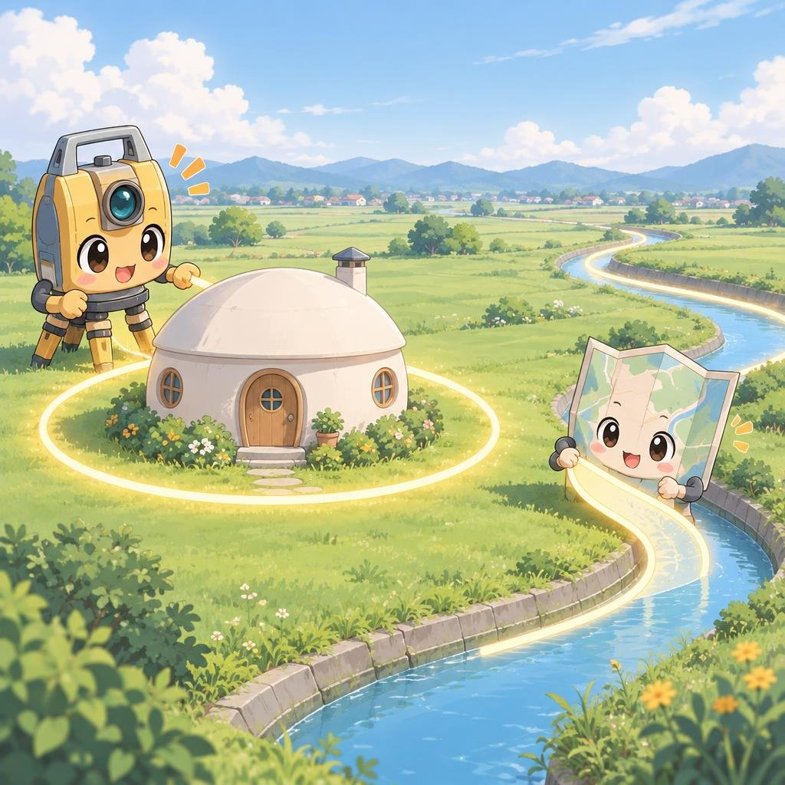

# Part 2

## From a plan to GIS operations

<!-- Anime-style cartoon generated with gpt-image-2.5-flare, November 2026; prompt in tools/divider-images/week11.json. -->

---

# Buildable area = site − constraints

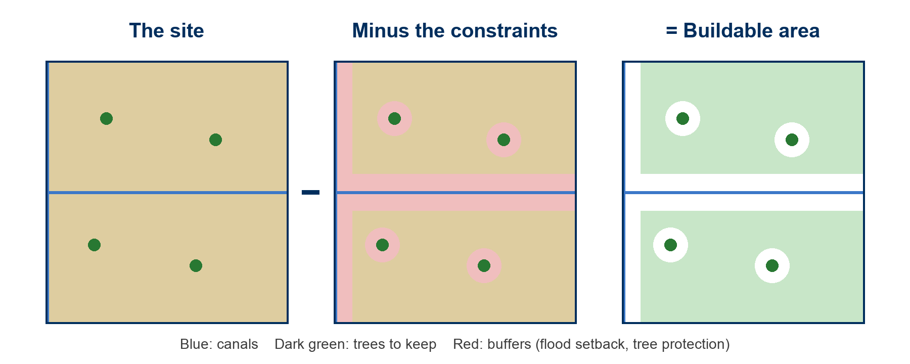

- Buffer each constraint, then take the **Difference**: the site minus the buffers
- What is left is where the program can go. The design happens **inside** it.

<!-- This is the Week 10 geoprocessing toolkit used for design rather than analysis. Difference keeps the part of the site outside the buffers. In Lab 10 students do this step by eye: they draw the buffers and then simply place nothing inside them. In a bigger project you would compute the buildable polygon and measure its area before placing anything. -->

---

# Units decide everything

- A buffer distance is in the **layer's units**
- In **WGS 84** those units are **degrees**: a "25" buffer reaches thousands of kilometers
- Site work needs a **projected CRS in meters**
- Lab 10 starts by setting **EPSG:2736, Tete / UTM zone 36S**, a UTM zone that fits Mozambique
- Check the CRS of **every new layer** too, not just the project

<!-- Week 8 put to work somewhere new. The most common Lab 10 failure is a layer created in WGS 84 by default and buffered in degrees; the lab warns about it in step 15. -->

---

# Shapes from points and lines

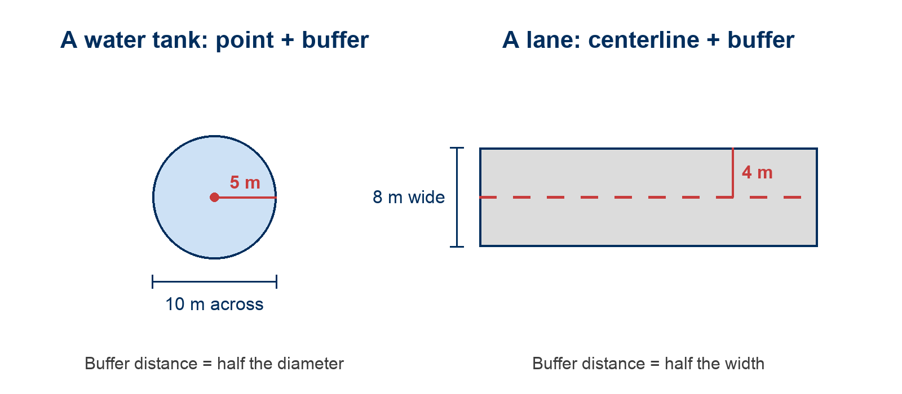

- A buffer goes out the **same distance in every direction**, so the distance is a **radius**
- Footprint: **half the diameter**. Road or lane: **half the width**.

<!-- The numbers here are deliberately not the Lab 10 numbers (a 10 m tank and an 8 m lane), so students still have to apply the rule in the lab. Ask: what buffer distance makes a building 20 m across? Then: what goes wrong if you buffer by the diameter? The circle comes out twice as wide and four times the area. -->

---

# Planning ideas as GIS operations

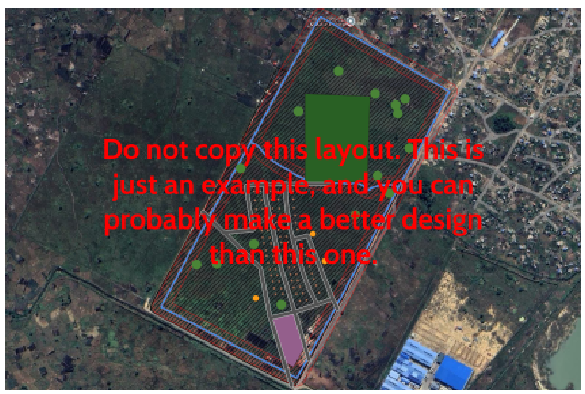

| Planning idea | GIS operation | In Lab 10 |
| --- | --- | --- |
| Hazards and setbacks | **Buffer** | 25 m along canals, 15 m around trees |
| Buildable area | Site **minus** constraints | Placing nothing in the buffers |
| Footprints | **Point** + half-diameter buffer | Homes, church, mosque, school |
| Roads | **Centerline** + half-width buffer | The road network |
| Fit checks | **Measure** area and length | Market, soccer fields |
| Real units | **Projected CRS** | EPSG:2736 |

<!-- This is the slide to photograph. The image is the example plan from the Lab 10 instructions, which tells students not to copy it. Then go straight into the activity: they are about to do every row of this table with a pencil. -->

---

<!-- _class: activity -->

# Activity: Paper Site Plan

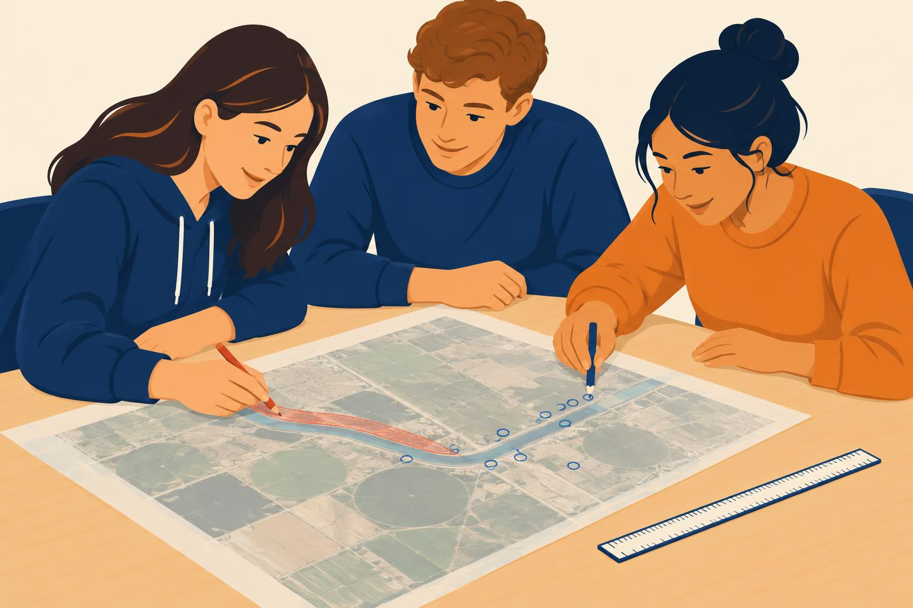

Groups of three. One printed aerial of the Lab 10 site, tracing paper, red and blue pencils.

1. **Red, 5 minutes**: the constraints. Canals, a flood band along each, trees worth keeping, the road entry.
2. **Blue, 5 minutes**: fit **20 homes**, **a school**, **a market**, and a **road** that reaches them all. Use the scale bar.
3. **Report out**: name the GIS operation behind three of your marks.

Everyone uploads the same photo of your group's plan: *In Class Activity - Paper Site Plan*.

<!-- Fifteen minutes. The handout is on the Week 11 activity page (docs/activities/week-11.md): print one per group, fit to letter. At the handout's scale an 8 m home is barely a dot; let them discover that. In the report-out, push for the operation names from the previous slide: buffer, difference, point plus buffer, centerline plus buffer, measure. -->

---

<!-- _class: lead -->

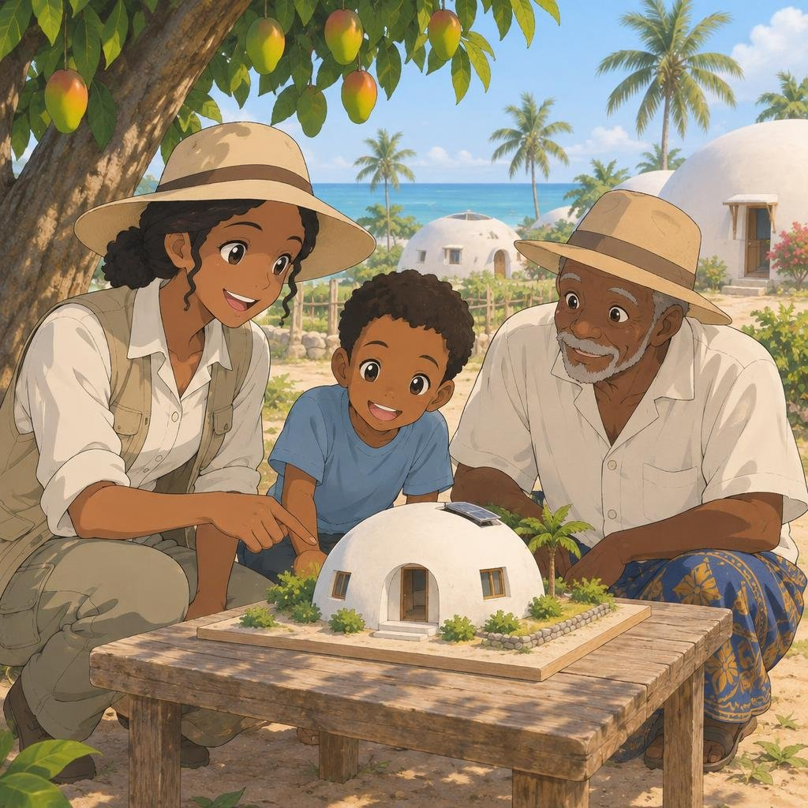

# Part 3

## Why this site, and who it is for

<!-- Anime-style cartoon generated with gpt-image-2.5-flare, November 2026; prompt in tools/divider-images/week11.json. -->

---

# Why Mozambique?

- **10 hurricane-equivalent storms** between 2019 and 2024
- **Cyclone Idai** (2019): flooding visible from space
- **Cyclone Freddy** (2023): the longest-lived tropical cyclone on record, 36 days
- Over half of homes in the 2017 census were **thatch-roofed huts**; many do not survive a cyclone

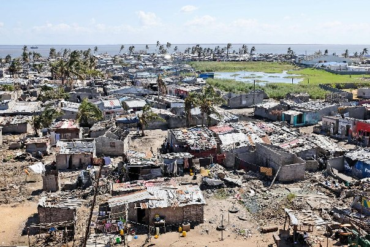

Beira after Cyclone Idai. Photo: Lusa.

<!-- All of these figures come from the Lab 10 background, with its sources (IOM, CNN, WMO, the 2017 Mozambique census). The Lab 10 site is on the edge of Beira, in the area where Idai's flooding was worst, which is why the flood setbacks are the first constraint students draw. -->

---

# Domes for the World

<a href="https://www.youtube.com/watch?v=x1ao3SbEiY0" target="_blank">

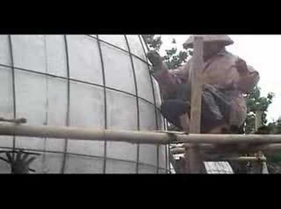

</a>

<a href="https://www.youtube.com/watch?v=x1ao3SbEiY0" target="_blank">youtube.com/watch?v=x1ao3SbEiY0</a>

- Cheap, strong, locally built **dome homes**, with locals trained to build them
- First big project: **New Ngelepen, Indonesia**: 71 dome homes, a mosque, a clinic, and a kindergarten
- Nearly the **same program** you plan in Lab 10
- Reall built a similar community at **Inhamizua**, about 5 miles from the Lab 10 site

<!-- Click the thumbnail to play the New Ngelepen video if there is time; it is short. BYU's Professor Andrew South is involved with Domes for the World, and the lab lists the BYU courses and the Sustainability Lab for students who want more of this. Reall's project page is linked in the Lab 10 problem statement. -->

---

# People are part of the plan

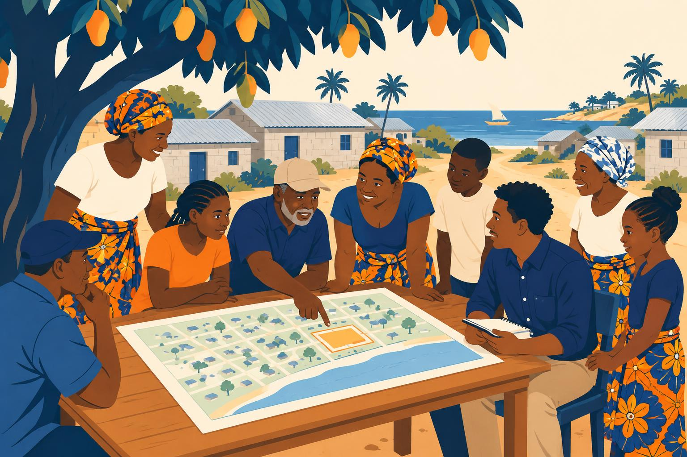

- Where do the **church**, **mosque**, and **school** go? Near the center, the entrance, each other?
- How far will people **walk** to the market, to water, to the road?
- Who gets the homes **farthest from the flood**?
- The data cannot answer these. The **community** can.
- Lab 10 asks you to reflect on this, so think about it as you place things

<!-- The technical half of the plan is the constraints and the buffers. The human half is placement, and it is where a plan succeeds or fails. Ask one student where they put the school in the paper activity, and why. -->

---

# Where GIS stops

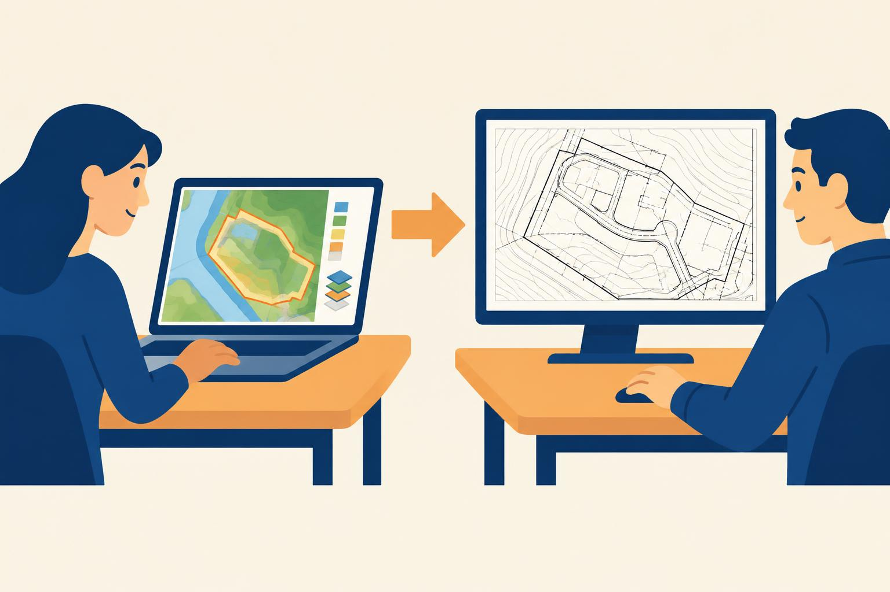

- **GIS** is where you test whether the program **fits** and **where** it should go
- Then the layout moves to **CAD and civil design software** for the engineering:
  - Grading and drainage
  - Utility lines and sizes
  - Exact dimensions for construction
- The GIS layout is the **concept**; the construction drawings come after
- More of this in **CCE 414**

<!-- Be honest about the boundary. Nobody builds from a QGIS buffer. But the concept plan decides most of what is expensive (where the roads go, how much floodplain is used), so getting it right in GIS is worth a lot. -->

---

# Your Lab 10 deliverable

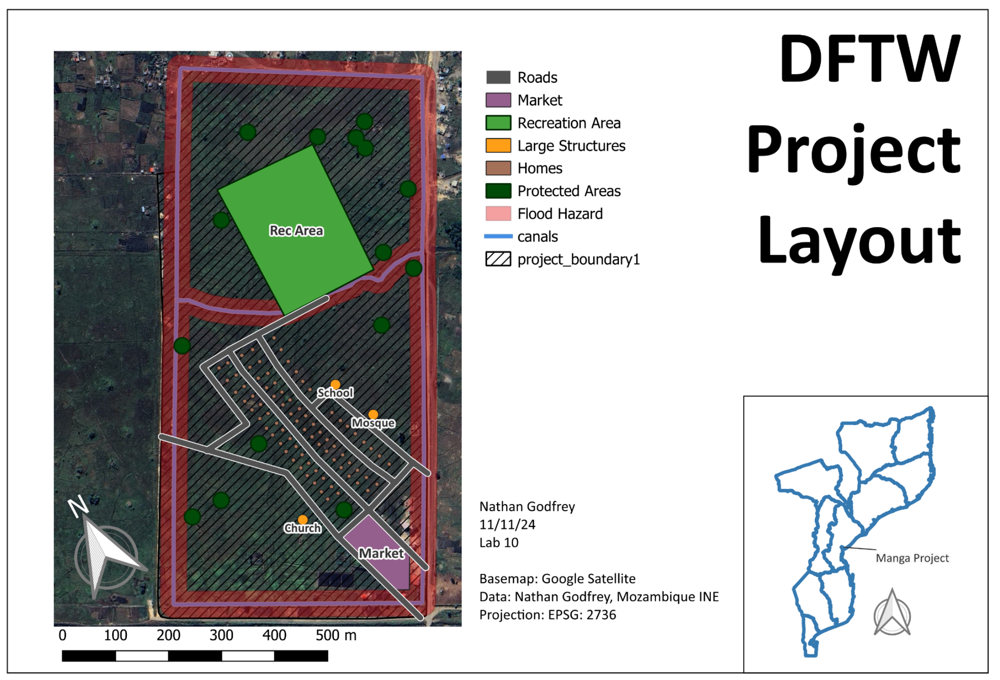

<!-- The finished layout from the Lab 10 instructions, made by a past TA: the site plan with every program element, the flood hazard band, a legend, scale bar, north arrow, and a locator map of Mozambique. Point out the rotated map frame, which the lab shows how to do. -->

---

<!-- _class: activity -->

# Thursday: hands-on in QGIS

- **Georeferencing**: giving coordinates to an image that has none, using ground control points
- The **Web Mapping with AI** kickoff: from a QGIS layer to a public web map
- Bring a laptop with **QGIS 3.44**
- Start **Lab 10** before Thursday so your questions are ready

<!-- Thursday's run sheet is docs/handson/week-11.md. -->

---

<!-- _class: activity -->

# Final Thoughts

**Quiz: What Goes Where?** Eight questions on your phone: program versus constraints, plans as layers, and **buffer arithmetic**. **Scan the code**, or open the link under it.

- Not graded, and every answer explains itself
- Good practice for Lab 10

**Before next class**

- **Lab 10: Domes for Mozambique** is due **Saturday** — [Lab 10](https://byu-hydroinformatics.github.io/cce114-geomatics/assignments/lab-10/)
- No reading quiz this week
- Questions? Office hours: [calendly.com/dan-ames/office-hours](https://calendly.com/dan-ames/office-hours)

byu-hydroinformatics.github.io/cce114-geomatics/quizzes/layout/

<!-- Remind them the buffer questions in the quiz are the ones Lab 10 grades. -->

<!-- Conversion notes (2026-11-05): new deck, no source PowerPoint (none existed for Day 20). Built around Lab 10 and kept separate from the Week 12 site-selection lecture. Real images: the Spanish Fork lot cropped from the Lab 4 QGIS capture; the constraints, example plan, and finished layout captures from Lab 10; the Beira photo (Lusa) from Lab 10; the Lab 10 site aerial is Esri World Imagery tiles with the lab's project_boundary1 drawn on, projected from EPSG:2736 with the Tete_To_WGS_1984_6 transformation; the New Ngelepen video thumbnail from YouTube. Diagrams pl-buildable-area.png and pl-buffer-arithmetic.png were drawn with Pillow; the buffer diagram uses a 10 m tank and an 8 m lane so it does not give away the Lab 10 answers. Reused course illustrations: pl-goals (Day 23), pl-choosing-crs (Day 14), pl-data-layers (Day 22), pl-thursday-qgis (Day 18). Generated illustrations: pl-title-dome-village, pl-three-scales, pl-program-constraints, pl-people-in-plan, pl-gis-to-cad, pl-paper-plan-activity. All statistics on the Mozambique and Domes for the World slides come from the Lab 10 background and its cited sources. -->
