<!-- _class: lead -->
<!-- _paginate: skip -->

# Project Site Selection, Part 1

## Geoprocessing and the Walmart problem

CCE 114 Geomatics
Civil & Construction Engineering
Brigham Young University
Dr. Dan Ames and Dr. James Halgren

<!-- Tuesday concept lecture, Week 12. This is the lecture behind Lab 11 and the pattern students will reuse in Lab 12, the final project. Thursday, we walk through the workflow diagrams and review for the exam; Lab 12 is introduced next Tuesday. -->

<!-- stamp:begin -->
<!-- _footer: 'CCE 114 · Day 22 — Project Site SelectionLast Updated: 2026-11-17© 2026 Daniel P. Ames · <a href="https://creativecommons.org/licenses/by/4.0/">CC BY 4.0</a>' -->
<!-- stamp:end -->

---

# Today's Goals

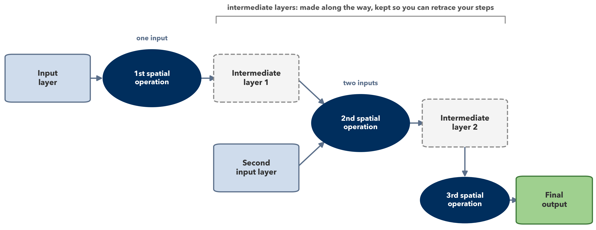

- By the end of class you should be able to:
  - Explain site selection as a **process of elimination**
  - Name the geoprocessing tools that do the eliminating: **Buffer, Clip, Intersection, Difference, Select by Location**
  - Turn a written **criterion** into a specific tool with specific settings
  - Chain those tools into a **workflow**: input layer → operation → new layer → operation → output
  - Sketch the workflow for the Walmart problem before touching QGIS

<!-- Set expectations. Today is the thinking, not the clicking. Lab 11 is where they click. Tell them the exam is this week and that this material is on it. -->

---

# Site selection is a process of elimination

- You are almost never asked "where is the best spot?"
- You are asked: **which places satisfy all of these conditions?**
- So you start with **everything** — the whole county — and take away what fails
- Each criterion is one bite out of the map
- What survives every bite is your answer: a **candidate set**, not a single answer
- The GIS does not pick the site. It narrows the field for the human who does.

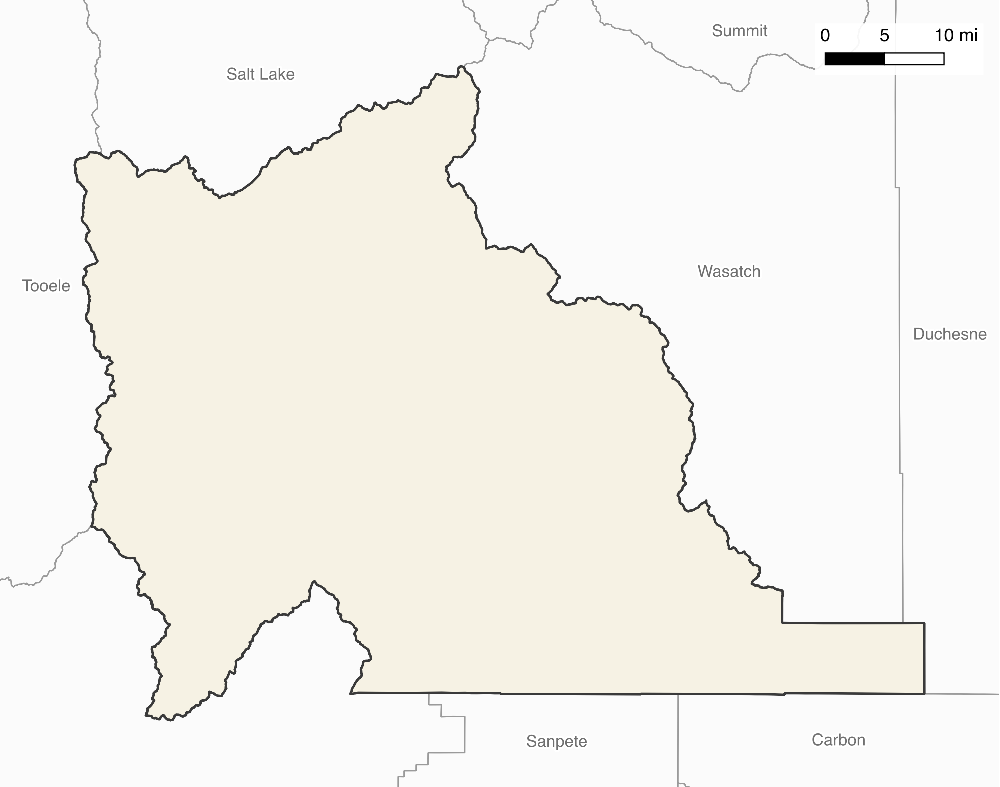

<!-- This is the framing for the whole day. Start with all of Utah County. Every criterion removes area. The output is a set of candidate polygons, and a person still has to choose among them using cost, zoning, ownership, and politics that are not in the data. -->

---

<!-- _class: lead -->

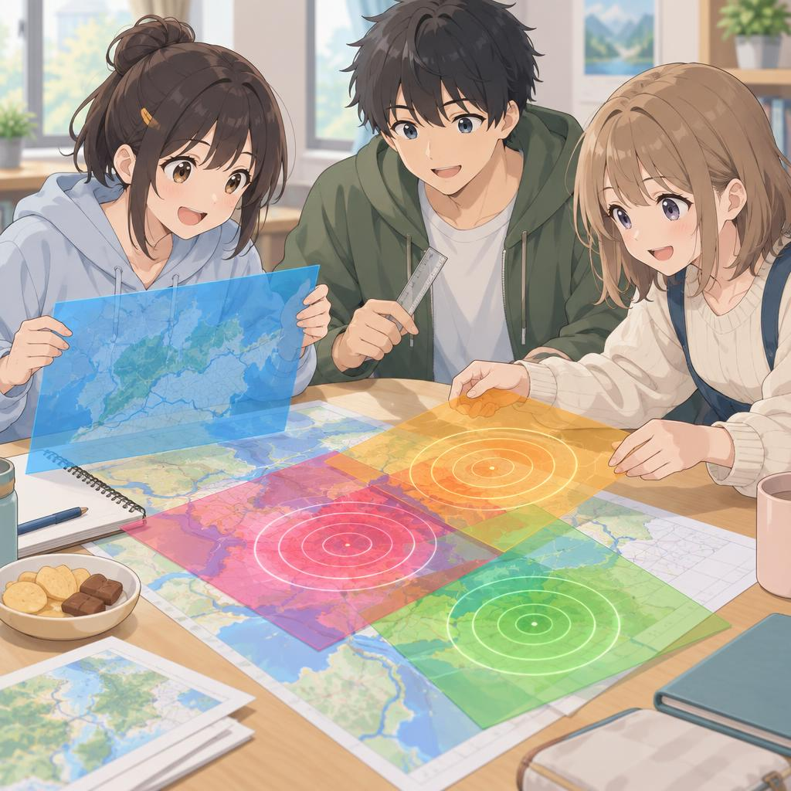

# Part 1

## Review: the common spatial analyses

<!-- Anime-style cartoon generated with gpt-image-2.5-flare, October 2026; prompt in tools/divider-images/week12.json. -->

---

# Reclassify: turn values into classes

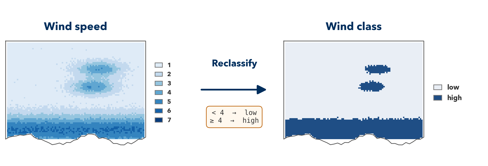

<!-- Reclassify is the raster version of elimination. Continuous wind speed becomes two classes, low and high, using a rule: wind below 4 is low, 4 or more is high. In QGIS this is Raster analysis, Reclassify by table. The lesson is that a criterion is a threshold, and a threshold turns a measurement into a yes or no. -->

---

# Reclassify: population density

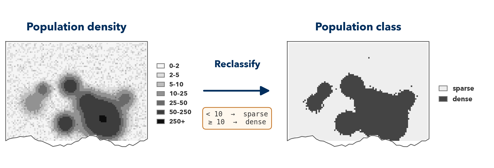

<!-- Same operation on census data: population density becomes population classes. This is exactly the criterion we will use for the Walmart problem, over 5000 people per square mile. Note that here we will do it with an attribute query on polygons rather than on a raster, but the thinking is identical. -->

---

# Buffer: everything within a distance

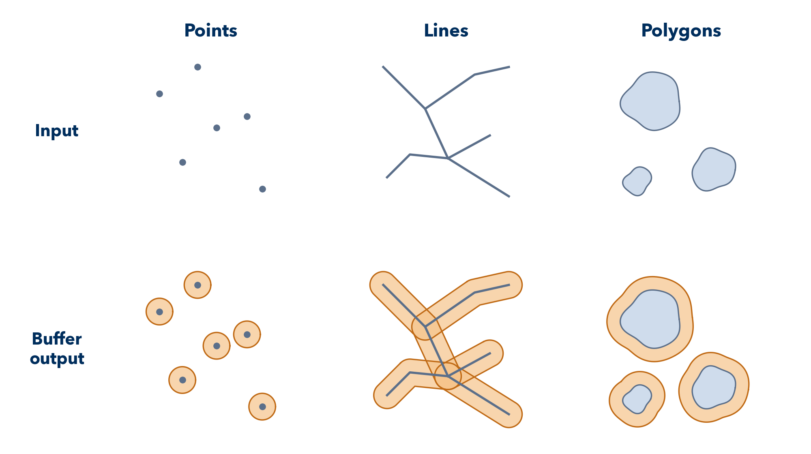

<!-- Buffer works on points, lines and polygons, and always returns polygons. Ask what a buffer of a polygon looks like: the polygon plus a collar around it. In QGIS: Processing Toolbox, Vector geometry, Buffer. Watch the units, which come from the layer's CRS, so a projected CRS in meters or feet, never degrees. -->

---

# Difference: cut a hole in a layer

- **Difference** removes the target features wherever the overlay layer covers them
- Which Boolean operation is like Difference?
  - *(Counties **NOT** Catchment)*
- QGIS: **Vector overlay → Difference**

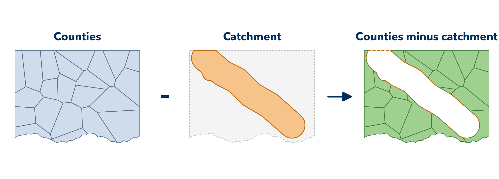

<!-- Answer to the Boolean question: NOT. Counties NOT Catchment. Every overlay tool has a Boolean twin: Intersection is AND, Union is OR, Difference is NOT. If students can hold onto that, they can pick the right tool from the criterion wording alone. -->

---

# Intersection: keep only the overlap

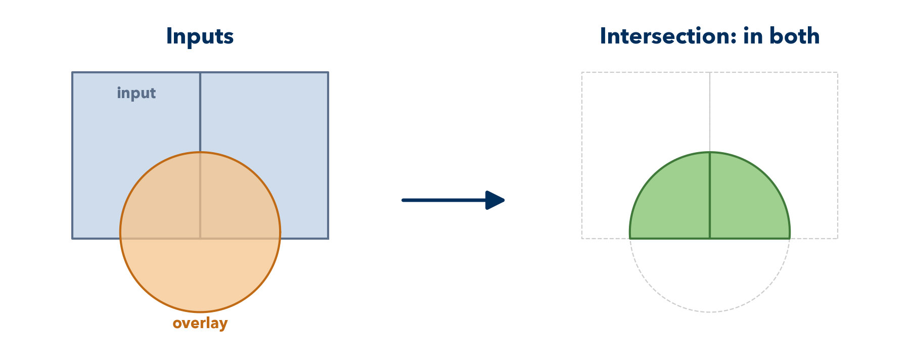

<!-- Intersection is AND. Only the area covered by both inputs survives, and the output carries the attributes of both. This is the workhorse for combining criteria: near a highway AND in a dense census block AND in Utah County. -->

---

# Intersection with real layers

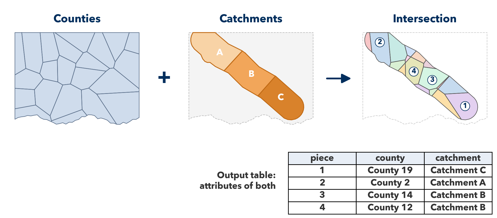

<!-- Catchments intersected with counties. The output has one polygon for every place a catchment and a county overlap, and its table carries both sets of attributes, for example County 19 and Catchment C. Point out how many more features come out than went in: overlay tools split geometry. -->

---

<!-- _class: quiz -->

# Which of the following are geoprocessing tools?

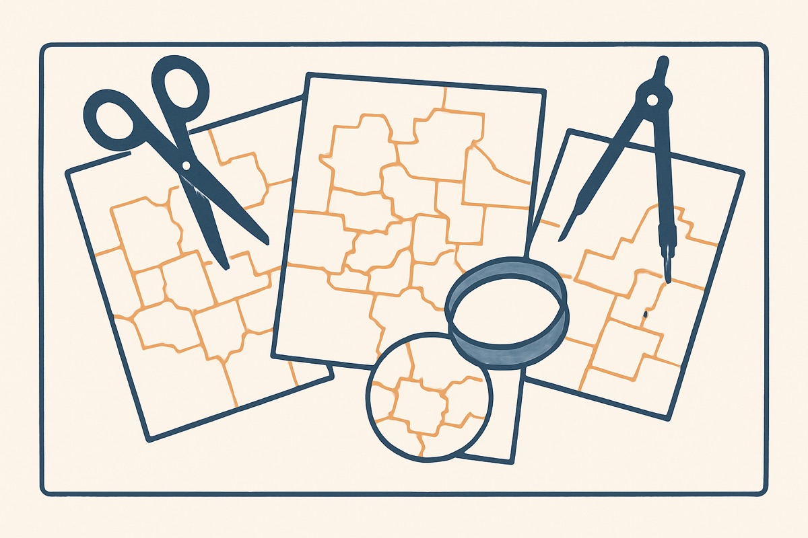

<ol type="A">
<li>Buffer</li>
<li>Union</li>
<li>Intersection</li>
<li>Difference</li>
<li class="answer">All of the above</li>
</ol>

* <i class="step"></i>

<!-- Let them discuss, then press → once to circle the answer. Answer: E. All four are in the QGIS Processing Toolbox under Vector overlay and Vector geometry. (For instructors: ArcGIS and some textbooks call Difference Erase. These students have never used ArcGIS, so do not bring it up unless someone asks.) -->

---

<!-- _class: quiz -->

# Finding all the area that is *near* a school is done with which tool?

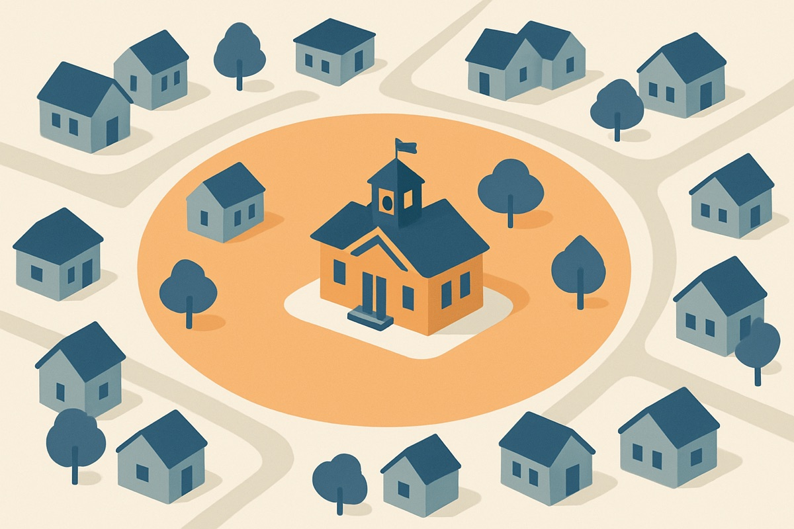

<ol type="A">
<li>Intersection</li>
<li>Union</li>
<li class="answer">Buffer</li>
<li>Difference</li>
<li>Clip</li>
</ol>

* <i class="step"></i>

<!-- Let them discuss, then press → once to circle the answer. Answer: C, Buffer. "Near" is always a distance, and a distance from a feature is always a buffer. Ask them what the buffer distance should be and watch them realize the criterion has to be written down as a number before the tool can run. -->

---

<!-- _class: quiz -->

# Eliminating an area that does *not* satisfy your query is done with…

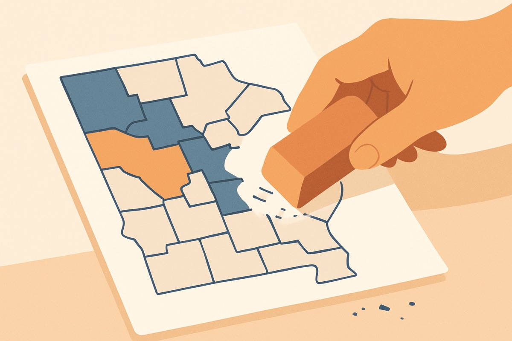

<ol type="A">
<li>Union</li>
<li>Clip</li>
<li class="answer">Difference</li>
<li>Buffer</li>
<li>Intersection</li>
</ol>

* <i class="step"></i>

<!-- Let them discuss, then press → once to circle the answer. Answer: C, Difference. Clip is defensible as a partial answer: Clip keeps what is inside the cutter, Difference keeps what is outside it. Both eliminate; they just eliminate opposite halves. This is the heart of the elimination idea, so spend a minute here. -->

---

<!-- _class: quiz -->

# Intersection and Union

When you run an **Intersection** or a **Union**, the attribute tables of both layers are joined together for…

<ol type="A">
<li>Union only</li>
<li>Intersection only</li>
<li>Neither</li>
<li class="answer">Both</li>
</ol>

* <i class="step"></i>

<!-- Answer: D, Both. Overlay tools carry the attributes of every input layer into the output. That is what makes them different from Clip, which keeps only the input layer's attributes and uses the second layer purely as a cookie cutter. Students often miss that each layer has its own, separate attribute table; the next two slides show the two tables and what QGIS actually writes out. Press → once after the discussion to circle the answer. -->

---
# Two layers, two attribute tables

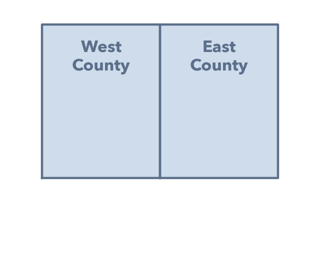

<h3>Counties</h3><table><thead><tr><th>county_id</th><th>county</th></tr></thead><tbody><tr><td>1</td><td>West County</td></tr><tr><td>2</td><td>East County</td></tr></tbody></table>

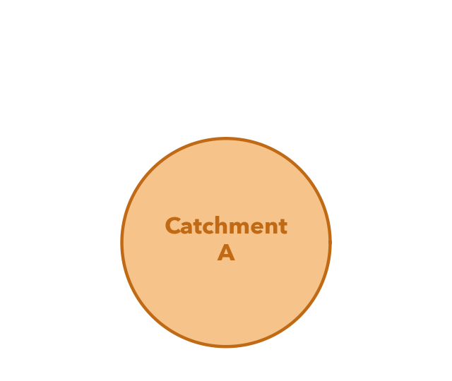

<h3>Catchments</h3><table><thead><tr><th>catch_id</th><th>catchment</th></tr></thead><tbody><tr><td>C1</td><td>Catchment A</td></tr></tbody></table>

<h3>Intersection output</h3>
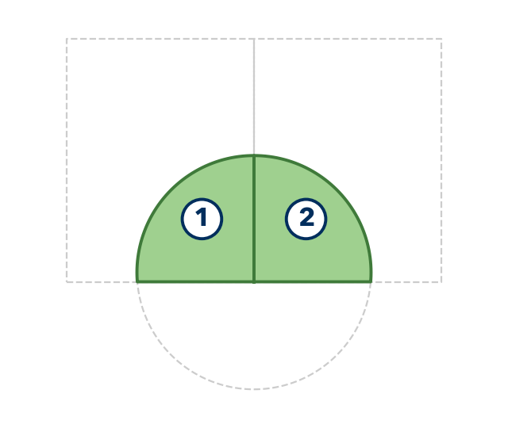
<table><thead><tr><th>piece</th><th>county_id</th><th>county</th><th>catch_id</th><th>catchment</th></tr></thead><tbody><tr><td><b>1</b></td><td>1</td><td>West County</td><td>C1</td><td>Catchment A</td></tr><tr><td><b>2</b></td><td>2</td><td>East County</td><td>C1</td><td>Catchment A</td></tr></tbody></table>

Every column from <b>both</b> tables. One row per piece where they overlap.

* <i class="step"></i>

<!-- Point at the left first: each layer has its own attribute table, and the two tables know nothing about each other. Counties has county_id and county; Catchments has catch_id and catchment. Ask what columns the output will have before you press →. Then press → to bring in the Intersection output: two pieces, one in each county, and each row carries the county's columns AND the catchment's columns. This is not a mock-up: tools/qgis_day22_attribute_demo.py builds these two invented layers in QGIS 3.44 and runs the real Intersection; the table is its output, row for row. -->
---
# Union: both tables again, with gaps

<h3>Counties</h3><table><thead><tr><th>county_id</th><th>county</th></tr></thead><tbody><tr><td>1</td><td>West County</td></tr><tr><td>2</td><td>East County</td></tr></tbody></table>

<h3>Catchments</h3><table><thead><tr><th>catch_id</th><th>catchment</th></tr></thead><tbody><tr><td>C1</td><td>Catchment A</td></tr></tbody></table>

<h3>Union output</h3>
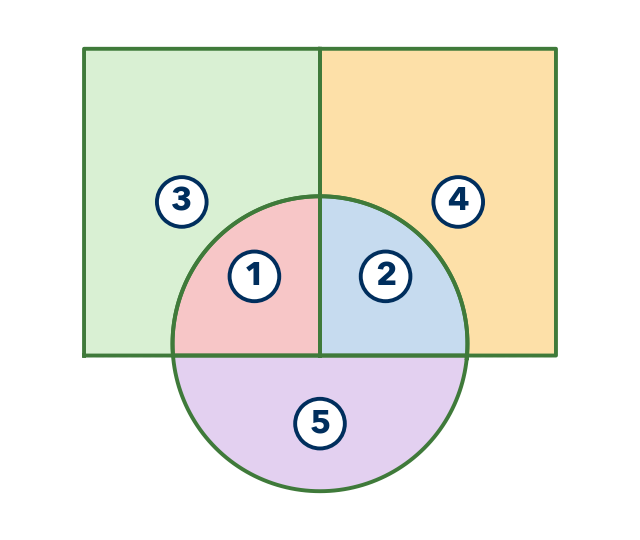
<table><thead><tr><th>piece</th><th>county_id</th><th>county</th><th>catch_id</th><th>catchment</th></tr></thead><tbody><tr><td><b>1</b></td><td>1</td><td>West County</td><td>C1</td><td>Catchment A</td></tr><tr><td><b>2</b></td><td>2</td><td>East County</td><td>C1</td><td>Catchment A</td></tr><tr><td><b>3</b></td><td>1</td><td>West County</td><td class="null">NULL</td><td class="null">NULL</td></tr><tr><td><b>4</b></td><td>2</td><td>East County</td><td class="null">NULL</td><td class="null">NULL</td></tr><tr><td><b>5</b></td><td class="null">NULL</td><td class="null">NULL</td><td>C1</td><td>Catchment A</td></tr></tbody></table>

Still both tables. A piece in only one layer gets <b>NULL</b> for the other layer's columns.

* <i class="step"></i>

<!-- Same two inputs, press → for the Union. Union keeps everything from either layer, so it makes five pieces instead of two: the two overlap pieces (1 and 2) carry both tables just like the Intersection, the parts of each county outside the catchment (3 and 4) have NULL catchment columns, and the part of the catchment outside both counties (5) has NULL county columns. So the quiz answer is Both: Intersection and Union each bring both tables along. Clip is the one that does not; it keeps only the input layer's columns. Real QGIS 3.44 Union output, from the same script. -->
---
# In QGIS: which fields come along?

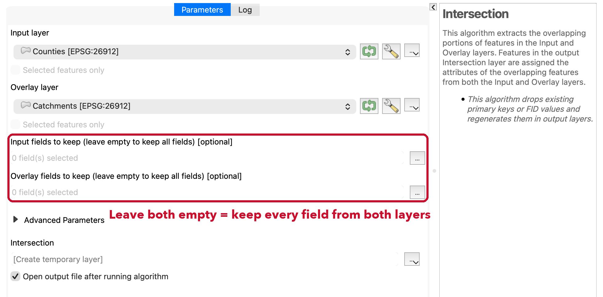

- **Intersection** keeps every field from both layers by default: leave both pickers **empty**
- Click **…** beside a picker to keep only the fields you need
- **Advanced Parameters ▸ Overlay fields prefix** adds a prefix such as `c_` to the overlay's columns, so you can tell them apart
- **Union** has no picker: it always keeps both tables
- **Clip** keeps only the input layer's fields

<!-- There is no "bring the attributes along" checkbox to remember: keeping both tables is the default. The two optional pickers, Input fields to keep and Overlay fields to keep, only ever trim. Captured from the real QGIS 3.44.13 Intersection dialog (Processing Toolbox ▸ Vector overlay ▸ Intersection) with the two demo layers from the previous slides; the prefix option was checked in the same dialog with Advanced Parameters open. The Union parameters (Input, Overlay, Overlay fields prefix, no field pickers) were checked with qgis_process help native:union. -->
---

# Site selection is cookie cutting

<figure>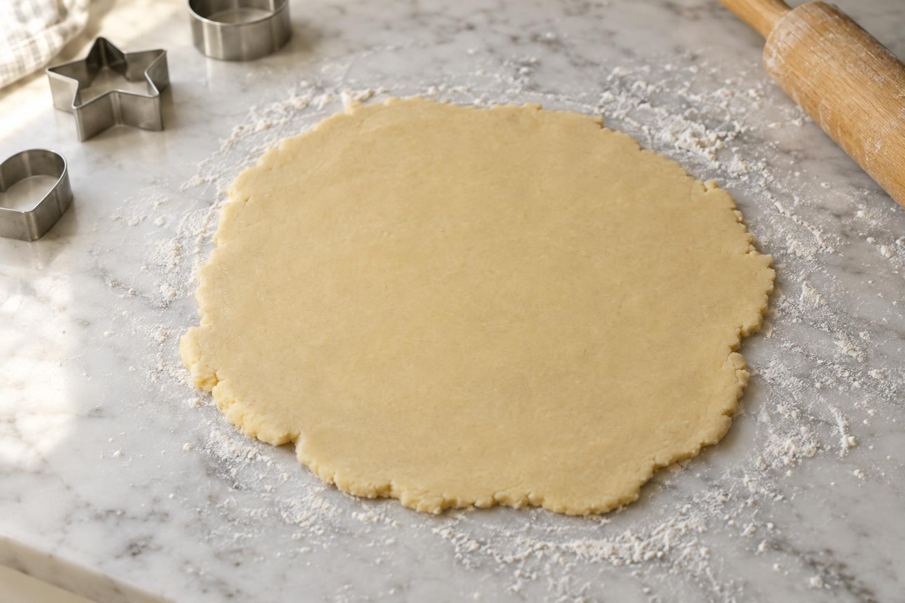<figcaption><b>1. Everywhere.</b> Before any criterion, every place is a candidate.</figcaption></figure>
<figure class="reveal-1">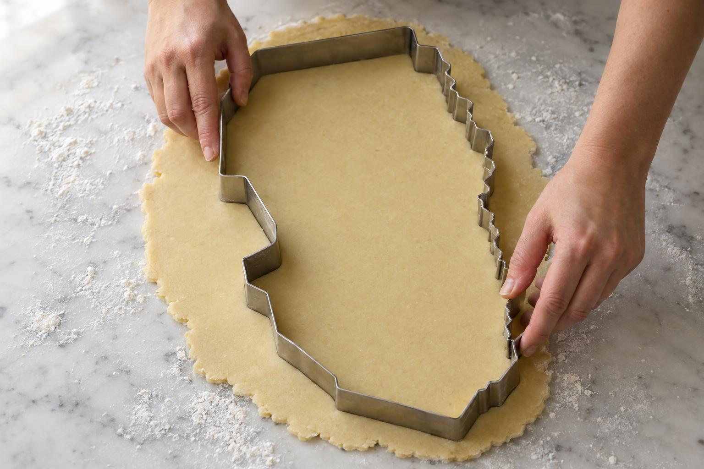<figcaption><b>2. Cut to the county.</b> The study area is the first cutter: <b>Clip</b>.</figcaption></figure>
<figure class="reveal-2">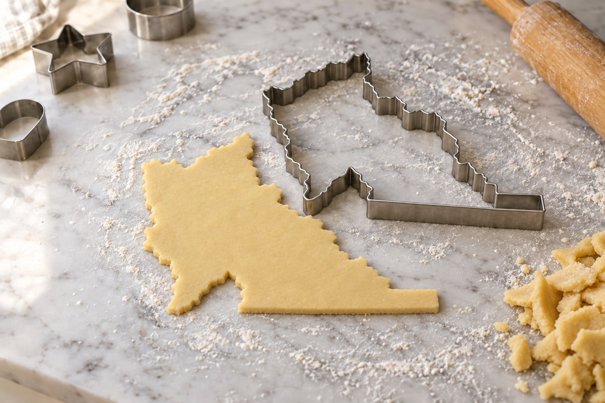<figcaption><b>3. A new layer.</b> Everything outside the county is gone.</figcaption></figure>
<figure class="reveal-3"><figcaption><b>4. Within 2 miles of I-15.</b> Keep what is <i>inside</i> the cutter: <b>Intersection</b>.</figcaption></figure>
<figure class="reveal-4"><figcaption><b>5. Not near a Walmart.</b> Remove what is <i>inside</i> each cutter: <b>Difference</b>.</figcaption></figure>
<figure class="reveal-5"><figcaption><b>6. What is left</b> passes every criterion: the candidate sites.</figcaption></figure>

* <i class="step"></i>
* <i class="step"></i>
* <i class="step"></i>
* <i class="step"></i>
* <i class="step"></i>

<!-- The whole Walmart lab in one picture, before we touch the real data. Press → once per panel. 1: the rolled dough is everywhere; nothing has been ruled out. 2: the county-shaped cutter is the study area, a Clip. 3: the cut piece is a brand new layer and the scraps are thrown away. 4: the long band is the 2-mile buffer around I-15; pressing it in and keeping what is inside is an Intersection. 5: each round cutter is a 2-mile buffer around an existing store; this time we throw away what is inside, a Difference. 6: what is left satisfies every criterion at once, and that leftover dough is the answer to the lab. The one idea to land: Intersection keeps what is inside the cutter, Difference removes it. (Bring cookies some semester; the analogy sticks even better with a real sugar cookie in hand.) The census-density cut is left out of the pictures to keep it to six; mention that it is one more cutter. Images generated with gpt-image-2.5-flare (panel 4 with gpt-image-2.5-sunburst), November 2026; prompts in tools/divider-images/week12-cookies.json. Day 23's Workflow Walkthrough deck has an older, different cookie series (state, county, lake, stores). -->

---

<!-- _class: lead -->

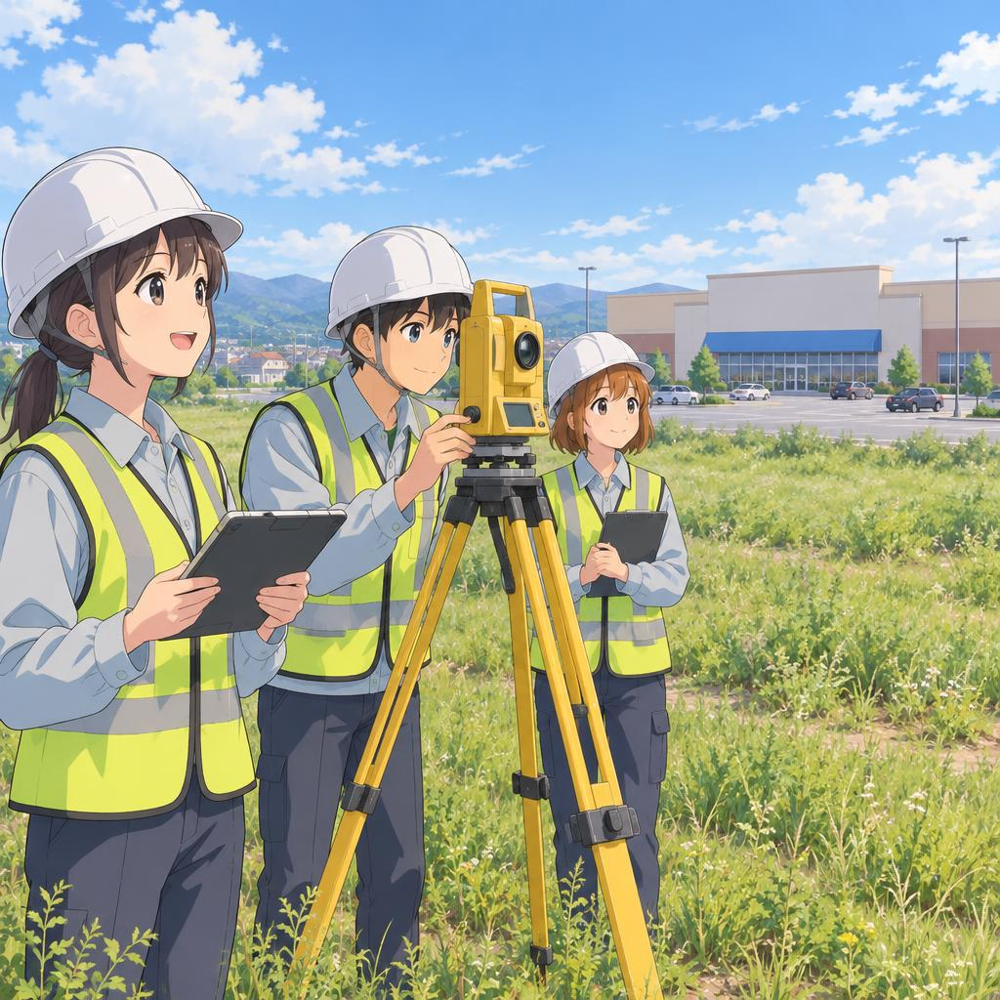

# Part 2

## The Walmart problem

<!-- Anime-style cartoon generated with gpt-image-2.5-flare, October 2026; prompt in tools/divider-images/week12.json. -->

---

# Where to put a new Walmart in Utah County?

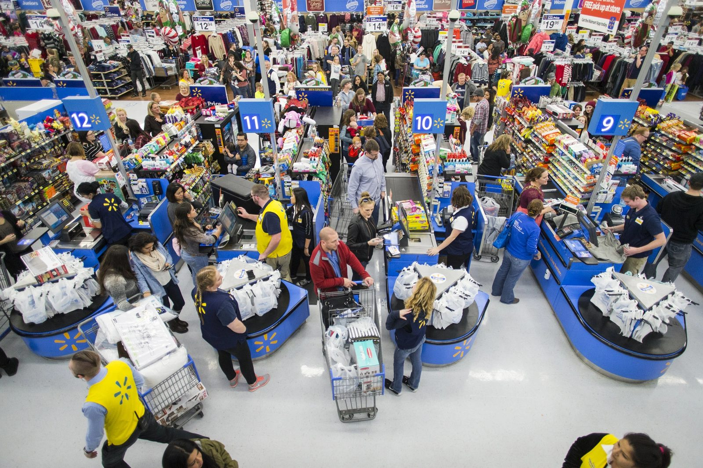

- Let's use geoprocessing tools to solve a real **site selection** problem
- Walmart really does this: a store is a nine-figure decision driven by drive time, competition, and density
- We will do a simplified version with data you can download today
- Store locations: Walmart's own public [ArcGIS REST service](https://services1.arcgis.com/WyIdBuoLrhwRHOSA/arcgis/rest/services), streamed into QGIS like the SGID in Lab 6

<!-- This is the problem for the rest of the hour and for Lab 11. Walmart publishes its own store locations as a public feature service, so students do not digitize points off Google Maps the way the old version of this lab did. Walmart retired the Open Data Hub download site in autumn 2026; the same kind of data is still public as the Walmart_Facilities_(Public) service, and Lab 11 step 7 now connects to it through the Data Source Manager. -->

---

# Criteria: from words to numbers

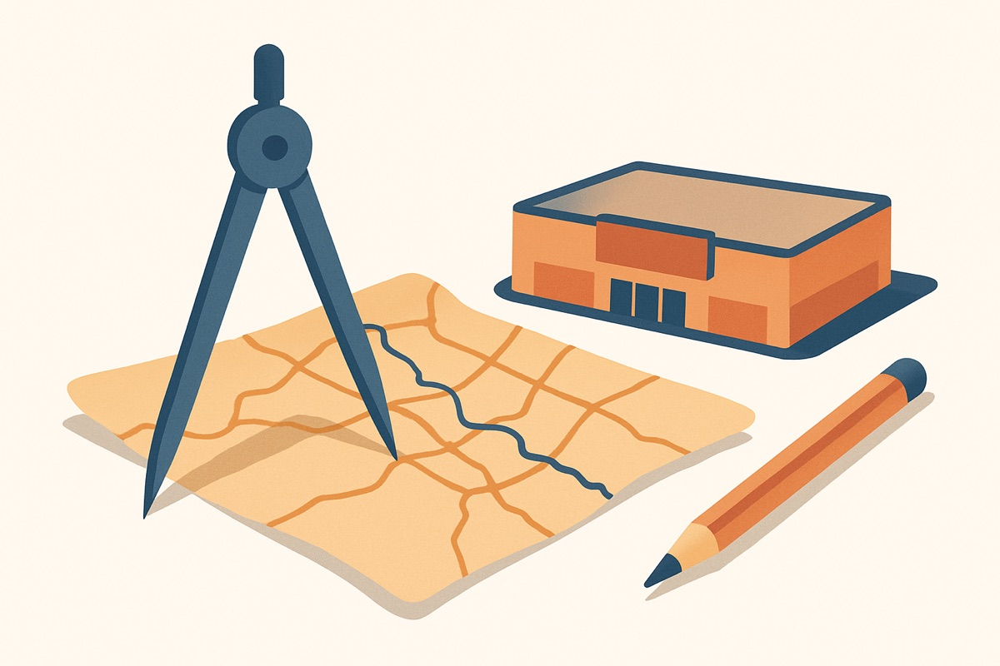

<table class="crit">
<thead><tr><th>The wish</th><th>Written precisely</th></tr></thead>
<tbody>
<tr><td>Not near an existing Walmart</td><td class="reveal-1">At least <b>2 miles</b> from any existing Walmart</td></tr>
<tr><td>Near major roads</td><td class="reveal-1">Within <b>2 miles</b> of I-15 or a highway</td></tr>
<tr><td>Near lots of people / families</td><td class="reveal-1">Over <b>5,000 people per square mile</b> (2020 Census blocks)</td></tr>
<tr><td>In Utah County</td><td class="reveal-1">Inside the <b>Utah County boundary</b></td></tr>
<tr><td>Room for a store</td><td class="reveal-1">Stores run 51,000–224,000 ft², averaging about <b style="white-space: nowrap;">102,000 ft²</b>: one must fit without demolishing large areas of buildings. <i>A judgment call.</i></td></tr>
</tbody>
</table>

* <i class="step"></i>

<!-- Read the left column as ordinary English: this is how a client states what they want. Then ask the class to rewrite each one so a computer could execute it, and let them try before you press →. Press → once to bring in the whole right column. The difference between a wish and a criterion is a number and a unit: "not near a Walmart" is a wish; "at least 2 miles from any existing Walmart" is something Buffer can execute. The last row, adequate space, is the hard one: no threshold in the toolbox decides it, so students have to make and defend a judgment call, in Lab 11 by looking at imagery. -->

---

# Criterion → data → tool

<table class="cdt">
<thead><tr><th>Criterion</th><th>Data layer</th><th>QGIS tool(s)</th></tr></thead>
<tbody>
<tr><td>At least 2 mi from any Walmart</td><td>Walmart's store service, <i>Walmart_Facilities_(Public)</i></td><td class="reveal-1"><b>Buffer</b> 2 mi, then <b>Difference</b></td></tr>
<tr><td>Within 2 mi of a highway</td><td>UGRC roads</td><td class="reveal-1">Select I-15 and highways, <b>Dissolve</b>, <b>Buffer</b> 2 mi, <b>Intersection</b></td></tr>
<tr><td>Over 5,000 people/mi²</td><td>UGRC Census 2020 Blocks</td><td class="reveal-1"><b>Field Calculator</b> for density, then <b>Extract by Expression</b></td></tr>
<tr><td>In Utah County</td><td>UGRC county boundary</td><td class="reveal-1"><b>Clip</b></td></tr>
<tr><td>Room for a store</td><td>Satellite imagery</td><td class="reveal-1">No single tool: your judgment</td></tr>
</tbody>
</table>

Every layer arrives in Web Mercator (EPSG:3857): <b>Reproject Layer</b> first, before any Buffer.

* <i class="step"></i>

<!-- Three questions, always in this order: what are the criteria, what data answers each criterion, what tool turns that data into a yes or no. Students who skip straight to the tools get lost, so with the tool column still hidden, have them name the tool for each row first, in pairs, then press → once to bring in the answers. "Not near" is a Buffer plus a Difference; "near" is a Buffer plus an Intersection; "in" is a Clip; "high density" is a new field plus an attribute query. Every criterion except the last is a tool; adequate space stays a judgment call made by looking at imagery. Lab 11 does several of these with Extract by Location and Extract by Attribute instead (same result, different tool), which is a good point to make: there is usually more than one right tool. The note at the bottom sets up the "Reproject before you buffer" slide later on: every UGRC download and Walmart's service arrive in EPSG:3857, so reproject before any Buffer or the 2 miles come out about 1.5. The slides that follow walk each row on the real data. -->

---

# Data

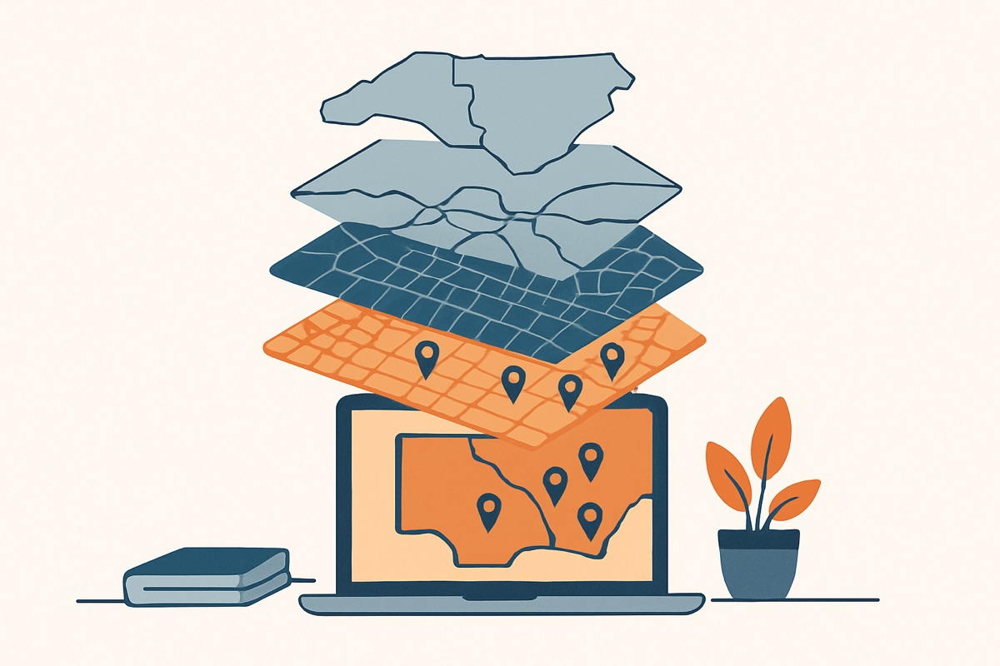

- **Utah County boundary** and **roads and freeways**: [Utah Geospatial Resource Center (UGRC)](https://gis.utah.gov/), formerly AGRC
- **Census blocks:** the "Census 2020 Blocks" dataset in UGRC's Demographics category
  - Download the Census redistricting file README too — it explains the column headers
- **Existing Walmart locations:** Walmart's own [ArcGIS REST service](https://services1.arcgis.com/WyIdBuoLrhwRHOSA/arcgis/rest/services), layer *Walmart_Facilities_(Public)*, about 5,600 stores, streamed live
- Everything lands in QGIS as a **layer**, and every one of these arrives in **Web Mercator (EPSG:3857)**. Remember that for the buffer step.

<!-- The 2021 version of this lab had students digitize Walmart locations by eye off Google Maps. Walmart's public feature service is faster and more defensible. Its Open Data Hub download page went away in autumn 2026, so Lab 11 now has students add an ArcGIS REST connection to Walmart's server, the Lab 6 skill again. The second bullet sets up the reproject slide: UGRC's downloads and both REST services are all EPSG:3857, whatever the project CRS says. -->

---

# Tools: the QGIS Processing Toolbox

- **Select by Expression** — features that match a rule
- **Buffer** — everything within a distance. Proximity.
- **Clip** — cut the input to an overlay's shape. Cookie cutter.
- **Intersection** — keep only the overlap, with both tables
- **Difference** — remove the overlay's area
- **Select / Extract by Location** — features by where they sit
- **Dissolve** — merge features that share a value
- **Field Calculator** — a new column, e.g. a density field
- **Reproject Layer** — into a projected CRS before any distance tool

<!-- Fuller versions of each line: Select by Expression finds features matching a rule, e.g. all roads where RT_NAME = '0015', or all census blocks above a density threshold. Buffer is the area within a given distance of a feature. Clip cuts the input layer to the shape of an overlay layer. Intersection keeps only where two layers overlap and carries both attribute tables. Difference removes the input wherever the overlay covers it. Select by Location / Extract by Location picks features by how they sit relative to another layer. Dissolve merges features that share an attribute value into one. Field Calculator computes a new column, e.g. density = population / area. Reproject Layer writes a copy of a layer in a new CRS; run it before Buffer whenever the layer is in Web Mercator or latitude/longitude. These are the tools for Lab 11 and the final project. Every one of them is in the Processing Toolbox; teach them the search box at the top of the toolbox rather than memorizing menu paths. -->

---
# Geoprocessing workflows

<!-- The shape of every geoprocessing job. A rectangle is a layer, an oval is an operation. An operation eats one or more layers and makes a new layer, which the next operation eats. Some operations eat one layer (Buffer, Dissolve, Reproject Layer); many eat two (Intersection, Difference, Clip, Select by Location), which is how a second input joins the chain. The layers made along the way are intermediate layers: keep them and give them names you will recognize, so you can check each step and retrace your work. Have them draw this shape on paper before they open QGIS: it is the single most useful habit in the course. Original figure drawn by tools/draw_day22_figures.py; it replaces the diagram from Bolstad's GIS Fundamentals. -->
---

# Utah County

<!-- Start here: the whole county, everything still in play. Selected from a statewide counties layer with Select by Expression, then exported as its own layer. -->

---

# UDOT routes

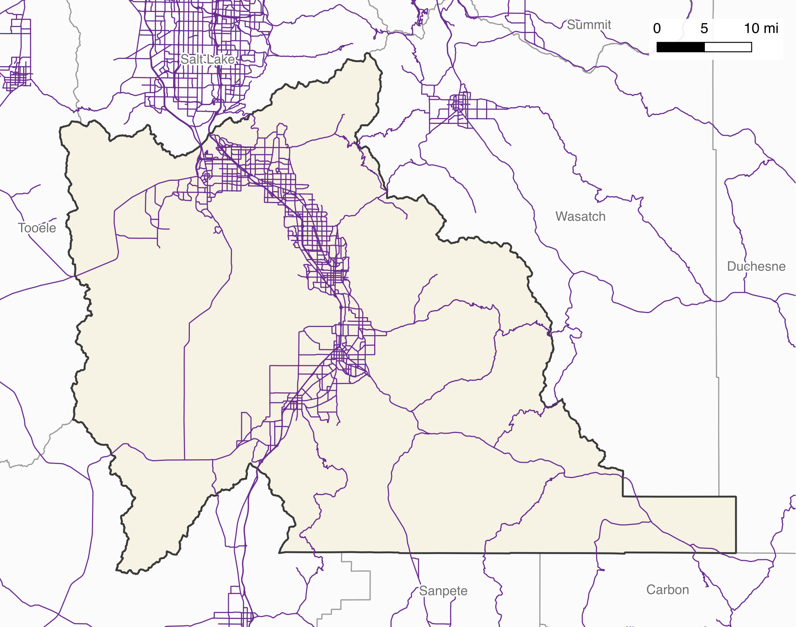

<!-- Every UDOT route in and around the county, from UDOT's route system on UGRC, mainlines and ramps. Too much: we only want I-15 and the highways. The next two slides show how to narrow it. -->

---

# The attribute table tells you how to select

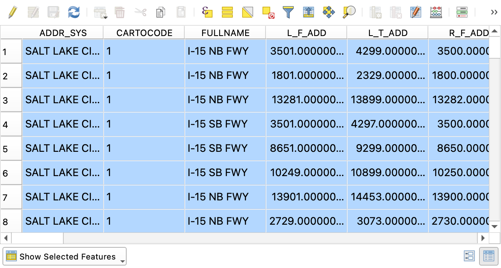

<!-- Open the attribute table before you write any query. HWYNAME, DOT_RTNAME, FULLNAME: the column that separates interstates from local roads is right there. This is the QGIS 3.44 attribute table for the UGRC major roads layer, switched to Show Selected Features after selecting HWYNAME = 'I-15': every row is one piece of the interstate. -->

---

# Just I-15 and the highways

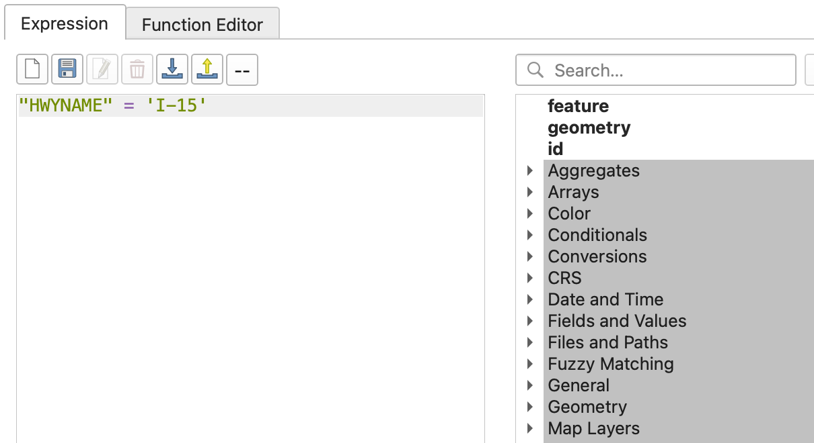

<!-- An attribute query, "HWYNAME" = 'I-15', selects I-15 out of the full roads layer. This is the QGIS Select by Expression dialog; Extract by Expression from the Processing Toolbox gives the same result as a new layer in one step. Note that I-15 comes out as many separate line features, which is why we Dissolve before buffering. -->

---

# Buffer I-15: what does it look like?

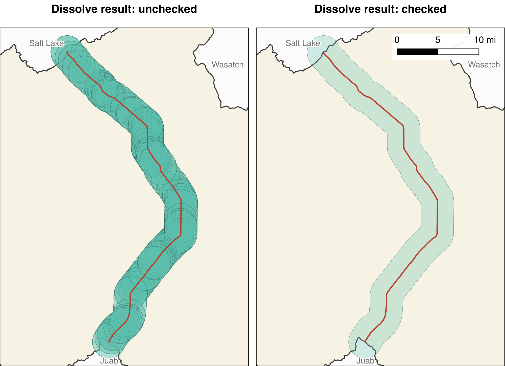

<!-- Two miles either side of the interstate, the same Buffer run twice in QGIS 3.44. Ask what went wrong on the left: I-15 inside the county is 180 separate line features, the buffer is drawn around each one, and the overlapping shapes show the segments. Check "Dissolve result" in the Buffer dialog, as Lab 11 step 25 says, and you get the one clean corridor polygon on the right. Also check the units: 2 miles is about 3219 meters, and the next slide shows what happens when those meters are the wrong kind. -->

---

# Reproject before you buffer

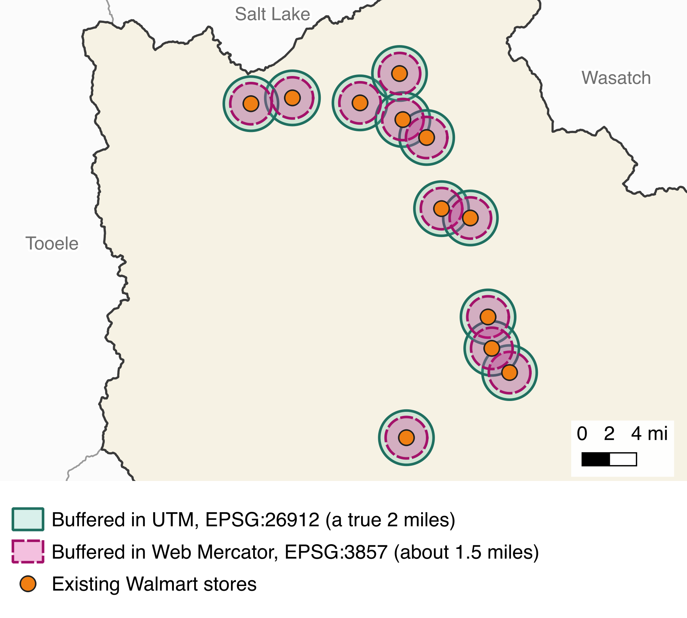

<!-- The same "2 miles" typed into the same Buffer tool on the same 12 stores, twice. Green: the stores reprojected to UTM zone 12N, EPSG:26912, then buffered; a true 2 miles. Magenta, dashed: buffered while still in Web Mercator, EPSG:3857, the CRS every UGRC download and Walmart's REST service arrive in. A Web Mercator meter is stretched by one over the cosine of the latitude, about 1.31 at 40 degrees north, so the magenta circles are about 1.5 real miles across. The project CRS does not fix it: Buffer uses the layer's CRS. Run the whole lab in Web Mercator and about 2,480 blocks survive instead of 1,871, a third too many, because the Walmart buffer is too small. That is why Lab 11 steps 25 and 26 now run Reproject Layer first. Ask the room: which way would the error go at the equator? (None: cos 0 = 1.) In Alaska? (Much worse.) -->

---

# Current Walmarts

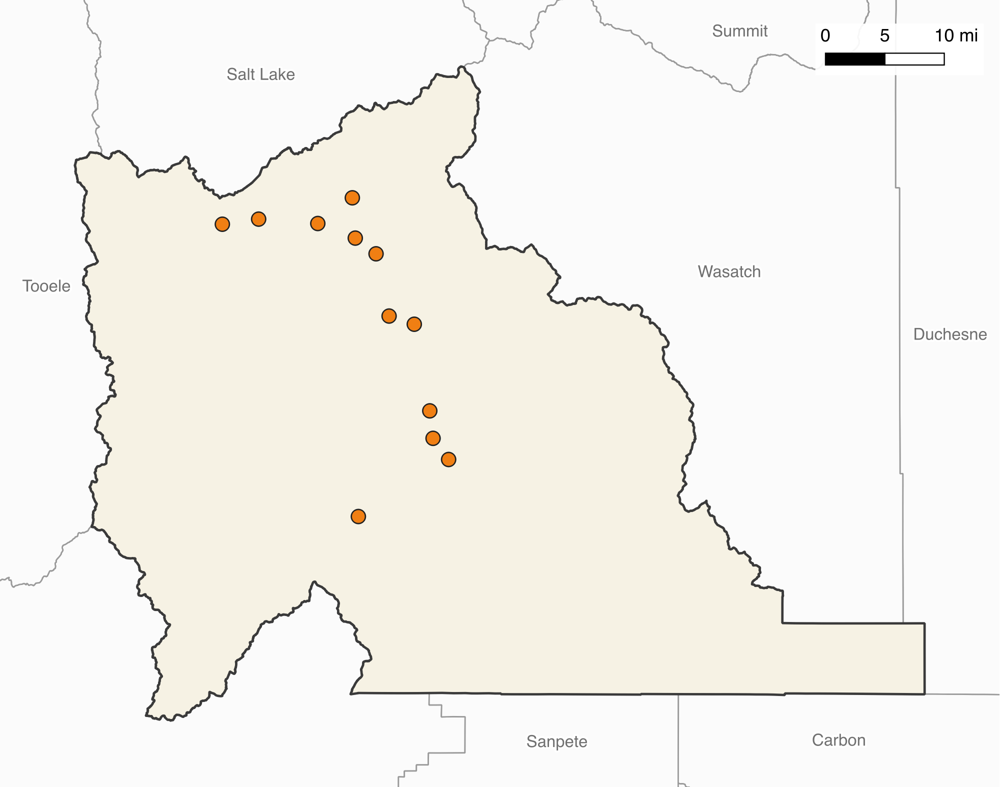

<!-- Twelve existing stores from Walmart's own store service, Walmart_Facilities_(Public), checked November 2026 (the Provo Sam's Club left out, as Lab 11 does; the Eagle Mountain store is in this service but not in the older one the lab used to link to), strung along the I-15 corridor because that is where the people are. Ask why the stores are already clustered where our "close to roads" criterion says to build: the criteria are not independent, and the competitor layer will be doing most of the eliminating. -->

---

<!-- _class: activity -->

# Buffer? What next?

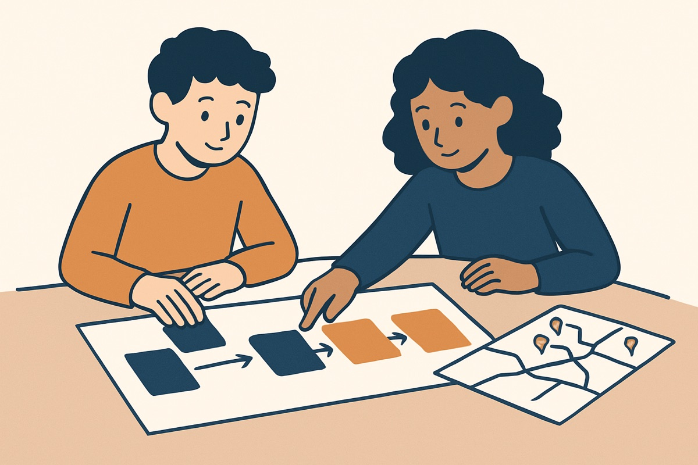

- We have the Walmart points. **Buffer them 2 miles.** Then what?
- In pairs, put the remaining steps in order and name the tool for each:
  - Keep only what is inside Utah County
  - Remove everything within 2 miles of an existing store
  - Keep only what is within 2 miles of I-15 or a highway
  - Keep only the census blocks over 5000 people per mi²
- **Does the order matter?** Where would you put the slowest step?

<!-- Five minutes in pairs, then a show of hands on the two questions worth arguing about: which pair of tools does "at least 2 miles from an existing Walmart" (Buffer, then Difference), and whether the order matters. For this chain, any order that runs each step after the layers it needs gives the same polygons, because both buffers are made from the original layers and Clip, Intersection and Difference commute here. What the order changes is run time: clip to the county first and every later step works on a fraction of the data, a real lesson for the final project. One catch inside this chain: compute density on whole census blocks before any clip or intersection, or the clipped areas change the density. Do not let "same answer here" become "order never matters": in general, swapping steps changes the answer (buffering the result of an intersection is not the same as intersecting a buffer), and the concepts exam tests the general rule. Thursday's order quiz comes back to this. -->

---

# Census blocks

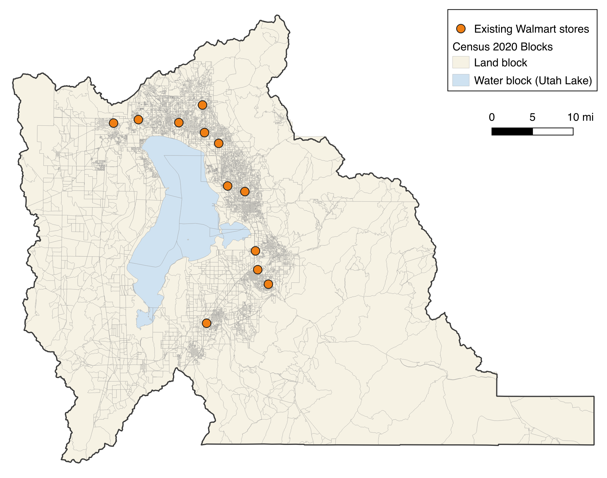

<!-- UGRC's Census 2020 Blocks for Utah County, the same layer students download in Lab 11 (10,092 blocks, 659,399 people), with the 12 existing Walmart stores from Walmart's own store service on top, Sam's Club left out as the lab does. The pale blue blocks are water: Utah Lake is census blocks too, with nobody living in them. Blocks are tiny downtown and huge in the mountains, which is exactly why we need density, population divided by area, rather than raw population counts. That is a Field Calculator job. -->

---

# Putting it all together

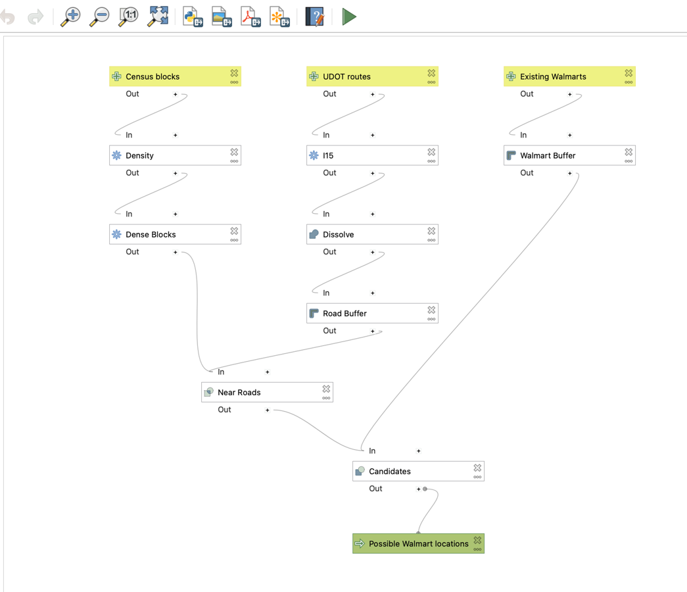

<!-- The full workflow in the QGIS Model Designer (Processing ▸ Model Designer): yellow boxes are the three inputs, white boxes are algorithms, the green box is the output. Trace the three branches with them: census blocks to a density field and an extract by expression, roads to I-15 then Dissolve then Buffer, Walmarts to a Buffer. Intersection keeps the dense blocks near roads, Difference removes the existing-Walmart buffers, and out comes Possible Walmart locations. -->

---

# The answer: a candidate set

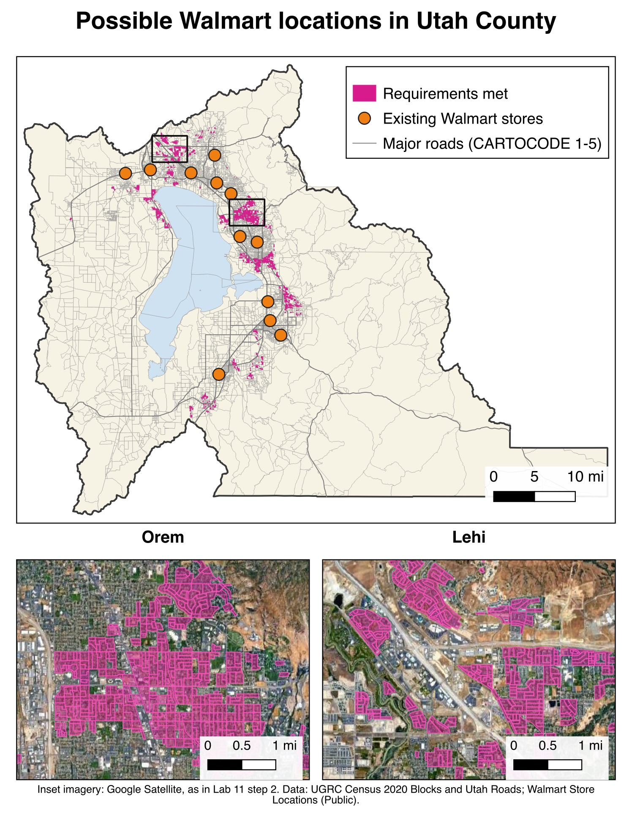

- Everything that survived every criterion
- Biggest clusters: **Orem–Provo**, **Lehi**, **Saratoga Springs**, **Springville**
- Not "the site" — a shortlist for a human to argue about
- Now go back and ask: which criterion did the most eliminating? What would change if 2 miles became 3?

<!-- The payoff: Lab 11 run exactly as written, in QGIS 3.44 with UGRC's data and Walmart's store service, re-run November 2026 with the reproject step. 1,871 census blocks, about 162,400 people, pass every criterion: Orem 35,000 people, Provo 33,600, Lehi 31,900, Saratoga Springs 15,000, Springville 11,900 (UGRC municipal boundaries). Magenta is "requirements met," and the insets zoom into Orem and Lehi on Google Satellite, the lab's basemap. Students will have to pick two sites inside clusters like these. Push the sensitivity question: a site selection result is only as good as the thresholds, and a good analyst reports how sensitive the answer is to them. This is the standard the final project maps will be graded against. -->

---

<!-- _class: activity -->

# Thursday: hands-on in QGIS

- Review of **workflow diagrams**: how to draw one and how to read someone else's
- **Study session for Concepts Exam 2** — bring your questions

<!-- Preview of Thursday: the workflow diagram review, then the floor opens for exam review. Lab 12, the final project, is introduced next Tuesday (Week 13), so do not promise it on Thursday. -->

---

<!-- _class: activity -->

# Final Thoughts

**Quiz: Where Would You Put It?** Eight questions on your phone: from a **requirement** to a criterion, **chaining** it, and believing the answer. **Scan the code**, or open the link under it.

- Not graded, and every answer explains itself
- Good practice for the exam and for Lab 11

**Before next class**

- **Lab 11: Walmart Site Selection** is due **Saturday** — [Lab 11](https://byu-hydroinformatics.github.io/cce114-geomatics/assignments/lab-11/)
  - Stores: Walmart's REST service (step 7). **Reproject before you buffer.**
- **Concepts Exam 2** is in the **Testing Center this week** — check the closing time and do not leave it to the last day
- No reading quiz this week; for the exam, review Bolstad & Manson's geoprocessing chapter and Quiz 8
- **Lab 12: Choose Your Own Adventure**, the final project, is introduced **next Tuesday**
- Questions? Office hours: [calendly.com/dan-ames/office-hours](https://calendly.com/dan-ames/office-hours)

byu-hydroinformatics.github.io/cce114-geomatics/quizzes/siting/

<!-- Confirm the Testing Center closing time and the exact reading chapter before class. Remind students that the exam covers the geoprocessing tools from today. If the room has no signal, put the quiz URL on the board. -->

<!-- Conversion notes (2026-09-02): source deck "Geoprocessing - Walmart Site Selection.pptx" (2021, 30 slides, no speaker notes in the original; all notes here are new). Dropped: source slide 26 "Buffer? What next?" reused the identical Current Walmarts image, so it became a text-only class activity; source slide 28 repeated the same generic workflow diagram already shown on slide 19, so it was replaced with the "what to carry into the final project" summary. Software wording updated to QGIS throughout (Erase renamed Difference, ArcToolbox renamed Processing Toolbox, Select By Attributes renamed Select by Expression, ModelBuilder noted as the QGIS Graphical Modeler). Data sources updated: AGRC renamed UGRC, and the "digitize Walmart locations off Google Maps" step replaced with the Walmart open data portal. ArcGIS screenshots kept and flagged for a QGIS re-shoot: images/ws-udot-routes-table.png (ArcMap attribute table), images/ws-select-i15.png (ArcMap Select By Attributes dialog), images/ws-model-builder.png (ArcGIS ModelBuilder diagram); the small Utah County, buffer, Walmart-points and census-block maps are plain map renders with no visible ArcGIS chrome. TODO for the instructor: confirm the Bolstad & Manson chapter number and the Testing Center closing time on the Before Next Class slide, and confirm the Lab 11 Saturday due date. -->

<!-- Update 2026-10-28: the reclassify, buffer, difference and intersection figures came from Bolstad's GIS Fundamentals and the Esri tool help. All were replaced with original synthetic figures drawn by tools/draw_geoprocessing_figures.py; no real places or data are shown. -->

<!-- Update 2026-09-02: ArcGIS-era screenshots replaced with QGIS 3.44 captures made by tools/qgis_reshoot_screens.py: ws-roads-attribute-table-qgis.png, ws-select-i15-qgis.png, ws-graphical-modeler-qgis.png replace the ArcMap table, dialog, and ModelBuilder diagram. -->
