<!-- _class: lead -->
<!-- _paginate: skip -->

# Workflow Walkthrough

CCE 114 Geomatics
Civil & Construction Engineering
Brigham Young University
Dr. James Halgren and Dr. Dan Ames

<!-- Thursday working session. Today has two halves: this deck, where we walk the site-selection workflow one more time, and the concepts review deck for Exam 2. The final project (Lab 12: Choose Your Own Adventure) is introduced next Tuesday with its own deck, so do not hand it out today. -->

<!-- stamp:begin -->
<!-- _footer: 'CCE 114 · Day 23 — Workflow WalkthroughLast Updated: 2026-11-17© 2026 Daniel P. Ames · <a href="https://creativecommons.org/licenses/by/4.0/">CC BY 4.0</a>' -->
<!-- stamp:end -->

---

# Today's Goals

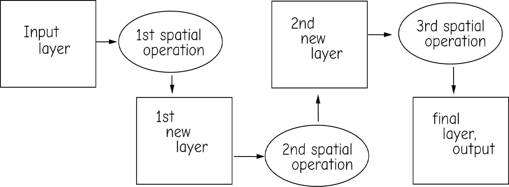

By the end of class you should be able to:

- Read a **workflow diagram** and say what each box and oval holds
- Rebuild the **Lab 11 site-selection workflow** from criteria to final map
- Name the **QGIS tool** that does each step
- Explain geoprocessing as **cookie cutting**, step by step
- Say exactly what you have to hand in, and when

<!-- Working session, not a lecture. The goal is that everyone can read and draw a workflow diagram, which they will need for Lab 11 and again for Lab 12. -->

---

<!-- _class: lead -->

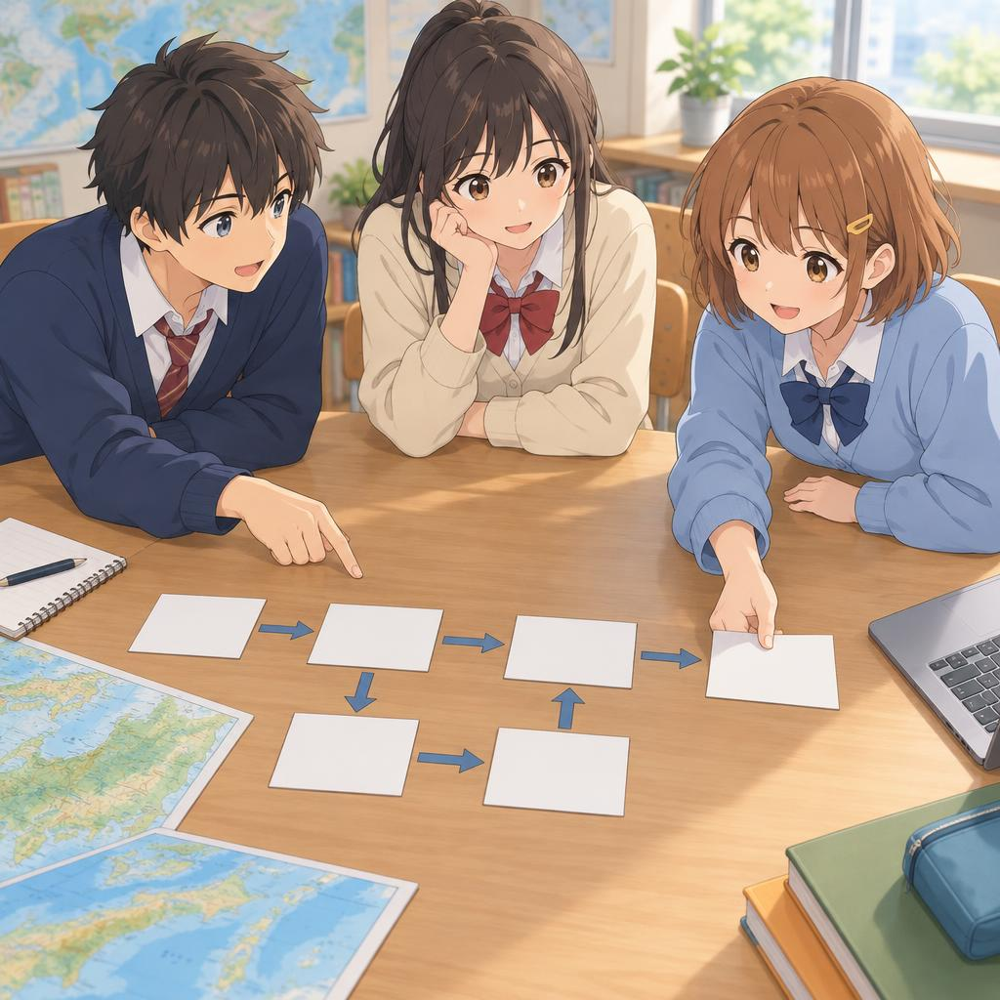

# Warm-up: the Lab 11 workflow

## What are the criteria? What data? What tools? In what order?

<!-- Lab 11 (Walmart Site Selection) is the closest model for Lab 12, the final project students start next Tuesday. Walk it once more, out loud. -->

<!-- Anime-style cartoon generated with gpt-image-2.5-flare, October 2026; prompt in tools/divider-images/week12.json. -->

---

# Where to put a new Walmart in Utah County?

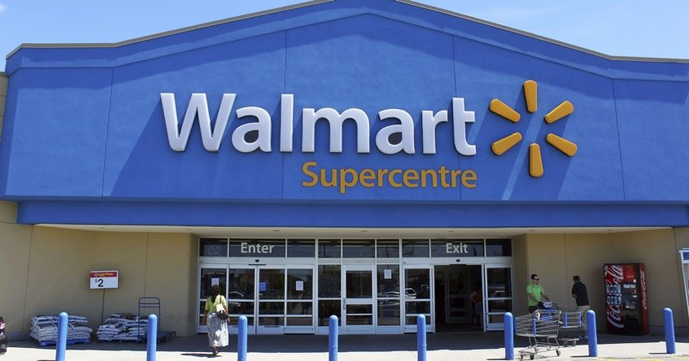

**What are the conditions?**

- Not near an existing Walmart
- Near a high density of family residences
- Within 2 miles of a highway
- In Utah County

<!-- Start with the plain-English conditions. Do not let anyone name a tool yet: first the conditions, then the data, then the tools. This is the same order the Lab 12 report has to follow. -->

---

# Criteria, written so a computer can check them

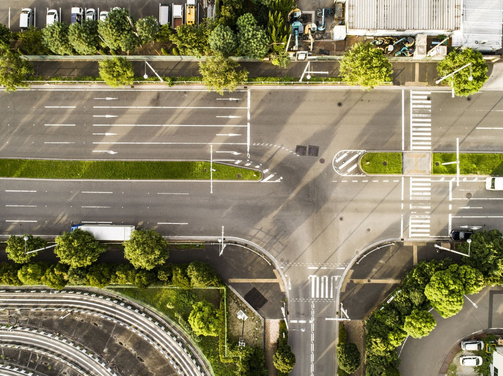

- **Proximity to other Walmarts:** at least **2 miles** from any existing store
- **Proximity to major roads:** within **2 miles** of I-15 or a highway
- **Population density:** over **5000 people per square mile** (Census 2020 blocks)
- **Adequate space:** stores run 51,000–224,000 ft², average about **102,000 ft²** — find places where that fits without demolishing a neighborhood

<!-- The jump from "near a highway" to "within 2 miles of I-15 or a highway" is the whole trick. Every criterion needs a number and a layer before you can run a single tool. Their Lab 12 criteria have to be written this way too. -->

---

# Data: four layers, all free

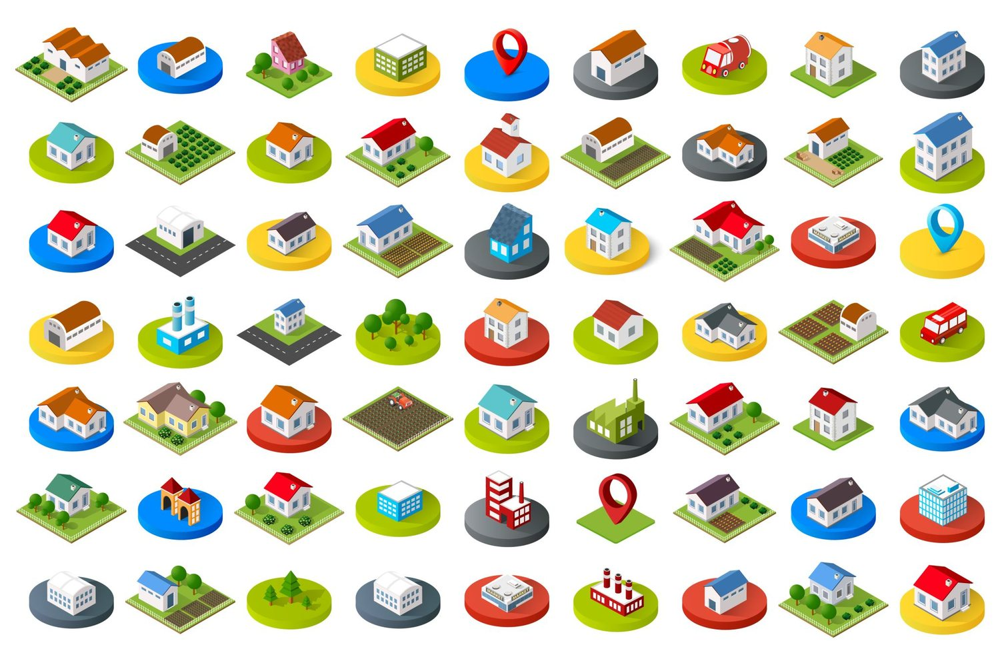

- **Utah County boundary** — Utah Geospatial Resource Center (UGRC, formerly AGRC), [gis.utah.gov](https://gis.utah.gov)
- **Roads and freeways** — UGRC
- **Census blocks with demographics** — UGRC "Census 2020 Blocks", plus the redistricting README that explains the column names
- **Existing Walmart locations** — Walmart's own public ArcGIS REST service, streamed in like the SGID in Lab 6
- All four arrive in **Web Mercator**: reproject before you buffer

<!-- Three of the four come from UGRC and the fourth from Walmart itself; Walmart retired its Open Data Hub download in 2026, so Lab 11 step 7 connects to the Walmart_Facilities_(Public) feature service instead. For Lab 12, if a layer they need does not exist, digitizing their own is a legitimate data source as long as they say so in the report. The last bullet is the lesson from Tuesday's reproject slide: every one of these layers is EPSG:3857, so a 2-mile buffer is only about 1.5 miles unless they reproject to EPSG:26912 first. Note the agency renamed from AGRC to UGRC; older lab handouts and slides still say AGRC. -->

---

# Tools: what each one is for

- **Select by Expression / Extract by Attribute** — pull out the features that match a rule, e.g. roads named "I-15", or blocks over a density threshold
- **Buffer** — the area within a set distance of a feature
- **Clip** — the cookie cutter: keep the part of the input inside the other layer, with only the input's attributes
- **Intersection** — the overlay: keep the overlap, with the attributes of **both** layers

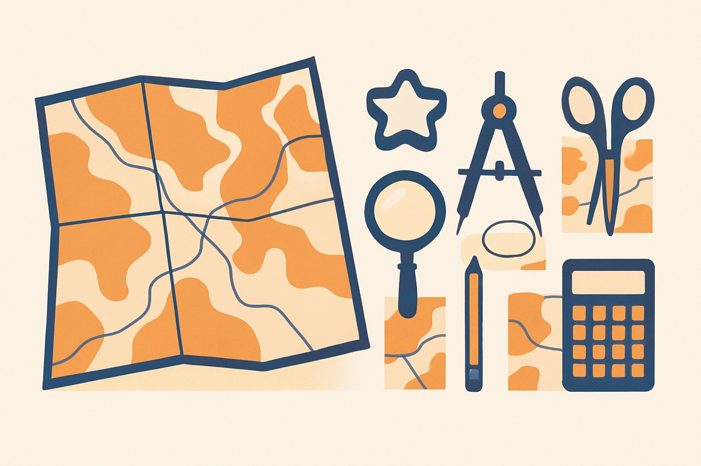

- **Difference** — cut the input features out of the target
- **Dissolve** — merge like features into one
- **Reproject Layer** — into a projected CRS before any Buffer
- **Digitize** — build a new layer by drawing features yourself

<!-- These all live in the QGIS Processing Toolbox under Vector overlay and Vector geometry. (For instructors: ArcGIS and some textbooks call Difference Erase. These students have never used ArcGIS, so do not bring it up unless someone asks.) One more tool that is not an overlay: the Field Calculator, in the attribute table window, computes a new attribute column, e.g. density = population divided by area. -->

---

# What is a workflow?

**Rectangles are layers. Ovals are operations. Every arrow makes a new layer.**

<!-- This is the figure from chapter 9 of the textbook and it is the single most useful picture in the course. The order matters: a different order gives a different final layer. Their report has to contain a diagram like this one, drawn for their own project. -->

---

<!-- _class: quiz -->

# In what order would you run these?

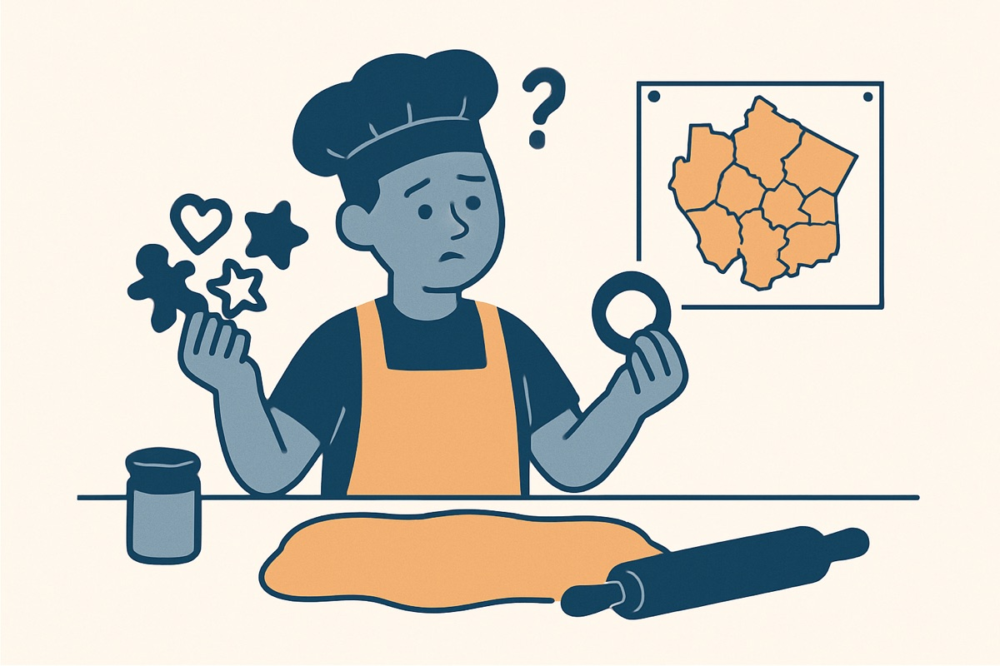

To find land at least 2 miles from an existing Walmart, inside Utah County, and within 2 miles of a highway:

<ol type="A">
<li>Buffer roads → Buffer Walmarts → Clip to county → Difference</li>
<li>Difference → Clip to county → Buffer roads → Buffer Walmarts</li>
<li>Clip to county → Buffer roads → Buffer Walmarts → Difference</li>
<li>Any order works — you get the same answer</li>
</ol>

<!-- A and C both work and give the same result; D is the trap, because B cannot run at all: Difference needs the buffers, and they do not exist yet. So the first rule is: an operation can only run after the layers it eats exist. A and C give the same polygons in this particular chain because both buffers are of the original layers and Clip and Difference commute here (Tuesday's "Buffer? What next?" activity); clipping early is the better of the two because every later step runs on less data. In general, though, swapping steps changes the answer: buffering the result of an intersect is not the same as intersecting a buffer. That general rule is the Figure 9-1 true/false question on the concepts exam, so do not let "same answer here" turn into "order never matters". Ask them to defend an answer before you say which. -->

---

<!-- _class: lead -->

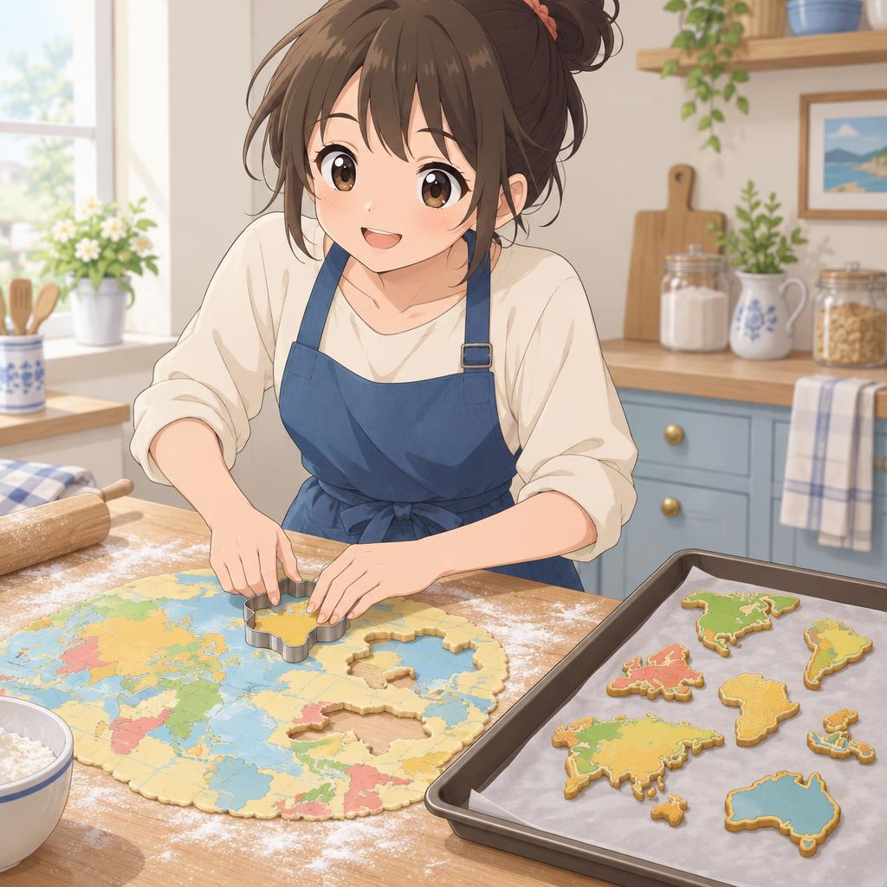

# Geoprocessing is cookie cutting

<!-- The next six slides are one long analogy. Run them quickly, one click each. Students remember this. -->

<!-- Anime-style cartoon generated with gpt-image-2.5-flare, October 2026; prompt in tools/divider-images/week12.json. -->

---
# Start with "everywhere"

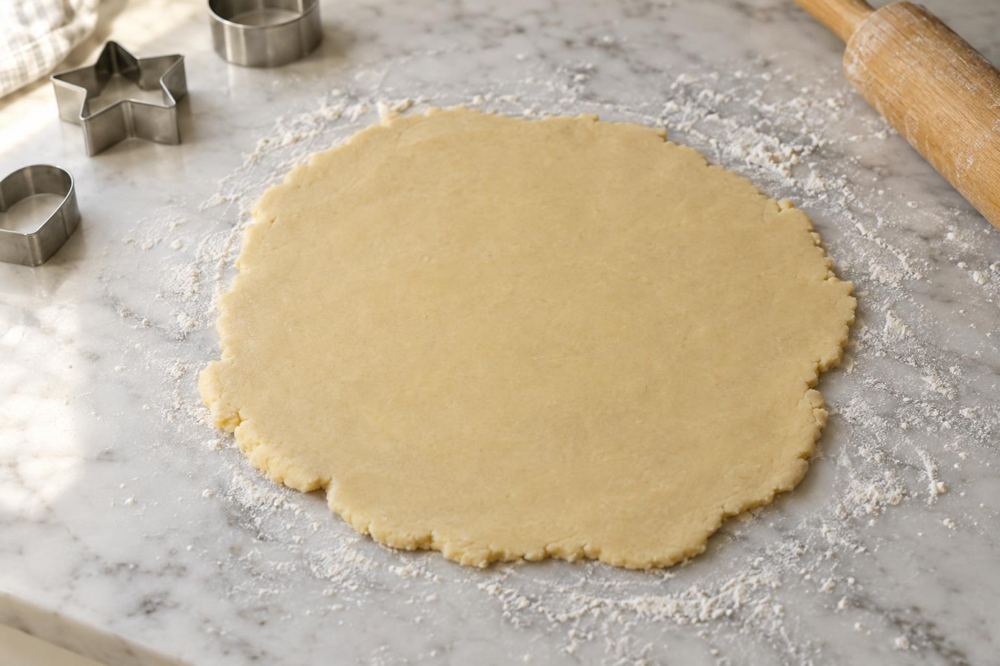

<!-- Rolled dough is the whole world. Before any criterion is applied, every location is still a candidate. -->

---

# Cut to the county

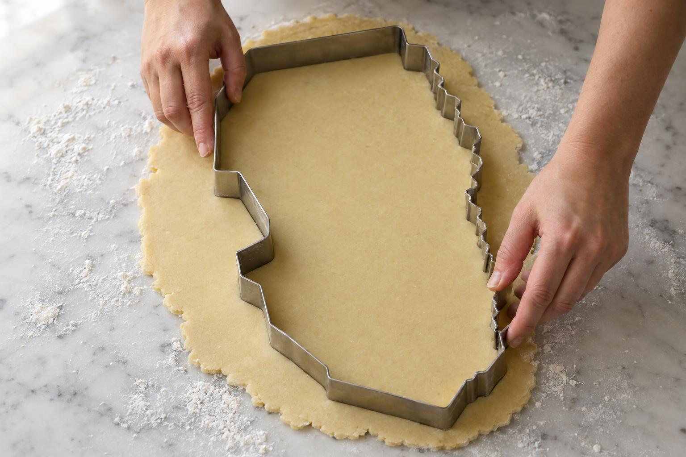

<!-- The first cutter is the study area: the Utah County boundary. Everything outside it is about to go. In QGIS this is a Clip, or Extract by Location as Lab 11 does it for the census blocks. -->

---

# One cut, and you have a study area

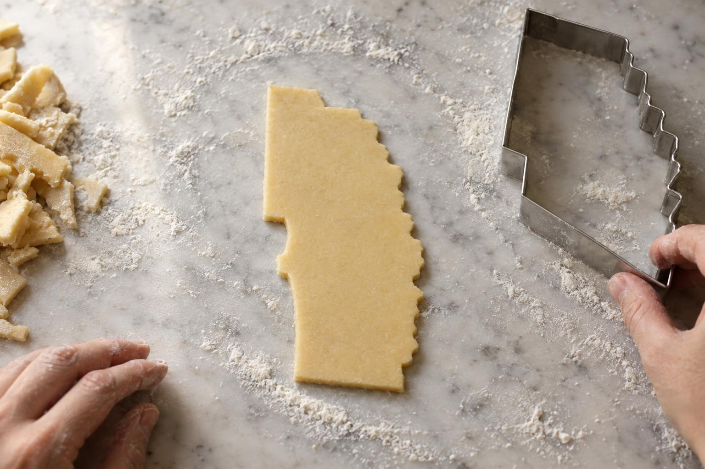

<!-- The cut shape is a new layer. The dough that is left over is discarded. -->

---

# Keep what is within 2 miles of I-15

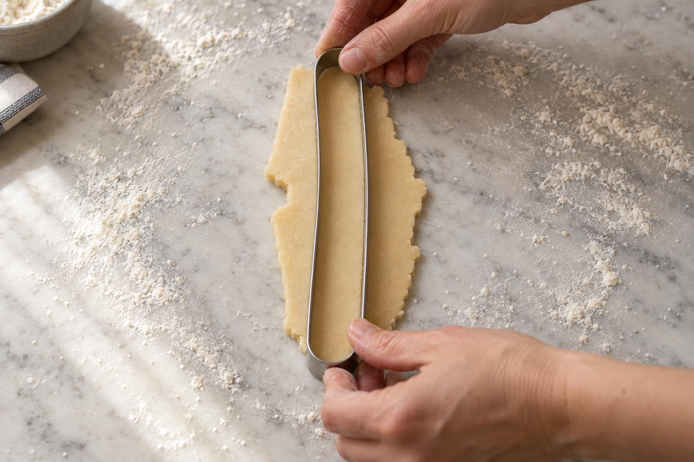

<!-- The long band is the 2-mile buffer around I-15 and the highways. Press it in and keep what is INSIDE the cutter: that is an Intersection. -->

---

# Cut out everything too close to an existing Walmart

<!-- Each round cutter is a 2-mile buffer around an existing store. This time we throw away what is INSIDE the cutter: that is a Difference. Intersection keeps the inside, Difference removes it; that is the one idea to land. -->

---

# A new dataset, ready to share

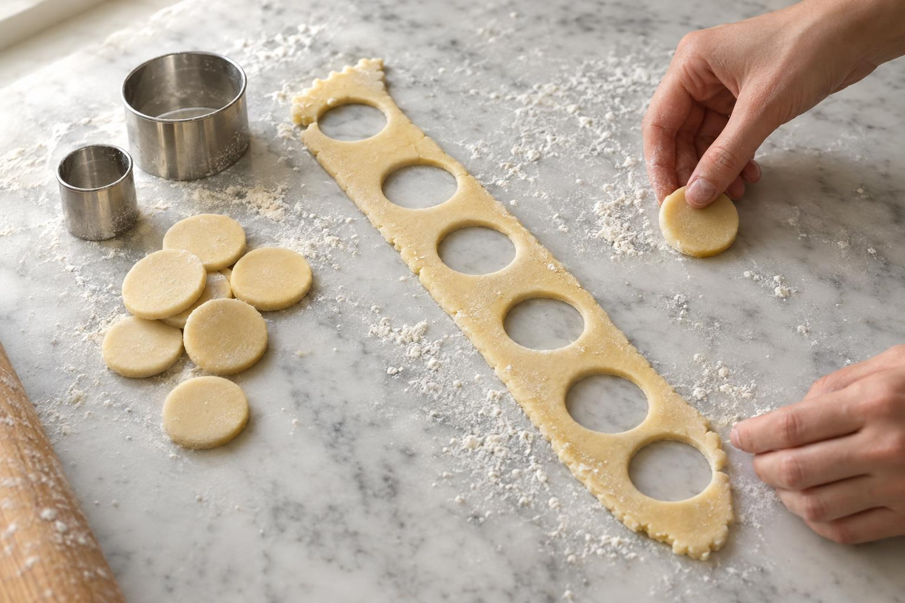

<!-- What is left passes every criterion at once. It is a brand new layer that did not exist before; symbolized and put on a map with the required elements, it is the deliverable. The census-density cut is one more cutter that the pictures leave out. Same six images as the cookie slide in Tuesday's Day 22 deck (prompts in tools/divider-images/week12-cookies.json); they replaced an older series here on 2026-11-17 that cut the state, then the county, then Utah Lake. -->

---

# The analogy, in QGIS names

| Cookie step | QGIS tool |
| --- | --- |
| Rolled dough | your input layers |
| Line up the cutter | **Select by Expression** |
| Cut the shape | **Clip** |
| Second cutter, keep inside | **Intersection** |
| Punch a hole, remove inside | **Difference** |
| Ring around a feature | **Buffer** |
| Merge crumbs | **Dissolve** |

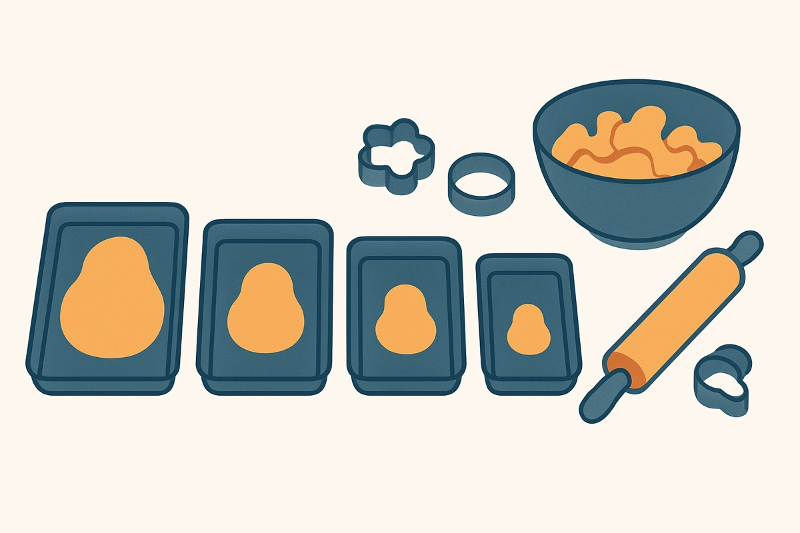

Every cut writes a **new layer**.

Keep them. Those intermediate layers are what you screenshot for the report, and they are the only way to check one criterion at a time when the answer looks wrong.

<!-- Emphasize "keep them". Students routinely overwrite their intermediates and then have nothing to show for the processing steps, which is a graded part of the report. Tell them to name layers as they go: step1_clip, step2_buffer, step3_difference, and so on. -->

---

# The finished product

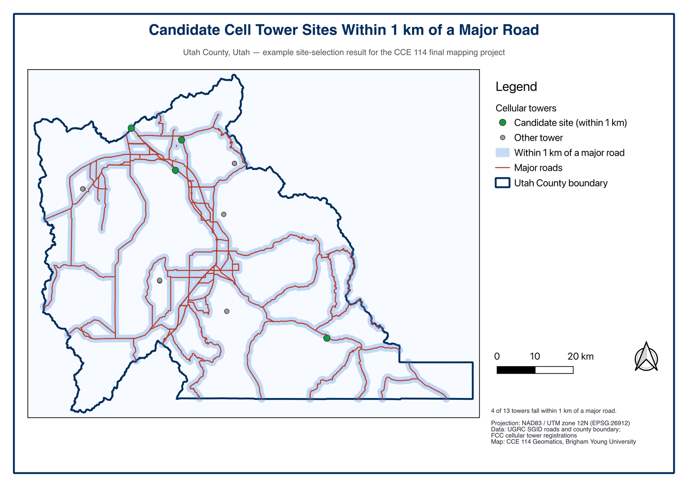

What to notice:

- A **title** that says what the map shows
- **Legend, scale bar, north arrow, data sources, projection**
- The **result stated in one line** in the margin
- Candidate areas symbolized so they read at a glance
- Nothing on the page that is not doing a job

<!-- An example final map made in QGIS 3.44 Print Layout: a small site-selection result (cell towers within 1 km of a major road in Utah County) with title, subtitle, legend, scale bar, north arrow, data sources, projection, a neat line, and the result stated in one sentence. This is the standard. Past student maps often add inset maps zoomed to the best candidate sites, which is a good addition when the candidates are small. -->

---
# Final Thoughts

- **Lab 11: Walmart Site Selection** is due **Saturday**
- Study for **Concepts Exam 2** — see the review deck from today's second half
- **Next Tuesday:** Lab 12, Choose Your Own Adventure, your own site-selection project
- **Web Mapping with AI Experience** is due in **Week 14**
- Questions? Office hours: [calendly.com/dan-ames/office-hours](https://calendly.com/dan-ames/office-hours)

<!-- Remind them the Testing Center has its own closing hours and that the exam is not open book. -->

<!-- Conversion notes (2026-09-02): source "Final Project Discussion.pptx" (2026, 25 slides). Nothing dropped outright; source slides 14 and 15 both used the same cookie photo and were merged into one slide, and the "Get Started" Google Sheet link was replaced with a pointer to Learning Suite because the 2018 sheet URL is stale (marked TODO). Software wording updated to QGIS throughout: ArcMap digitizing to QGIS digitizing, Erase noted as QGIS "Difference", ArcToolbox implied tools mapped to the Processing Toolbox, AGRC updated to UGRC. ArcGIS-era artwork kept and flagged: images/fp-example-map.jpg is a student final map produced in ArcMap (map output rather than a software screenshot, so it is still a fair example, but a QGIS Print Layout example would be better). The tool-order quiz slide and the QGIS name table are new, written for this session. -->

<!-- Update 2026-09-02: ArcGIS-era screenshots replaced with QGIS 3.44 captures made by tools/qgis_reshoot_screens.py: fp-example-map-qgis.png (QGIS Print Layout example) replaces the ArcMap student map. -->

<!-- Update 2026-11-17: renamed from "Final Mapping Project" (final-project.md) to "Workflow Walkthrough". The project half (the five problem options, the report, the map, the deliverable and the sign-up) moved to slides/day-24/lab-12-choose-your-own-adventure.md, because the final project is now introduced on Tuesday of Week 13 as Lab 12. -->
