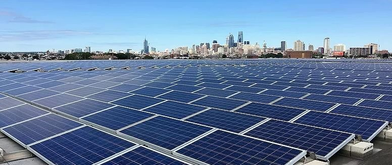
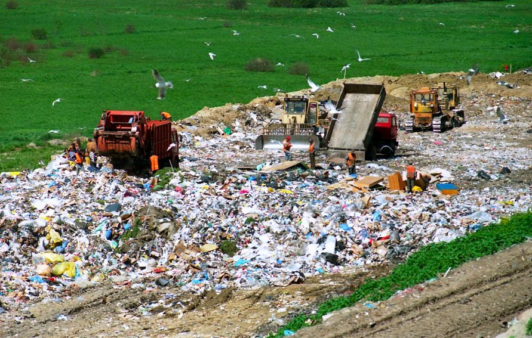
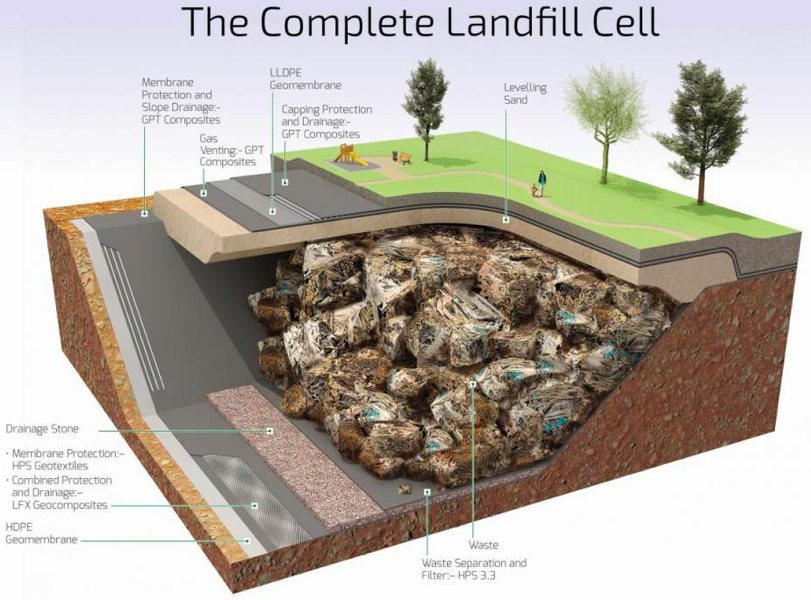
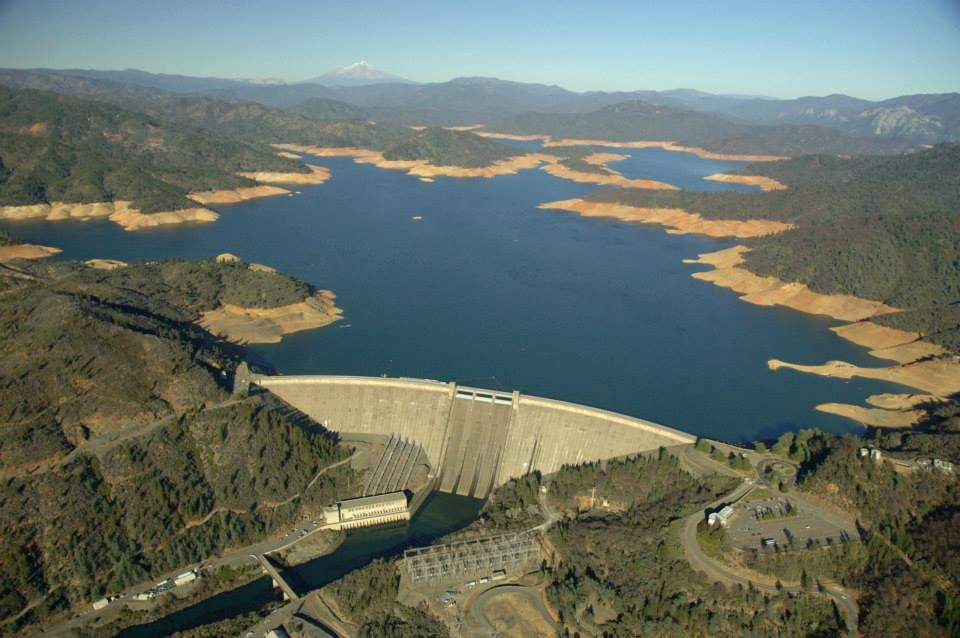
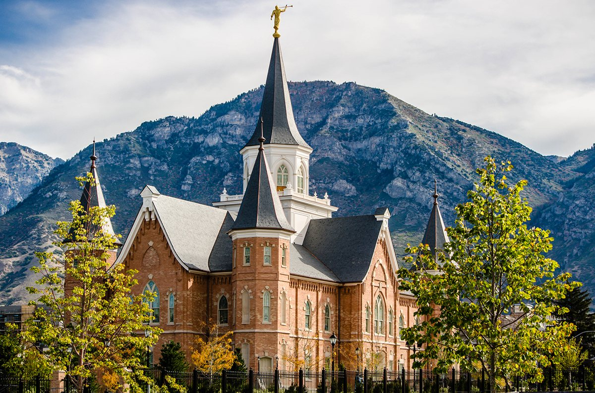
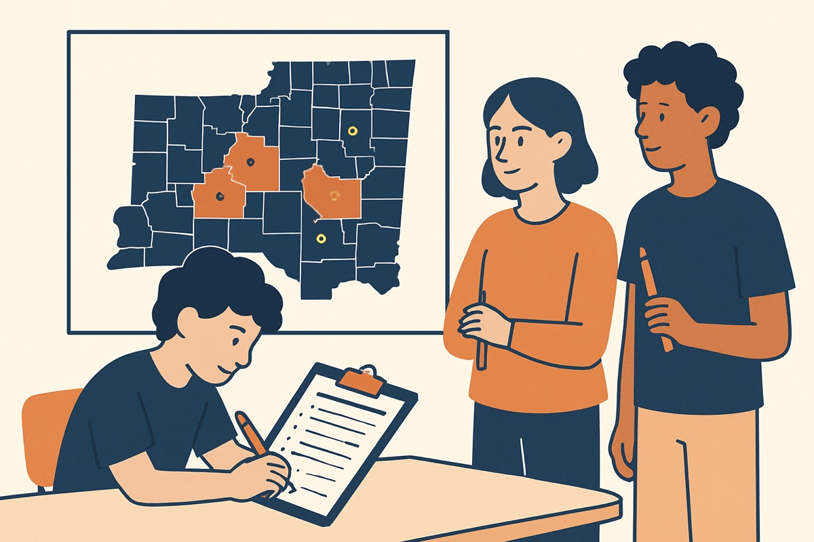

<!-- _class: lead -->
<!-- _paginate: skip -->

# Lab 12: Choose Your Own Adventure

## Your problem, your county, the Lab 11 workflow

CCE 114 Geomatics
Civil & Construction Engineering
Brigham Young University
Dr. Dan Ames and Dr. James Halgren

<!-- Tuesday of Week 13. Lab 12 is the final project: each student picks a site-selection problem and a Utah county and runs the Lab 11 pattern on it, on their own. Calling it a lab, not a "final project", is deliberate: it is one more lab, a little bigger, built from skills they already have. Introduce it, then spend the last part of class on sign-up and a first sketch. -->

<!-- stamp:begin -->
<!-- _footer: 'CCE 114 · Day 24 — Lab 12: Choose Your Own AdventureLast Updated: 2026-11-17© 2026 Daniel P. Ames · <a href="https://creativecommons.org/licenses/by/4.0/">CC BY 4.0</a>' -->
<!-- stamp:end -->

---
# Today's Goals

By the end of class you should be able to:

- Say what **Lab 12** asks for: your own site-selection analysis, done **individually**
- Pick one of the **five problems** and a **Utah county**
- Turn your problem into **criteria, data, tools and an order**, the same four questions as Lab 11
- Say exactly what you hand in, and when

<!-- The point of the name: this is Lab 12, not a mysterious term project. Same pattern as Lab 11, a problem you choose. -->
---

# What the project asks for

- Work **individually**: your own problem, your own county, your own report
- Choose one of the five problems and one **Utah county** (not Utah County; Lab 11 already did it)
- Find at least **four** appropriate datasets
- Decide which spatial analyses solve your problem, and **write the steps down first**
- Run the analyses in QGIS, then build the final map
- Report the data, the analyses, and the result — with **intermediate maps** along the way

<!-- Lab 12 is the final project, and it is individual: everyone signs up, works and submits on their own. The Lab 12 page on the course site is the specification; this slide is the summary. The "write the steps down first" line is the one that saves them the most time. -->

---

# Choose your problem

Find a suitable location for:

1. A **solar panel farm**
2. A **landfill**
3. An **airport**

4. An **LDS temple**
5. An **irrigation reservoir**

For whichever you pick: **What are the criteria? What data are required? What tools and analyses are needed? In what order?**

<!-- Give them two minutes to pick before you walk the five option slides. Any of the five works with the same tool set they used in Lab 11. -->

---

# Site selection: solar panel farm

<a href="https://www.youtube.com/watch?v=QmHzP-i-mm4" target="_blank">youtube.com/watch?v=QmHzP-i-mm4</a>

- What are the criteria?
- What are the data?
- What are the tools?
- What is the workflow?

<!-- Solar farms want flat ground, high solar radiation, a nearby transmission line and a road, and land that is not already built on or protected. Slope from a DEM, land cover, and transmission lines are the obvious layers. The linked video is a short piece on utility-scale solar siting; click the image to open it in a new tab. -->

---

# Site selection: landfill

- What are the criteria?
- What are the data?
- What are the tools?
- What is the workflow?

<!-- Landfills are the classic exclusion problem: away from housing, away from streams and wells, away from floodplains, off steep slopes, on the right soils, but still within a reasonable haul distance of the population it serves. Almost all Difference and Buffer. -->

---

# Site selection: airport

- What are the criteria?
- What are the data?
- What are the tools?
- What is the workflow?

<!-- Airports need a long flat run of land, clear approach paths, distance from dense housing because of noise, and road access. Slope and land cover from raster data, plus population from Census blocks. -->

---

# Site selection: irrigation reservoir

- What are the criteria?
- What are the data?
- What are the tools?
- What is the workflow?

<!-- Reservoirs want a narrow valley with a large upstream drainage area, close to the farmland being served, and not on top of existing development. This one leans hardest on terrain data. -->

---

# Site selection: temple

- What are the criteria?
- What are the data?
- What are the tools?
- What is the workflow?

<!-- Temple siting is a membership-density and drive-time problem: far enough from existing temples, close to a large membership, visible, and on a parcel large enough to hold the building and its grounds. -->

---

# What to include in your written report

- **Introduce the problem** — what are you siting, where, and why
- **Describe the data** — every layer, where it came from, its projection
- **Describe the tools** — each analysis step, with the workflow diagram
- **Describe your result** — the sites you selected and why they won

<!-- The report is a short technical document, not an essay. Two to three pages of text is enough; the maps carry the rest. Anything they downloaded needs a source named. -->

---

# What to include in your map

- All **required cartographic elements**: title, legend, scale bar, north arrow, neatline, data sources, projection
- At least one **inset map** zoomed to the selected sites
- A **point marker** on each selected site
- **IMPORTANT:** also include maps of your **intermediate results** — the data you worked on to get to the final map

<!-- The intermediate maps are where most of the grade separation happens. A single beautiful final map with no evidence of the processing is not a complete submission. Screenshots from the QGIS map canvas are fine for the intermediates; the final map goes through Print Layout. -->

---

# The deliverable

- **One PDF report**, submitted online
- Due the **Saturday of Week 14**
- The PDF holds the write-up, the **intermediate maps and data** that show your processing steps, and the **final results map**
- Full instructions: [Lab 12 page](https://byu-hydroinformatics.github.io/cce114-geomatics/assignments/lab-12/)
- Closest model for the workflow: [Lab 11 — Walmart Site Selection](https://byu-hydroinformatics.github.io/cce114-geomatics/assignments/lab-11/)

<!-- One PDF. Not a folder of images, not a QGIS project file. Point them at the Lab 12 page for the full instructions; point values are on Learning Suite. -->

---

<!-- _class: activity -->

# Get started right now

- Enter your **name**, your **selected project**, and your **selected county** in the class sign-up sheet
- Only **one or two people per county** — first come, first served
- Then, on paper: list your **criteria**, the **layers** you will need, and a first **workflow diagram**
- Keep that sketch: it is the first draft of your Lab 12 workflow diagram

<!-- TODO: the sign-up sheet link lives on Learning Suite; the 2018 deck linked a Google Sheet that is no longer current. Paste this term's sheet link here or drop it in the Learning Suite announcement before class. -->

<!-- Spend the last fifteen minutes of class on this. Before class, open the class sign-up sheet (a Lab 12 tab: name, problem, county, data needed), clear last semester's rows, and check the headers still match. Only one or two students per county, and not Utah County. Walk the room; the students who leave without a county chosen are the ones who fall behind. Common snags: a student picks Utah County anyway (it is excluded because Lab 11 used it; the point is to transfer the method), or a problem has no data (send them to the UGRC SGID browser; if the key layer does not exist, change the problem, not the county). -->

---

# The next two weeks

- **The rest of today, Thursday of Week 13 (Winter only; Fall has Thanksgiving), and Tuesday of Week 14 are work sessions.** Bring your data; instructors are in the room to help
- Come with a specific question: a tool that will not run, a projection mismatch, a layer you cannot find
- Presentations start **Thursday of Week 14**; the PDF is due the **Saturday of Week 14**
- Use the work sessions for the hard parts and do the writing and map layout on your own time

<!-- Set the expectation that work sessions are for getting unstuck, not for starting from zero. -->

---
# Final Thoughts

- Sign up with your **problem and county** before you leave
- Download at least **two** of your four datasets and open them in QGIS
- **Web Mapping with AI Experience** is due in **Week 14**
- **Lab 12** presentations start **Thursday of Week 14**; the PDF is due the **Saturday of Week 14**
- Questions? Office hours: [calendly.com/dan-ames/office-hours](https://calendly.com/dan-ames/office-hours)

<!-- Built 2026-11-17 from the project half of the former Day 23 "Final Mapping Project" deck, when the final project was renamed Lab 12: Choose Your Own Adventure (the name CE 414 uses), made individual instead of pairs or groups, and moved from Thursday of Week 12 to Tuesday of Week 13. -->
